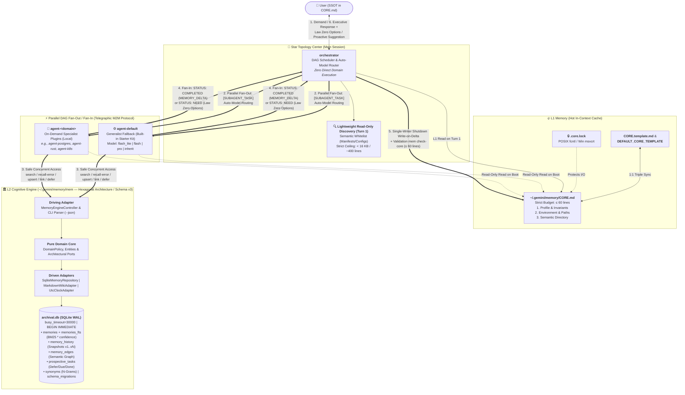
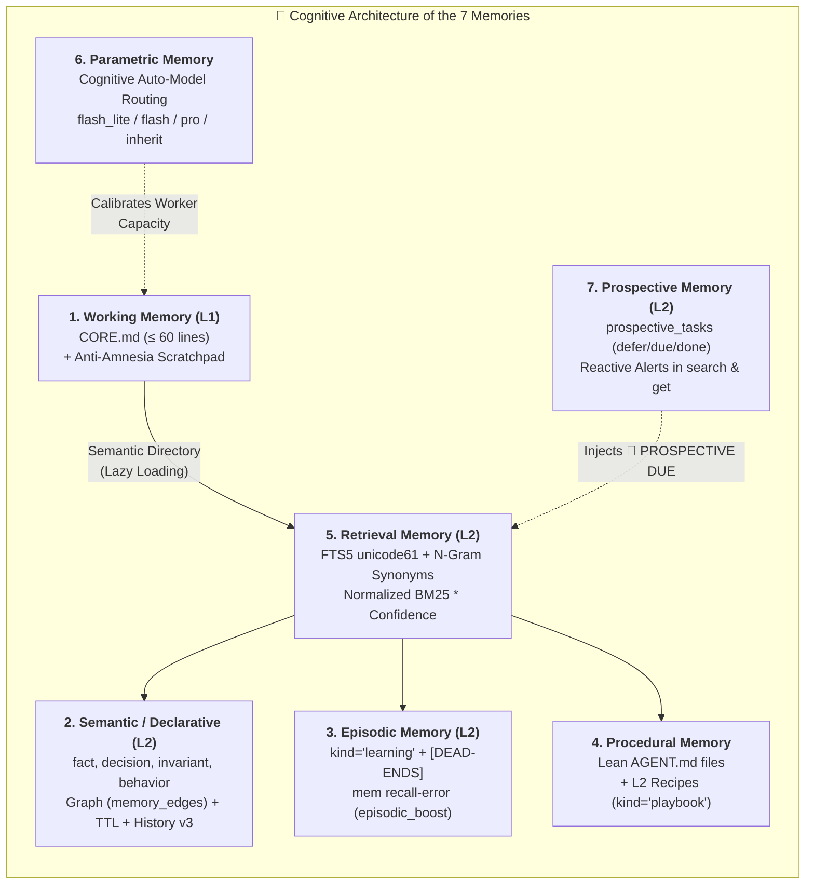
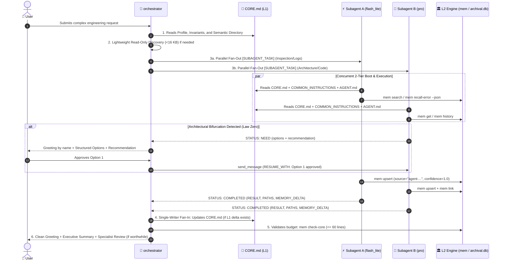

# 🚀 Antigravity: Global Star-Topology Multi-Agent Ecosystem & Hybrid Cognitive Memory Engine

🌐 **Languages:** [Português (BR)](README.md) | **English** | [Español](README.es.md) | [简体中文](README.zh-CN.md)

[](#2-architectural-pillars)
[-007ec6?style=flat-square)](#3-hybrid-cognitive-architecture-of-the-7-memories)
[](#4-internal-engineering-of-the-l2-engine-geminimemorymem)
[-ffd343?style=flat-square)](#4-internal-engineering-of-the-l2-engine-geminimemorymem)
[-brightgreen?style=flat-square)](#10-automated-test-suite)

**Antigravity** is a multi-agent orchestration framework built on a **Strict Star Topology** and a **2-Tier Hybrid Cognitive Memory Engine (Schema L2 v3)** designed to run natively over the global `~/.gemini` directory. It transforms isolated LLM sessions into a deterministic distributed software engineering system — combining parallel scheduling over directed acyclic graphs (**DAG Fan-Out / Fan-In**), dynamic cognitive model routing (**Auto-Model Routing**), **Zero Assumptions (Law Zero)** governance, and concurrent transactional persistence in SQLite WAL + FTS5 with zero external dependencies.

---

## 📑 Table of Contents

1. [Value Proposition & Engineering Philosophy](#1-value-proposition--engineering-philosophy)
2. [Architectural Pillars](#2-architectural-pillars)
3. [Hybrid Cognitive Architecture of the 7 Memories](#3-hybrid-cognitive-architecture-of-the-7-memories)
4. [Internal Engineering of the L2 Engine (`~/.gemini/memory/mem`)](#4-internal-engineering-of-the-l2-engine-geminimemorymem)
5. [End-to-End Lifecycle (4-Phase Walkthrough)](#5-end-to-end-lifecycle-4-phase-walkthrough)
6. [Repository Structure & Git Isolation (Starter Kit)](#6-repository-structure--git-isolation-starter-kit)
7. [Installation, Least Privilege & First-Boot Onboarding](#7-installation-least-privilege--first-boot-onboarding)
8. [Subagent Ecosystem & Specialist Creation (`agent-<domain>`)](#8-subagent-ecosystem--specialist-creation-agent-domain)
9. [Complete CLI Reference for `~/.gemini/memory/mem`](#9-complete-cli-reference-for-geminimemorymem)
10. [Automated Test Suite](#10-automated-test-suite)
11. [Git Governance, Security & Code Invariants](#11-git-governance-security--code-invariants)

---

## 1. Value Proposition & Engineering Philosophy

Conventional LLM-based assistants suffer from four severe structural failures when applied to real-world software engineering projects:

| Classic LLM Agent Pathology | Antigravity Engineering Solution |
| :--- | :--- |
| **1. Cross-Session Amnesia & Repeated Mistakes** | **2-Tier Hybrid Memory + Episodic Recall (`recall-error`):** Hot L1 cache (`CORE.md` $\le 60$ lines) always in context paired with an archival L2 database (`archival.db` on SQLite WAL + FTS5) storing facts, decisions, semantic graphs, version history (`memory_history`), and lessons learned (`learning`) that mandatorily include the `[DEAD-ENDS / TENTATIVAS DESCARTADAS]` section. |
| **2. Context Explosion & Attention Degradation (*Context Rot*)** | **Star Topology + Differential Context Passing (M2M):** The main agent (`orchestrator`) never executes code directly or accumulates raw dumps. It decomposes demands into atomic subtasks and injects into subagents exclusively the required paths and invariants in a noise-free telegraphic format. Large outputs are mandatorily written to disk (Anti-Amnesia). |
| **3. Race Conditions in Parallel Multi-Agent Execution** | **Single-Writer L1 + L2 Transactional Concurrency:** During a parallel Fan-Out, subagents **never** edit `CORE.md`; they write concurrently to L2 SQLite (protected by `WAL`, `busy_timeout=30000`, and reentrant `BEGIN IMMEDIATE` transactions) and return `MEMORY_DELTA`. Only the `orchestrator` updates `CORE.md` during Fan-In under an exclusive file lock (`fcntl`/`msvcrt`). |
| **4. Architectural Hallucinations & Silent Decisions** | **Inviolable Law Zero (Zero Assumptions Protocol):** No agent may silently assume requirements, architecture, public contracts, library additions, or scope. When facing technical bifurcations, the subagent halts execution with `STATUS: NEED`, and the `orchestrator` delegates the decision to the user with structured options and a well-grounded technical recommendation. |

---

## 2. Architectural Pillars

### 2.1. Strict Star Topology (Central `orchestrator`)
The ecosystem forbids direct lateral communication between subagents (chaotic *mesh*). The **`orchestrator`** sits at the center of the star as the sole point of contact with the user and the sole task scheduler:
* **Absolute Prohibition of Direct Execution by the Orchestrator:** The `orchestrator` never edits project code, writes SQL queries, runs domain terminal commands, or manipulates containers.
* **Lightweight Read-Only Discovery on Turn 1 (Semantic Whitelist):** When the initial context does not describe the target project's structure, the `orchestrator` is strictly permitted to perform lightweight reconnaissance reads through a *semantic whitelist* — root directory listings and top-level manifests or configuration files (`package.json`, `pyproject.toml`, `Cargo.toml`, `go.mod`, `docker-compose.yml`, `Makefile`, `README.md`, etc.) respecting a **strict ceiling of `< 16 KB` (~400 lines)** — solely to plan the DAG accurately. All deep analysis and mutations are delegated to subagents.
* **Mandatory Clean Greeting (Zero Boot/Status Report):** The `orchestrator` always begins its responses by greeting the user by the name registered in `CORE.md`, never emitting robotic boot reports (such as *"L1 memory synchronized"* or *"directives loaded"*), unless explicitly requested.

### 2.2. Atomic DAG Decomposition & Fan-Out / Fan-In Parallelism
Every complex request is broken down into the maximum number of **atomic, orthogonal, and independent subtasks**:
* **Simultaneous Fan-Out:** All subtasks with zero in-degree (no pending dependencies) are dispatched **simultaneously in the same turn** via multiple parallel calls to `invoke_subagent`.
* **Smart Session Reuse vs. Parallelism:** Concurrent subtasks use parallel instances via `invoke_subagent`; sequential steps within the same domain that benefit from context caching reuse the existing `conversationId` via `send_message`.

### 2.3. Cognitive Auto-Model Routing
When invoking subagents (`invoke_subagent(TypeName="self", Model=...)`) or workers (`swarm`), the `orchestrator` selects the smallest model and effort level (`low`, `medium`, `high`, `xhigh`, `max`) capable of solving the subtask with excellence, optimizing latency and token cost across `agy`'s actual **23-model** catalog:

| `Model` Parameter | Complexity & Effort | Ideal Use Cases, Complete Catalog (23 Models) & Quota Regimes |
| :--- | :--- | :--- |
| **`"flash_lite"`** | **Tier 1: Low (Effort `low` — I/O & Mechanics)** | Reading files/configs/logs, directory listings, `git status`/`diff`, quick L2 searches (`mem search`), port checks, and text formatting. **Daily Reset:** `gemini-3.8-flash-low`, `gemini-4-hydrogen-low`, `gemini-4-neon-low`, `claude-sonnet-5-5-low`, `claude-opus-5-5-low` \| **Weekly Reset (7d):** `gemini-4-argon-low`. |
| **`"flash"`** | **Tier 2: Medium (Effort `medium` — Standard Operational)** | Implementing scoped classes/functions, unit tests, automation scripts, Dockerfiles, SQL queries (DDL/DML), and build configurations. **Daily Reset:** `gemini-3.8-flash-medium`, `gemini-3.8-flash-high`, `gpt-oss-120b-medium`, `gemini-4-hydrogen-medium`, `gemini-4-neon-medium`, `claude-sonnet-5-5-medium`. |
| **`"pro"`** | **Tier 3: High (Effort `high` / `xhigh` — Deep Architecture)** | Clean Architecture / Ports & Adapters, critical concurrency, heavy structural refactoring, BVA, and complex debugging while preserving Argon's weekly quota. **Daily Reset:** `gemini-4-neon-high`, `gemini-4-hydrogen-high`, `claude-sonnet-5-5-high`, `claude-opus-5-5-medium`, `gemini-4-neon-xhigh`, `gemini-4-hydrogen-xhigh`. |
| **`"inherit"`** | **Tier 4: Frontier (Effort `xhigh` / `max` / `high` Frontier)** | Novel architectural decisions, extreme *frontier* challenges, and adversarial auditing. **Daily Reset:** `claude-opus-5-5-high`, `gemini-4-neon-xhigh`, `gemini-4-hydrogen-xhigh`, `gemini-pro-orchestrator-neon` \| **Weekly Reset (7d):** `gemini-4-argon-medium`, `gemini-4-argon-high`, `gemini-pro-orchestrator-g1-pro`. |

* **Intelligent Quota Auto-Failover (429 / Quota Exhaustion):** Since the catalog provides 23 models and 5 effort levels (`low`, `medium`, `high`, `xhigh`, `max`) distributed across independent quota pools, if a worker encounters quota exhaustion (`RESOURCE_EXHAUSTED` / HTTP 429) before or mid-task, the `orchestrator` automatically reroutes execution to an available model/tier of equivalent capability and effort (`flash_lite` $\leftrightarrow$ `flash` $\leftrightarrow$ `pro` $\leftrightarrow$ `inherit`, or an *in-place* switch across the Gemini 3.8 Flash, Gemini 4 Neon/Hydrogen/Argon, GPT-OSS, Claude Sonnet/Opus 5.5, and Orchestrator families while preserving partial progress), completing the task transparently without interrupting the workflow.

### 2.4. Inviolable Law Zero (Zero Assumptions Protocol)
No agent (`orchestrator` or subagent) may silently deduce or choose when facing uncertainties in:
1. **Requirements and Business Rules**
2. **Software Architecture** (layers, Ports & Adapters, internal contracts)
3. **Public API Contracts and Database Schemas**
4. **Selection or Addition of Libraries, Frameworks, and Dependencies**
5. **Security, Permissions, and Scope**

* **Operational Calibration:** Purely mechanical or syntactic internal details that strictly follow SOLID principles and existing repository conventions have technical autonomy and do not cause unnecessary interruptions.
* **Active Delegation Flow:** Facing any doubt or structural decision, the subagent stops immediately and emits `STATUS: NEED` (`target_domain: "orchestrator"`) listing `options: ["Option 1 [Recommended]", "Option 2"]` and `recommendation`. The `orchestrator` pauses the flow and submits the options and technical recommendation to the user, to whom the final decision exclusively belongs.

### 2.5. L1 Single-Writer Rule & 1:1 Triple-Sync Invariant
* **Single-Writer for `CORE.md`:** Only the `orchestrator` has write permission on `~/.gemini/memory/CORE.md` during turn closing (*Shutdown Write-on-Delta* at Fan-In), mandatorily validating the $\le 60$-line budget via `~/.gemini/memory/mem check-core`.
* **1:1 Triple-Sync Invariant (`core-template-sync-invariant`):** Whenever `~/.gemini/memory/CORE.template.md` is updated, the `orchestrator` must update in the same turn `~/.gemini/memory/CORE.md` and the `DEFAULT_CORE_TEMPLATE` constant inside `~/.gemini/memory/mem` (and vice versa), guaranteeing strict line-by-line parity (differing only in the `{{USER_NAME}}`, `{{USER_LANG}}`, and `{{DEFAULT_WORKSPACE}}` placeholders).
* **Identity SSOT:** User personal data (name, language, private project paths) resides exclusively in `CORE.md` and in the `global:user-profile` record of the L2 database (`archival.db`); hardcoding them in versioned procedural files (`GEMINI.md`, `COMMON_INSTRUCTIONS.md`, `AGENT.md`, `README.md`) is strictly forbidden.

### 2.6. Telegraphic M2M Protocol (Differential Context Passing)
Machine $\leftrightarrow$ Machine communication eliminates 100% of conversational preambles:

````carousel
```markdown
# 1. Atomic Subtask Dispatch (orchestrator -> Subagent)
[SUBAGENT_TASK]
AGENT_ID: <agent-<domain> | agent-default>
AGENT_DEF: ~/.gemini/agents/<agent-id>/AGENT.md
ATOMIC_GOAL: <Single, direct, and verifiable objective>
CONTEXT: <Only strictly necessary paths, snippets, and invariants>
```
<!-- slide -->
```yaml
# 2. Doubt / Dependency Escalation / QA+AppSec Handoff (Subagent -> orchestrator)
STATUS: NEED
AGENT: <my-agent-id>
NEEDS:
  - target_domain: "<domain | default | orchestrator>" # Single string OR list (e.g., ["qa", "appsec"])
    atomic_goal: "<Required action from another domain/gates OR doubt/decision to delegate to the user>"
    context: "<Summary of changes, build/test commands, risks, or technical scenario>"
    options: ["<Option 1 [Recommended]>", "<Option 2>"] # Mandatory for doubts/decisions
    recommendation: "<Objective technical rationale for the recommended option>"
PATHS: ["<absolute paths created/modified/inspected>"]
MEMORY_DELTA: "<none | namespace/topic written to L2 via mem upsert/link/defer>"
RESUME_WITH: "<Exact data/decision needed to proceed OR QA+AppSec approval confirmation>"
```
<!-- slide -->
```yaml
# 3. Subtask Completion (Subagent -> orchestrator)
STATUS: COMPLETED
AGENT: <my-agent-id>
RESULT: "<Dense and direct technical summary of what was executed/validated>"
PATHS: ["<absolute paths created/modified/inspected>"]
MEMORY_DELTA: "<none | namespace/topic written to L2 via mem upsert/link/defer>"
```
````

> [!NOTE]
> The `target_domain` field in `STATUS: NEED` accepts either a single string (e.g., `"rust"`, `"orchestrator"`) or a list of domains (e.g., `["qa", "appsec"]`). Every development agent (`EXTENDS: agent-dev-base`, except `agent-qa` and `agent-appsec` during auditing) ends code/config/infra/script changes by mandatorily emitting `STATUS: NEED` with `target_domain: ["qa", "appsec"]`; conversely, upon any failure or vulnerability, `agent-qa` and `agent-appsec` emit `STATUS: NEED` with `target_domain: "<dev-stack>"` for code fixes, repeating the cycle until double `STATUS: COMPLETED`.

### 2.7. Dynamic Specialist Plugin Registry & End-of-Conversation Review
Specialist subagents (`~/.gemini/agents/agent-<domain>/AGENT.md`) operate as dynamic plugins indexed in Section 3 (`Semantic Directory`) of `CORE.md`.
* **Mandatory End-of-Conversation Analysis & Proactive Specialist Suggestion (`end-of-conversation-specialist-review` / `proactive-specialist-suggestion`):** At the end of **every** conversation or delivery with the user — regardless of whether a fallback to `agent-default` occurred — the `orchestrator` analyzes the conversation as a whole to evaluate whether creating new specialist agents is worthwhile (e.g., a new recurring domain/stack/workflow, specialized tool, or overload of an existing specialist). When worthwhile, the `orchestrator` is **required** to include in its final response a structured proposal of the recommended specialists, specifying:
  1. **Agent Name:** `agent-<domain>`
  2. **Path:** `~/.gemini/agents/agent-<domain>/AGENT.md`
  3. **Inheritance (`EXTENDS`):** Applicable to the domain, if any
  4. **Domain Scope and Invariants**
  5. **Primary L2 Namespace:** `<domain>`
  6. **Benefit Rationale**
* *Anti-Noise Calibration:* When it is not worthwhile (domain already well covered by current specialists or purely trivial/one-off demand), the `orchestrator` must not force artificial suggestions.

### 2.8. Universal Quality Pipeline (`dev <-> qa / appsec`)
Every software development demand in the ecosystem (regardless of programming language or technology stack) executes a mandatory bidirectional cycle in the DAG before final delivery to the user:
1. **`dev` (Language/Stack Specialist):** Implementation or refactoring adhering to SOLID, Clean Architecture / Ports & Adapters, and domain invariants. Before concluding code changes (features, fixes, contracts, CLI/flags, APIs, dependencies, or configs), it mandatorily checks and updates impacted documentation (`README.md`, `docs/`, `CHANGELOG.md`, guides/schemas) in the same turn (**Doc-Sync Gate**) and executes the **Local CI Gate** (1:1 local simulation of `.github/workflows/*.yml` with pedantic `zizmor`, `actionlint`, verification of SHAs on immutable Git Tags/Node.js, and actual execution of CI linters/tests/SCA/`run:` steps). Upon concluding any change to code, configuration, infrastructure, or scripts (even after passing local tests), every agent inheriting from `agent-dev-base` MUST finish by mandatorily emitting `STATUS: NEED` with `target_domain: ["qa", "appsec"]` (never an isolated `STATUS: COMPLETED`), reporting an objective summary of changes, `PATHS`, executed build/test commands, Doc-Sync Gate status, Local CI Gate evidence, and risks/attention points.
2. **`qa` (`agent-qa`):** Independent adversarial Quality Gate featuring boundary value analysis (BVA), *fuzzing*/*chaos*, linters, strict invariant auditing, mandatory execution of the **Local CI Gate** 1:1 with `.github/workflows/*.yml` before declaring `COMPLETED`, and documentation adherence verification (detecting *drift* between code and docs/schemas).
3. **`appsec` (`agent-appsec`):** Continuous security review covering OWASP/CWE, SAST, input sanitization, and *supply-chain* hardening.
* **Mandatory Return & Blocking Loop (`qa/appsec -> "<dev-stack>"`):** Whenever `agent-qa` or `agent-appsec` finds **any** failure, regression, invariant violation, bug, vulnerability, or security finding, it MUST mandatorily emit `STATUS: NEED` directed to `target_domain: "<dev-stack>"` of the appropriate dev specialist agent with an actionable forensic report (file, line, root cause, severity, reproduction/evidence, and expected fix) so the dev fixes the code — never concluding with `STATUS: COMPLETED` while open findings remain. After fixing, the dev re-emits `STATUS: NEED` (`target_domain: ["qa", "appsec"]`), repeating the cycle until both approve with `STATUS: COMPLETED`.
* **Anti-Loop Safeguard:** `agent-qa` and `agent-appsec` (which also inherit from `agent-dev-base`) are exempt from the `["qa", "appsec"]` handoff when finishing their validations/audits — they emit `STATUS: COMPLETED` only when 100% approved (zero open findings) or `STATUS: NEED` to `"<dev-stack>"` when findings exist.
* **Strict Scope Exceptions:** The handoff and full chaining are waived only for strictly *read-only* tasks (no file edits), commit/PR message generation, or trivial textual adjustments with no code/config/infra/script changes.

### 2.9. Complete Architectural Diagram



---

## 3. Hybrid Cognitive Architecture of the 7 Memories

Inspired by the convergence of modern cognitive architectures (*Letta/MemGPT, CoALA, Mem0, and Zep/Graphiti*), Antigravity's persistence layer partitions knowledge into **2 physical tiers** and **7 specialized cognitive subsystems**:



### 3.1. Working Memory (L1 Working Memory + Anti-Amnesia Physical Scratchpad)
* **Hot L1 Cache (`~/.gemini/memory/CORE.md`):** Maintained under a strict budget of **$\le 60$ lines** (audited via `mem check-core`, configurable via `--max-lines` or the `ANTIGRAVITY_CORE_MAX_LINES` environment variable). Structured in 3 fixed sections:
  1. *User Profile & Global Invariants (Identity SSOT)*
  2. *Active Environment & Key Paths*
  3. *Semantic Directory (L2 Pointers & Specialist Plugins)*
* **Anti-Amnesia Physical Persistence:** Truncating or summarizing large outputs in chat is forbidden. Any extensive processing, log, or long diff must be written in full to a physical file (e.g., `output_full.txt` or `.task_context`) and have its absolute path returned in the `PATHS` array of the M2M payload.

### 3.2. Semantic & Declarative Memory (Semantic Memory, Graph, Provenance & L2 v3 Versioning)
Resides in the `memories` table of L2 SQLite (`archival.db`), organized by `namespace` (`<domain>` or `proj:<repo>`) and `topic`:
* **Declarative Types (`kind`):**
  * `fact`: Objective facts, versions, ports, paths, and configurations (automatically receives a **30-day default TTL** if `--ttl` is omitted).
  * `decision`: Approved architectural and technical decisions (lean ADRs, infinite TTL by default).
  * `invariant`: Inviolable technical rules and permanent domain constraints.
  * `behavior`: Operational heuristics and execution preferences.
* **Semantic Freshness (TTL & Revalidation):** Records with a defined `ttl_days` are continuously monitored. When $\text{elapsed\_days} > \text{ttl\_days}$, reads via `search`, `get`, or `recall-error` automatically emit the alert:
  `⚠️ STALE MEMORY (verificada há Xd, TTL=Yd — revalide no ambiente e rode 'mem verify <ns> "<topic>"')`.
* **Directed Semantic Graph (`memory_edges`):** Topics are connected by typed edges (`DEPENDS_ON`, `RELATES_TO`, `SUPERSEDES`, etc.) via `mem link`, with cascading deletion (`ON DELETE CASCADE`) and bidirectional display (`out` `--(REL)-->` and `in` `<--(REL)--`) in the `mem get` command.
* **Automatic Versioning, Provenance & Soft-Delete (Schema v3):**
  * Each record stores `version` (starting at `1` and auto-incremented on every `upsert` or `import-md`), `source` (agent or author identifier, e.g., `--source "agent-default"`), and `confidence` (confidence factor in the interval $[0.0, 1.0]$).
  * Before any update or soft-delete, the complete previous state is immutably archived in the **`memory_history`** table, auditable via `mem history <ns> "<topic>" [--json]`.
  * The `mem delete <ns> "<topic>"` command performs a **soft-delete by default** (setting `deleted_at` and removing the entry from the active FTS5 index without losing the record or its history), enabling immediate recovery via `mem restore <ns> "<topic>"`. Physical removal occurs only when `--hard` is explicitly provided.
* **Markdown Wiki Interoperability (`export-md` / `import-md`):** Exports and imports the entire L2 database (including v3 metadata and graph edges converted into WikiLinks `[[ns/topic]]`) to Markdown files compatible with Obsidian/Logseq and an `INDEX.md` index. To prevent filename collisions on topics differing only by punctuation or case, `MarkdownWikiAdapter` appends a deterministic **6-character SHA-256 hex suffix** (`<slug>_<sha256[:6]>.md`).

### 3.3. Episodic Memory (Episodic Memory & Error Diagnosis)
* **`kind='learning'` Records with Mandatory Dead-Ends:** Every lesson learned after resolving a bug or complex issue must contain the **`[DEAD-ENDS / TENTATIVAS DESCARTADAS]`** section documenting what failed and why, preventing future agents from repeating invalid hypotheses.
* **`mem recall-error "<snippet_ou_stacktrace>"` Engine:**
  1. Extracts alphanumeric words ($\ge 3$ characters) from the stacktrace or error message.
  2. Performs automatic splitting of `CamelCase` (`CAMEL_CASE_SPLIT`) and `snake_case` identifiers, preserving both the compound token and its elementary parts.
  3. Filters noise against a strict set of **46 `ERROR_STOPWORDS`** from programming languages and runtimes (`error`, `exception`, `traceback`, `null`, `java`, `lang`, `runtime`, `function`, `method`, etc.).
  4. Sorts candidates by specificity (descending length `(-len(x), x)`), selects up to **24 terms**, and executes the FTS5 search with **`prioritize_episodic=True`**, activating the computed column `episodic_boost = 1` to place `learning` and `playbook` records at the absolute top of results.

### 3.4. Procedural Memory
Divided into two complementary layers:
1. **Lean Static Instructions (`AGENT.md`):** Role definitions, domain boundaries, and operational invariants in `~/.gemini/agents/<agent-id>/AGENT.md`.
2. **Dynamic Playbooks (`kind='playbook'` in L2):** Reusable step-by-step recipes (build procedures, migrations, deployments, diagnostic checklists) stored and versioned in `archival.db`.

### 3.5. Retrieval Memory (FTS5 Hybrid Search Engine, N-Gram Synonyms & BM25 Ranking)
* **Diacritic-Insensitive Lexical Indexing:** Uses the `memories_fts` virtual table with `fts5(..., content='memories', content_rowid='id', tokenize='unicode61 remove_diacritics 2')`. Single terms of at least 2 characters (`MIN_TOKEN_LENGTH = 2`) receive prefix search (`"term"*`), while phrases or double-quoted terms perform exact search (`"term"`).
* **Dynamic Synonym Expansion (1-Gram, 2-Gram, and 3-Gram):** Before querying FTS5, `DomainPolicy.build_fts_query` analyzes the full query, trigrams, bigrams, and unigrams against the `synonyms` table (pre-populated at boot with **12 technical synonym groups** `DEFAULT_SYNONYM_GROUPS`, such as `k8s` $\leftrightarrow$ `kubernetes`, `loom` $\leftrightarrow$ `virtual threads`, `hexagonal` $\leftrightarrow$ `ports and adapters` $\leftrightarrow$ `clean architecture`, `postgres` $\leftrightarrow$ `postgresql` $\leftrightarrow$ `psql`, etc., and extensible via `mem syn add`).
* **Hybrid Ranking Mathematical Formula (Normalized BM25 + Hits + Confidence + Time Decay):**
  Because SQLite FTS5's native `bm25()` function returns negative values (where more negative values indicate higher relevance), multiplying it directly by boost factors would invert the ranking. The `mem` engine normalizes the score by flipping its sign (`-1.0 * bm25(...)`) with a floor of `0.0001`, applies per-column weights (`topic=5.0`, `content=1.0`, `tags=3.0`, `namespace=0.5`), scales linearly by hits (`access_count` capped at 30 hits), weights by Schema v3's `confidence` factor, and applies smooth time decay in days:

$$\text{relevance\_score} = \frac{\max\left(0.0001,\; -1.0 \times \text{bm25}(\text{memories\_fts},\; 5.0,\; 1.0,\; 3.0,\; 0.5)\right) \times \left(1.0 + 0.15 \times \min(\text{access\_count},\; 30)\right) \times \text{confidence}}{1.0 + 0.02 \times \max\left(0.0,\; \text{julianday}(\text{'now'}) - \text{julianday}(\text{updated\_at})\right)}$$

> [!NOTE]
> Every successful read via `mem get`, `mem search`, or `mem recall-error` transactionally increments the `access_count` counter of the returned records, feeding back into the relevance of the most useful knowledge and enabling its promotion to `CORE.md` via `mem promote`.

### 3.6. Parametric Memory (Parametric Memory via Cognitive Auto-Model Routing)
Treats the intrinsic capability of different model weights (`flash_lite`, `flash`, `pro`, `inherit` / **Gemini 4 Argon**) as a cognitive resource routable per subtask by the `orchestrator` (as detailed in [Section 2.3](#23-cognitive-auto-model-routing)).

### 3.7. Prospective Memory (Prospective Memory & Asynchronous Triggers)
Managed in the `prospective_tasks` table via the `mem defer`, `mem due`, and `mem done` commands:
* Allows any subagent to schedule technical reminders or future actions tied to a trigger condition (`trigger_cond`) within a `namespace`.
* **Automatic Reactive Injection:** Whenever an agent runs `mem search` or `mem get` (in default text mode) on a namespace containing prospective tasks with `status = 'pending'`, the controller automatically injects at the top of the output the alert:
  `🔔 PROSPECTIVE DUE [<namespace>]: #<id> [<trigger_cond>] -> <action>`
* Pending tasks are also consolidated and reported globally in the `mem check-core` audit.

---

## 4. Internal Engineering of the L2 Engine (`~/.gemini/memory/mem`)

The executable [`~/.gemini/memory/mem`](memory/mem) (~2,600 lines) was designed as a self-contained Python 3 binary (**zero external dependencies**, using exclusively the standard library: `argparse`, `contextlib`, `hashlib`, `json`, `os`, `re`, `sqlite3`, `sys`, `dataclasses`, `datetime`, `typing`, `fcntl`/`msvcrt`), strictly structured according to **Clean Architecture (Ports & Adapters)** and the **SOLID** principles.

### 4.1. Single-File Hexagonal Architecture Layers

| Architectural Section in Code | Core Components | Strict Responsibility |
| :--- | :--- | :--- |
| **1. Domain Exceptions & Entities** | `DomainValidationError`, `ResourceNotFoundError`, `MemoryRecord`, `MemoryHistoryRecord`, `SemanticEdge`, `ProspectiveTask`, `NamespaceStat`, `StorageStats`, `WikiDocument` | Immutable value objects (`@dataclass(frozen=True, slots=True)`) and business semantic exceptions with zero I/O coupling. |
| **2. Architectural Ports** | `ClockPort`, `MemoryRepositoryPort` (`typing.Protocol`) | Abstract contracts (Interfaces) inverting dependencies (DIP) between business rules/controller and physical infrastructure. |
| **3. Pure Domain Policies** | `DomainPolicy` | Namespace validation (`^[a-z0-9][a-z0-9_-]*$` or `^proj:[a-zA-Z0-9._-]+$`), `VALID_KINDS`, `confidence` ($[0.0, 1.0]$), TTL parsing, *staleness* computation, FTS5 query construction with synonym n-grams, and stacktrace tokenization. |
| **4. Driven Adapters (Infra)** | `file_lock`, `immediate_transaction`, `UtcClockAdapter`, `SqliteMemoryRepository`, `MarkdownWikiAdapter` | SQLite WAL + FTS5 persistence, automatic schema migrations, cross-platform file locking, and resilient YAML Frontmatter / WikiLinks parser. |
| **5. Driving Adapter (App/CLI)** | `MemoryEngineController`, `build_parser`, `main` | Use-case orchestration, dual output formatting (Human or structured JSON via `--json`), and clean boundary error handling (`sys.exit(1)` without exposing raw tracebacks to the agent). |

### 4.2. Concurrency Control, Reentrant Transactions & File Locking
To support dozens of subagents running in parallel during a DAG Fan-Out without `SQLITE_BUSY` errors or file corruption:
1. **High-Concurrency Pragmas:** Upon opening each connection, `SqliteMemoryRepository._get_conn()` applies:
   * `PRAGMA busy_timeout=30000;` (30 seconds of active wait on write contention)
   * `PRAGMA journal_mode=WAL;` (*Write-Ahead Logging* enabling unblocked parallel reads during writes)
   * `PRAGMA synchronous=NORMAL;`, `PRAGMA temp_store=MEMORY;`, and `PRAGMA foreign_keys=ON;`
2. **Reentrant Context Manager `immediate_transaction(conn)`:** Uses connections in `isolation_level=None` mode (native driver autocommit) and explicitly manages transactions with `BEGIN IMMEDIATE;`. By checking `is_outer = not conn.in_transaction`, it allows safe composition of internal methods with atomic commit/rollback only at the outermost scope.
3. **Cross-Platform File Lock (`file_lock`):** Operations on `CORE.md` (`init` and `check-core`) acquire an exclusive OS-level lock on `~/.gemini/memory/.core.lock`, using `fcntl.flock(fd, fcntl.LOCK_EX)` on POSIX systems (Linux/macOS) and `msvcrt.locking(fd, msvcrt.LK_LOCK, 1)` on Windows (`nt`).
4. **Online Hot Backup (`mem backup`):** Uses the native `sqlite3.Connection.backup()` API to copy database pages in a transactionally consistent manner to `~/.gemini/memory/backups/archival_<timestamp>.db` (or a custom path) without interrupting concurrent writes.

### 4.3. FTS5 External Content Trigger State Machine (5-Transition Guard)
The `memories_fts` virtual table uses `content='memories'` (*External Content Table*) to avoid text duplication on disk. In SQLite FTS5, issuing a `'delete'` command on the virtual table for a `rowid` that was already removed in a prior soft-delete is **not idempotent** — it causes inconsistency in the inverted B-Tree and corrupts the database with `SQLITE_CORRUPT (database disk image is malformed)`.

To solve this mathematically, the `memories_ai`, `memories_ad`, and `memories_au` triggers implement a **Deterministic State Machine with Double Guard** (`WHERE old.deleted_at IS NULL` and `WHERE new.deleted_at IS NULL`):

```sql
CREATE TRIGGER IF NOT EXISTS memories_au
AFTER UPDATE OF topic, content, tags, namespace, deleted_at ON memories BEGIN
    -- Only remove from the FTS5 index if the PREVIOUS state was ACTIVE:
    INSERT INTO memories_fts(memories_fts, rowid, topic, content, tags, namespace)
    SELECT 'delete', old.id, old.topic, old.content, old.tags, old.namespace
    WHERE old.deleted_at IS NULL;

    -- Only insert into the FTS5 index if the NEW state remains/becomes ACTIVE:
    INSERT INTO memories_fts(rowid, topic, content, tags, namespace)
    SELECT new.id, new.topic, new.content, new.tags, new.namespace
    WHERE new.deleted_at IS NULL;
END;
```

This guard safely covers all **5 possible state transitions**:
1. **Creation (`None` $\rightarrow$ `Active`):** `memories_ai` inserts into FTS5 (`WHEN new.deleted_at IS NULL`).
2. **Active Update (`Active` $\rightarrow$ `Active`):** `memories_au` removes old terms (`old.deleted_at IS NULL`) and indexes new ones (`new.deleted_at IS NULL`).
3. **Soft-Delete (`Active` $\rightarrow$ `Soft-Deleted`):** `memories_au` removes old terms from FTS5 (`old.deleted_at IS NULL`) and skips reinsertion (`new.deleted_at IS NOT NULL`).
4. **Archived Record Mutation (`Soft-Deleted` $\rightarrow$ `Soft-Deleted`):** `memories_au` operates as a pure **NO-OP** (neither `SELECT` returns rows), preventing double deletion and B-Tree corruption.
5. **Reactivation via `restore` or `upsert` (`Soft-Deleted` $\rightarrow$ `Active`):** `memories_au` skips deletion (`old.deleted_at IS NOT NULL`) and indexes only the new active state (`new.deleted_at IS NULL`).

---

## 5. End-to-End Lifecycle (4-Phase Walkthrough)



1. **Phase 1 — L1 Boot & Lightweight Discovery (Turn 1):** The `orchestrator` receives the user's message and reads `~/.gemini/memory/CORE.md` to identify the user's name, invariants, and available specialists in the `Semantic Directory`. If it needs to understand the target repository's structure, it reads only top-level manifests within the semantic whitelist (`< 16 KB`).
2. **Phase 2 — DAG Decomposition, Auto-Model Routing & Law Zero:** The `orchestrator` splits the problem into orthogonal subtasks, selects the optimal `Model` (`flash_lite`, `flash`, `pro`, or `inherit`), and dispatches multiple subagents in parallel with the `[SUBAGENT_TASK]` header. If any business, contract, or architectural uncertainty arises, the flow pauses via `STATUS: NEED` and consults the user with options and a technical recommendation.
3. **Phase 3 — 2-Tier Execution & Concurrent L2 Persistence:** Each subagent performs a lean boot by reading `CORE.md`, `COMMON_INSTRUCTIONS.md`, and its `AGENT.md` in parallel. It queries L2 on demand (`mem search`, `mem get`, or `mem recall-error` upon failures), executes its task strictly within its domain, writes new learnings to L2 (`mem upsert` with `--source` and `--confidence`) without touching `CORE.md`, and returns `STATUS: COMPLETED` reporting `MEMORY_DELTA` and `PATHS`.
4. **Phase 4 — Single-Writer Fan-In, `check-core` Audit & Final Response:** The `orchestrator` consolidates the results, updates `CORE.md` if new structural pointers emerged (maintaining 1:1 triple sync if the template changes), runs `mem check-core` to attest the $\le 60$-line limit, and delivers the response starting with a clean greeting by the user's name — including the end-of-conversation review with structured suggestions for new `agent-<domain>` plugins whenever the context demonstrates real benefit (without forcing artificial suggestions on trivial or already well-covered demands).

---

## 6. Repository Structure & Git Isolation (Starter Kit)

The [`.gitignore`](.gitignore) file adopts a **Default-Deny (`*`) with Explicit Whitelist** policy, strictly separating the **Portable Starter Kit** (versioned in Git — which ships out-of-the-box with **only** `orchestrator` and `agent-default`) from the **User's Local & Private State** (ignored by Git, including the database, `CORE.md`, and any `agent-<domain>` specialists created on demand):

```text
~/.gemini/
├── .gitignore                        # ✅ [Versioned - Starter Kit] '*' rule + strict Starter Kit Whitelist
├── GEMINI.md                         # ✅ [Versioned - Starter Kit] Global Constitution (Law Zero, Star, M2M, 7 Memories)
├── README.md                         # ✅ [Versioned - Starter Kit] Complete Architectural & Operational Documentation
├── README.en.md                      # ✅ [Versioned - Starter Kit] Architectural & Operational Documentation (English)
├── README.es.md                      # ✅ [Versioned - Starter Kit] Architectural & Operational Documentation (Español)
├── README.zh-CN.md                   # ✅ [Versioned - Starter Kit] Architectural & Operational Documentation (简体中文)
│
├── agents/
│   ├── COMMON_INSTRUCTIONS.md        # ✅ [Versioned - Built-in] Shared 2-Tier protocol, mem CLI & M2M
│   ├── orchestrator/
│   │   └── AGENT.md                  # ✅ [Versioned - Built-in] DAG Scheduler, Auto-Model Router & L1 Single-Writer
│   ├── agent-default/
│   │   └── AGENT.md                  # ✅ [Versioned - Built-in] Generalist Executor Subagent (Fallback & Bootstrap)
│   ├── agent-dev-base/               # 🔒 [Ignored - Local] SSOT abstract base (EXTENDS) with 9 engineering invariants
│   │   └── AGENT.md
│   └── agent-<domain>/               # 🔒 [Ignored - Local] On-demand specialist plugins created by the user
│       └── AGENT.md                  #    (19 active local plugins: 15 EXTENDS agent-dev-base + 4 independent — see Section 8.1)
│
├── memory/
│   ├── mem                           # ✅ [Versioned - Starter Kit] Hexagonal L2 Cognitive Engine in Python 3 (Schema v3)
│   ├── CORE.template.md              # ✅ [Versioned - Starter Kit] Canonical L1 Hot Memory template (<= 60 lines)
│   ├── tests/
│   │   ├── test_mem.py               # ✅ [Versioned - Starter Kit] Suite with 21 automated L2 engine tests (stdlib unittest)
│   │   └── test_catalog_parity.py    # ✅ [Versioned - Starter Kit] Catalog parity suite (agents/CORE/dev-base/README)
│   ├── CORE.md                       # 🔒 [Ignored - Local] L1 cache rendered with the user's real identity
│   ├── .core.lock                    # 🔒 [Ignored - Local] Cross-platform mutual-exclusion lockfile for CORE.md
│   ├── archival.db                   # 🔒 [Ignored - Local] Local SQLite WAL + FTS5 database ( + -wal / -shm )
│   ├── backups/                      # 🔒 [Ignored - Local] Online snapshots generated by 'mem backup'
│   └── wiki/                         # 🔒 [Ignored - Local] Markdown exports generated by 'mem export-md'
│
└── antigravity-cli/                  # 🔒 [Ignored - Local] Local CLI client settings (settings.json)
```

---

## 7. Installation, Least Privilege & First-Boot Onboarding

### 7.1. System Requirements
* **Operating System:** Linux, macOS, or Windows.
* **Runtime:** `python3` ($\ge 3.10$) with the standard `sqlite3` module compiled with **FTS5** extension support (enabled by default in modern Python 3 distributions).
* **External Dependencies (`pip`):** **None** (Zero dependencies).

### 7.2. Quick Installation
```bash
# 1. Clone the Starter Kit directly into ~/.gemini (or copy the files there)
git clone <url-do-repositorio> ~/.gemini

# 2. Ensure execution permission for the L2 memory engine CLI
chmod +x ~/.gemini/memory/mem

# 3. Run the test suite to validate the Python + SQLite FTS5 environment
python3 -m unittest discover -s ~/.gemini/memory/tests/ -v
```

### 7.3. Least-Privilege Configuration (`~/.gemini/antigravity-cli/settings.json`)
To allow the `orchestrator` and subagents to read/write technical memories without friction and operate with the default frontier model (**Gemini 4 Argon**), configure explicit permissions in `~/.gemini/antigravity-cli/settings.json` (replacing `<your_username>` with your system user):

```json
{
  "allowNonWorkspaceAccess": true,
  "model": "Gemini 4 Argon (Medium)",
  "permissions": {
    "allow": [
      "read_file(/home/<your_username>/.gemini/memory)",
      "write_file(/home/<your_username>/.gemini/memory)",
      "read_file(/home/<your_username>/.gemini/agents)",
      "write_file(/home/<your_username>/.gemini/agents)",
      "read_file(/home/<your_username>/.gemini/GEMINI.md)",
      "write_file(/home/<your_username>/.gemini/GEMINI.md)",
      "command(/home/<your_username>/.gemini/memory/mem)",
      "command(ls)",
      "command(grep)",
      "command(wc)"
    ]
  },
  "trustedWorkspaces": [
    "/home/<your_username>/.gemini",
    "/home/<your_username>/.gemini/memory",
    "/home/<your_username>/.gemini/agents"
  ]
}
```

### 7.4. First-Boot Onboarding (2 Modes)

#### Option A: Automatic Interactive Onboarding via Chat
When starting the first conversation while `CORE.md` does not yet exist or contains `Usuário: [UNCONFIGURED]`, the `orchestrator` automatically executes the **First-Boot Onboarding Protocol**:
1. Invokes `agent-default` to initialize the infrastructure (`~/.gemini/memory/mem init`).
2. Asks the user for their **Display Name**, **Preferred Language**, and **Default Workspace**.
3. Renders `~/.gemini/memory/CORE.md` and records `global:user-profile` in the L2 database.

#### Option B: Direct Terminal Onboarding (CLI)
You can initialize the `archival.db` database (populating the 8 foundational records in the `global` namespace and their semantic edges) and generate `CORE.md` in a single command:

```bash
~/.gemini/memory/mem init \
  --user "YourName" \
  --lang "en-US" \
  --workspace "/home/<your_username>/workspace" \
  --force
```

### 7.5. Environment Variables Supported by the `mem` Engine
The `~/.gemini/memory/mem` engine allows overriding its paths and limits via environment variables (useful for test isolation or custom workspaces):

| Environment Variable | Default Value | Description |
| :--- | :--- | :--- |
| `ANTIGRAVITY_DB_PATH` | `~/.gemini/memory/archival.db` | Absolute path to the L2 SQLite database file. |
| `ANTIGRAVITY_CORE_PATH` | `~/.gemini/memory/CORE.md` | Absolute path to the L1 Hot Memory file. |
| `ANTIGRAVITY_CORE_TEMPLATE_PATH` | `~/.gemini/memory/CORE.template.md` | Path to the base template used by the `mem init` command. |
| `ANTIGRAVITY_CORE_LOCK_PATH` | `~/.gemini/memory/.core.lock` | Path to the cross-platform exclusive lock file. |
| `ANTIGRAVITY_CORE_MAX_LINES` | `60` | Maximum line budget validated by `mem check-core`. |

---

## 8. Subagent Ecosystem & Specialist Creation (`agent-<domain>`)

Only **two agents ship out-of-the-box in the Git-versioned Starter Kit**: **`orchestrator`** and **`agent-default`**. All other specialist subagents (`~/.gemini/agents/agent-<domain>/AGENT.md`) act as **Dynamic Specialist Plugins created on demand by the user** (and remain ignored in Git via `.gitignore` to preserve each environment's local customization).

### 8.1. Ecosystem Agent Matrix (Built-in vs. On-Demand Plugins)

| Agent ID | Definition Path | Starter Kit Status (`.gitignore`) | Primary L2 Namespace | Role and Operational Scope |
| :--- | :--- | :--- | :--- | :--- |
| **`orchestrator`** | [`~/.gemini/agents/orchestrator/AGENT.md`](agents/orchestrator/AGENT.md) | ✅ **Built-in (Versioned)** | `global` | **Main Session Default Agent:** DAG scheduler, cognitive Auto-Model Router, Lightweight Read-Only Discovery (`< 16 KB`), exclusive Single-Writer for `CORE.md`, and executive interface with the user. |
| **`agent-default`** | [`~/.gemini/agents/agent-default/AGENT.md`](agents/agent-default/AGENT.md) | ✅ **Built-in (Versioned)** | `default` *(or `proj:<repo>`)* | **Generalist Executor Subagent:** Fallback for domains without a dedicated specialist (Discovery, Shell, generic automation, Web Search), bootstrapping of new specialists, and First-Boot Onboarding. |
| **`agent-<domain>`**<br/>*(Local on-demand plugins)* | `~/.gemini/agents/agent-<domain>/AGENT.md` | 🔒 **User-Created On-Demand Plugin (Git-Ignored)** | `<domain>` | **Dynamic Specialist Plugins:** Created on demand (via proactive suggestion in the `orchestrator`'s end-of-conversation review or manually) to isolate deep invariants of a recurring stack, language, or architecture. Software engineering specialists inherit the abstract base [`agent-dev-base`](~/.gemini/agents/agent-dev-base/AGENT.md) via `EXTENDS`. |

#### Complete Catalog of Registered Local Specialists (19 On-Demand Plugins)

All specialists below reside locally in `~/.gemini/agents/agent-<domain>/AGENT.md` (ignored in Git by the Default-Deny `.gitignore`). The **15 engineering specialists** inherit in full the 9 invariants of [`agent-dev-base`](~/.gemini/agents/agent-dev-base/AGENT.md) (SOLID, Ports & Adapters, KISS, DRY, Extreme Performance, Zero-Comments Gate, Proactive Suggestion, Exhaustive Failure-First Test Matrix, and GoF on-demand), while the **4 independent specialists** (`agent-android-re`, `agent-git`, `agent-linux-desktop`, `agent-linux-gaming`) operate with dedicated guidelines focused on static analysis, version control, system administration, and gaming optimization:

| Agent ID | Definition Path | Primary L2 Namespace | Inheritance (`EXTENDS`) | Scope & Specialized Invariants |
| :--- | :--- | :--- | :--- | :--- |
| **`agent-android-dev`** | `~/.gemini/agents/agent-android-dev/AGENT.md` | `android-dev` | `agent-dev-base` | Native Android development (Kotlin, Jetpack Compose, Coroutines/Flow, Gradle Kotlin DSL), Clean Architecture/MVVM, *clean-room* reconstruction, system services (`MediaProjection`, `AccessibilityService`, overlays), and *on-device* AI (ML Kit, ONNX Runtime, OpenCV). |
| **`agent-android-re`** | `~/.gemini/agents/agent-android-re/AGENT.md` | `android-re` | Independent | Defensive static reverse engineering and *read-only* triage of Android packages (`.apk`, `.apkm`, `.xapk`, `.aab`): binary AXML decoding, splits/DEX/`.so` library inventory, asset extraction, and headless JADX (`rea inspect-android-package`). |
| **`agent-appsec`** | `~/.gemini/agents/agent-appsec/AGENT.md` | `appsec` | `agent-dev-base` | AppSec engineering and autonomous pentesting: offensive skills (OWASP/API/LLM/Agentic), SAST rules (`OpenGrep`/`Semgrep`/`AST-grep`), `STRIDE` threat modeling, `CVSS 3.1` scoring, `SARIF 2.1.0` with safe URIs, `Caido`/`HTTPQL` proxy, `Strix` CLI/Cloud, reproducible PoCs, and `CWE-1236` sanitization. |
| **`agent-ci-cd`** | `~/.gemini/agents/agent-ci-cd/AGENT.md` | `ci-cd` | `agent-dev-base` | CI/CD and GitHub Actions pipeline engineering: strict manifest/CLI derivation (anti-copy-paste), supply-chain hardening (`zizmor --persona=pedantic` with 0 findings/suppressed, SHA-40 on immutable Git Tags and zero deprecated Node.js, `actionlint`, `permissions: contents: read`, `persist-credentials: false`, `concurrency`, anti-injection via `env:`, SCA), 1:1 pre-commit Local CI Gate, reproducible/static `musl` multi-arch builds (`--locked`, segregated cache, `strip`, `SHA256SUMS.txt`), per-arch smoke tests, and `.github/dependabot.yml`. |
| **`agent-docker-sandbox`** | `~/.gemini/agents/agent-docker-sandbox/AGENT.md` | `docker-sandbox` | `agent-dev-base` | Docker/OCI engineering and secure sandboxing: multi-stage Dockerfiles pinned by `@sha256:`, *least privilege* (non-root, zero `sudo NOPASSWD:ALL`, `cap_drop=["ALL"]`, zero baked CA/keys), `.git` `:ro`, TOCTOU protection and `tar --no-same-owner`, network isolation, cgroups/log-rotation, ephemeral PKI, sidecars, and anti-drift `docker-py`. |
| **`agent-epub-translator`** | `~/.gemini/agents/agent-epub-translator/AGENT.md` | `epub-translator` | `agent-dev-base` | Autonomous EPUB translation via global CLI `epub-translator-google` (`--headless`, `antigravity`/`google-free`/`google-cloud` providers), IDPF OCF compliance, `verify` validation, concurrency control, ZSTD + SQLite WAL caching, and maintenance of the Hexagonal Rust codebase. |
| **`agent-git`** | `~/.gemini/agents/agent-git/AGENT.md` | `git` | Independent | Git version control (*read-only* by default): *Conventional Commits* messages (3 blocks) and PRs (4 blocks) written to `/tmp/` (returning the literal absolute path without dumping content), proactive SemVer audit of the SSOT manifest (`commit-semver-audit`), branch/worktree/conflict management, and pre-commit SSOT anti-leak auditing. |
| **`agent-go`** | `~/.gemini/agents/agent-go/AGENT.md` | `go` | `agent-dev-base` | Idiomatic Go 1.24+ engineering: Charmbracelet CLIs/TUIs (`bubbletea`/`bubbles`/`lipgloss`/`chroma`), IPC sidecars (POSIX `socketpair` / TCP loopback + HMAC-SHA256 on Windows, length-prefixed JSON framing, deltas), safe concurrency (`context`/`errgroup`), Ports & Adapters, and static `CGO_ENABLED=0` builds. |
| **`agent-kotlin`** | `~/.gemini/agents/agent-kotlin/AGENT.md` | `kotlin` | `agent-dev-base` | Kotlin 2.x engineering (JVM/KMP, Gradle Kotlin DSL, Coroutines & Flow) aligned with official *Kotlin Coding Conventions*, algebraic domain modeling, `@JvmInline value class`, Ports & Adapters, and testing with JUnit 5 and MockK. |
| **`agent-linux-desktop`** | `~/.gemini/agents/agent-linux-desktop/AGENT.md` | `linux-desktop` | Independent | *Host-agnostic* Linux Desktop administration: dynamic distro/package-manager detection (`pacman`/`apt`/`dnf`/`zypper`/Flatpak `--user`), XDG standards, Wayland/X11 display servers, dual-stack networking (IPv4/IPv6), and user process supervision. |
| **`agent-linux-gaming`** | `~/.gemini/agents/agent-linux-gaming/AGENT.md` | `linux-gaming` | Independent | *Host-agnostic* Linux gaming performance and compatibility optimization (Steam/Proton, Heroic, Lutris, VKD3D-Proton, DXVK, NVIDIA PRIME/RADV/ANV, `ntsync`, `gamemode`, `gamescope`, `mangohud`, `scx`, `protontricks`, shader caches, and per-engine tweaks), with safe VDF editing, `.bak.<timestamp>` backups, VRAM management, and per-AppID persistence in L2. |
| **`agent-llm-agents`** | `~/.gemini/agents/agent-llm-agents/AGENT.md` | `llm-agents` | `agent-dev-base` | Multi-agent architectures and LLM systems: `openai-agents`, LiteLLM, on-demand MCP, multi-model routing, Jinja (`StrictUndefined`) + prefix caching (`<cache_point>`), JSON Schema coercion, output spilling, safe `tool_call`/`tool_result` compaction, deterministic guardrails, `RunContext`, real RBAC, and LLM-as-a-Judge. |
| **`agent-oreilly-dl`** | `~/.gemini/agents/agent-oreilly-dl/AGENT.md` | `oreilly-dl` | `agent-dev-base` | Engineering and pipeline of the Python CLI `oreilly-dl` (`oreilly-epub-downloader`): `click`/`rich`, direct fast-path, JWT validation (`orm-jwt`), resilient IPv4/Firefox UA scraping, concurrent downloads (`httpx`/`asyncio`), XHTML sanitization, and EPUB 3.0 packaging (`ebooklib`). |
| **`agent-python`** | `~/.gemini/agents/agent-python/AGENT.md` | `python` | `agent-dev-base` | Modern Python 3.11+ engineering: PEP 517/621 packaging (`hatchling`/`uv`/`venv`), CLIs (`click`/`rich`), resilient HTTP/scraping (`httpx` IPv4/WAF, `beautifulsoup4`, `lxml`), EPUB generation (`ebooklib`), and Ports & Adapters architecture. |
| **`agent-qa`** | `~/.gemini/agents/agent-qa/AGENT.md` | `qa` | `agent-dev-base` | Independent adversarial Quality Gate: fuzzing, *chaos engineering*, BVA, I/O and concurrency failure simulation, strict invariant auditing (zero comments, linters, CVE `audit`), 1:1 pre-commit Local CI Gate (`.github/workflows/*.yml`), E2E validation, and benchmarks/stress testing. |
| **`agent-react-ts`** | `~/.gemini/agents/agent-react-ts/AGENT.md` | `react-ts` | `agent-dev-base` | Modern SPA engineering: React 19+, strict TypeScript (`strict: true`, zero `any`), Vite, Tailwind CSS v4, `@xyflow/react`, anti-XSS Markdown (React AST / `DOMPurify`), polling/streaming with `AbortController`, `HttpOnly`/`SameSite=Strict` auth (zero secrets in `localStorage`), and WCAG 2.1 AA. |
| **`agent-rust`** | `~/.gemini/agents/agent-rust/AGENT.md` | `rust` | `agent-dev-base` | High-performance Rust 2024/2021 engineering: Ports & Adapters, borrow checker, Tokio runtime (concurrency/semaphores), explicit `Result`/`Option` handling (zero panics), `clap`, `reqwest`, streaming ZIP/EPUB, and `rusqlite` persistence. |
| **`agent-ts-mcp`** | `~/.gemini/agents/agent-ts-mcp/AGENT.md` | `ts-mcp` | `agent-dev-base` | Modern TypeScript/Node.js engineering: Model Context Protocol (MCP) servers and clients, CLIs, analysis tools (REA), JSON Schema contracts, `Result` algebra, evidence provenance, and Ports & Adapters architecture. |
| **`agent-web`** | `~/.gemini/agents/agent-web/AGENT.md` | `web` | `agent-dev-base` | Modern Web Frontend engineering and static applications: semantic HTML5, responsive CSS3 (Flexbox/Grid/`sticky`), Vanilla JS ES6+/ES Modules, Web APIs, a11y, Core Web Vitals, GitHub Pages, and usage of the `modern-web-guidance` skill. |

### 8.2. Mode 1: Automatic Creation via End-of-Conversation Review & Proactive Suggestion
1. You request tasks involving a new recurring domain/stack/workflow, a specialized tool, or work that overloads an existing specialist (with or without fallback to `agent-default`; illustrative examples: optimizing PostgreSQL queries, building a Rust service, or configuring Kubernetes manifests).
2. At the end of the conversation/delivery, the `orchestrator` analyzes the entire context and, when worthwhile, presents the **Proactive Specialist Suggestion** structured to propose creating the recommended plugins (Name, Path, `EXTENDS` inheritance, Scope/Invariants, L2 Namespace, and benefit rationale). When not worthwhile, it does not force artificial suggestions.
3. Upon receiving your *"Yes / Go ahead and create it"*, the `orchestrator` delegates to `agent-default` the creation of `~/.gemini/agents/agent-<domain>/AGENT.md`, initializes the `<domain>` namespace in L2, and registers the new pointer in `CORE.md`'s `Semantic Directory` (validating with `mem check-core`).

### 8.3. Mode 2: Manual Step-by-Step Creation (Schema L2 v3 Standard)
To manually create a local specialist plugin (e.g., `agent-postgres`):

**Step 1:** Create the file `~/.gemini/agents/agent-<domain>/AGENT.md` following the lean pattern compatible with **Schema L2 v3** (inheriting Law Zero and shared instructions by DRY reference, identical to [`agents/agent-default/AGENT.md`](agents/agent-default/AGENT.md)):

```markdown
# 🧩 <Domain> Specialist Subagent (`agent-<domain>`)

> **ID:** `agent-<domain>` | **Primary L2 Namespace:** `<domain>` (or `proj:<repo>` for local projects)
> **Scope:** <Concise description of the specialist's exclusive responsibilities and what must be delegated to other agents>.
> **Constitution:** Inherits in full Law Zero and the rules of [`~/.gemini/GEMINI.md`](~/.gemini/GEMINI.md) and [`~/.gemini/agents/COMMON_INSTRUCTIONS.md`](~/.gemini/agents/COMMON_INSTRUCTIONS.md).

---

## 🛠️ Operational Execution Guidelines

1. **Law Zero Inheritance (Zero Assumptions):**
   * **NEVER ASSUME ANYTHING.** When facing any uncertainty, requirement ambiguity, architectural/business decisions, or multiple viable paths, stop immediately.
   * Emit `STATUS: NEED` with `target_domain: "orchestrator"` presenting the identified options (`Option 1 [Recommended]`, `Option 2`) and a grounded technical recommendation for user deliberation.
2. **Absolute Prohibition of Autonomous Git Commit/Push:**
   * Never execute `git commit` or `git push` without prior, explicit user authorization in the current turn.
3. **Domain-Specific Technical Invariants (`<domain>`):**
   * <Domain-specific invariant 1>
   * <Domain-specific invariant 2>
4. **Rigorous Software Engineering (SOLID & Clean Architecture):**
   * All written or refactored code must strictly adhere to **SOLID**, **Clean Architecture / Ports & Adapters**, strict typing, and explicit error handling.
5. **Single-Writer Rule for `CORE.md` & L2 Curation (Schema v3):**
   * `agent-<domain>` **NEVER** edits `CORE.md` directly.
   * Acquired knowledge (configurations, playbooks, dead-ends) must be recorded in L2 via `~/.gemini/memory/mem upsert` specifying provenance (`--source "agent-<domain>"` and `--confidence 1.0`), or via `link`/`defer`, and reported in the `MEMORY_DELTA` field of the `STATUS: COMPLETED` payload.
   * **L2 v3 Governance & Resilience:** Use `mem history <domain> "<topic>" [--json]` to audit previous versions before overwriting, `mem delete` (safe soft-delete) and `mem restore` for recovery if needed, `mem backup` for preventive snapshots, and the `--json` flag for deterministic integration without manual parsing.
6. **Anti-Amnesia & Telegraphic M2M:**
   * Summarizing large outputs in chat is forbidden (write a physical dump and point to it in `PATHS`). Communication with the `orchestrator` must be 100% telegraphic and greeting-free.
```

**Step 2:** Add the pointer in Section 3 (`Semantic Directory`) of `~/.gemini/memory/CORE.md` and validate the line budget:
```bash
~/.gemini/memory/mem check-core
```

---

## 9. Complete CLI Reference for `~/.gemini/memory/mem`

All commands below match the exact specification implemented in `build_parser()` of [`~/.gemini/memory/mem`](memory/mem).
> [!TIP]
> **Global/Subcommand `--json` Flag:** Can be passed either before the subcommand (`mem --json get ...`) or after compatible subcommands (`search`, `get`, `list`, `history`, `backup`, `stats`/`status`, `due`, `recall-error`, `check-core`). When `--json` is present and a domain, SQLite, or I/O error occurs, the engine writes `{"status": "error", "error": "<message>"}` to `stderr` and exits with code `1`.

### 9.1. Summary Table of Commands and Exact Flags

| Subcommand | Exact Syntax & Supported Flags | Functional Description |
| :--- | :--- | :--- |
| **`init`** | `mem init [--user <name>] [--lang <language>] [--workspace <path>] [--force]` | Initializes `archival.db` at Schema v3, populates the 8 foundational records in `global` (and their edges), and generates `CORE.md` from `CORE.template.md` (`--force` overwrites an existing `CORE.md`). |
| **`search`** | `mem search "<query>" [--ns <ns>] [--limit <N>] [--json]` | Normalized FTS5 BM25 hybrid search weighted by `confidence`, `access_count`, and recency, with automatic n-gram synonym expansion (default `--limit 5`). |
| **`get`** | `mem get <namespace> "<topic>" [--json]` | Retrieves an exact active record, increments `access_count`, checks `STALE` / `PROSPECTIVE DUE` alerts, and displays incoming/outgoing graph edges (`memory_edges`). |
| **`upsert`** | `mem upsert <namespace> <kind> "<topic>" "<content>" ["<tags>"] [--ttl <days\|0\|none>] [--source "<origin>"] [--confidence <0.0..1.0>]` | Atomically inserts or updates a record (`kind` $\in$ `{fact, learning, behavior, decision, invariant, playbook}`). If it already exists, archives the previous version in `memory_history` and increments `version`. |
| **`verify`** | `mem verify <namespace> "<topic>" [--ttl <days\|0\|none>]` | Revalidates the semantic freshness of an active record by updating `updated_at` to the current UTC timestamp and optionally redefining its `ttl_days`. |
| **`list`** | `mem list [--ns <ns>] [--json]` | Lists all active records (`deleted_at IS NULL`), optionally filtered by namespace, ordered by `namespace, topic`. |
| **`delete`** | `mem delete <namespace> "<topic>" [--hard]` | Performs **soft-delete by default** (archives snapshot in `memory_history`, sets `deleted_at`, and removes from the FTS5 index). With `--hard`, executes a permanent physical `DELETE`. |
| **`restore`** | `mem restore <namespace> "<topic>"` | Restores a soft-deleted record (`deleted_at = NULL`), automatically reindexing it in FTS5 via the `memories_au` trigger. |
| **`history`** | `mem history <namespace> "<topic>" [--json]` | Displays the current state (active, soft-deleted, or removed) and all previous versions archived in `memory_history` in chronological version order (`version ASC`). |
| **`backup`** | `mem backup [dest_path] [--json]` | Creates a consistent online hot backup using `sqlite3.Connection.backup()`. If `dest_path` is omitted, saves to `~/.gemini/memory/backups/archival_<timestamp>.db`. |
| **`promote`** | `mem promote [--ns <ns>] [--limit <N>] [--by {hits,recent}] [--min-hits <N>]` | Identifies high-traffic or recent candidates in L2 and generates a ready-to-paste Markdown snippet for the `Semantic Directory` of `CORE.md`. |
| **`stats`** *(or `status`)* | `mem stats [--json]` / `mem status [--json]` | Displays consolidated metrics per namespace, count of *stale* records, prospective tasks, semantic edges, synonyms, soft-deletes, history versions, and Top 5 most accessed records. |
| **`link`** | `mem link <src_ns>:<src_topic> <RELATION> <dst_ns>:<dst_topic>` | Creates a directed edge in the `memory_edges` table between two active topics (e.g., `RELATES_TO`, `DEPENDS_ON`, `SUPERSEDES`). |
| **`defer`** | `mem defer <namespace> "<trigger_cond>" "<action>"` | Schedules a task in Prospective Memory (`prospective_tasks`) with `status='pending'`. |
| **`due`** | `mem due [--ns <ns>] [--json]` | Lists all pending prospective tasks (globally or filtered by `--ns`). |
| **`done`** | `mem done <task_id>` | Marks prospective task `<task_id>` as completed (`status='done'`, setting `completed_at`). |
| **`syn`** *(or `syn-list`)* | `mem syn [list \| add <term> "<syn1,syn2,...>"]` | Lists dynamic synonyms configured in FTS5 (`mem syn` / `mem syn list` / `mem syn-list`) or adds/updates expansions (`mem syn add <term> "s1,s2"`). |
| **`recall-error`** | `mem recall-error "<error_snippet>" [--ns <ns>] [--limit <N>] [--json]` | Tokenizes error messages or stacktraces (`CamelCase`/`snake_case` split + 46-stopword filter) and searches L2 solutions prioritizing `learning` and `playbook` (`episodic_boost`). |
| **`check-core`** | `mem check-core [--max-lines <N>] [--json]` | Audits `CORE.md`'s line budget (default `60` or `$ANTIGRAVITY_CORE_MAX_LINES`), computes word/byte/estimated-token density, and lists pending prospective tasks. Returns **exit code `1`** if the limit is exceeded. |
| **`export-md`** | `mem export-md [dir] [--ns <ns>]` | Exports active memories to Markdown files with YAML Frontmatter and WikiLinks `[[ns/topic]]` + `INDEX.md` (default `~/.gemini/memory/wiki`). On full export (without `--ns`), removes orphaned `.md` files. |
| **`import-md`** | `mem import-md [dir]` | Imports Markdown files from the Wiki (default `~/.gemini/memory/wiki`), preserving history in `memory_history`, incrementing `version`, and rebuilding edges in `memory_edges`. |

### 9.2. Practical CLI Usage Examples

```bash
# 1. Record an episodic learning with provenance and mandatory Dead-Ends
~/.gemini/memory/mem upsert postgres learning "pgbouncer-prepared-statements-error" \
  "Transaction pooling in PgBouncer requires protocol-level prepared statements or disabling them in the driver.
[DEAD-ENDS / TENTATIVAS DESCARTADAS]:
- Increasing max_prepared_transactions in postgresql.conf does not solve it because the error happens in PgBouncer's session multiplexer." \
  "postgres,pgbouncer,pooling" --source "agent-default" --confidence 0.95

# 2. Query solutions for an exception/stacktrace via Episodic Recall in JSON
~/.gemini/memory/mem recall-error "PSQLException: prepared statement S_1 already exists in PgBouncer" --ns postgres --json

# 3. Connect two topics in the Semantic Graph and inspect links
~/.gemini/memory/mem link postgres:pgbouncer-prepared-statements-error RELATES_TO global:agent-memory-architecture
~/.gemini/memory/mem get postgres "pgbouncer-prepared-statements-error"

# 4. Audit version history (Schema v3) and perform a preventive Hot Backup
~/.gemini/memory/mem history postgres "pgbouncer-prepared-statements-error" --json
~/.gemini/memory/mem backup --json

# 5. Schedule, list, and complete an item in Prospective Memory
~/.gemini/memory/mem defer proj:api-pagamentos "When migrating to PostgreSQL 17" "Revalidate vacuum parameters and run mem verify"
~/.gemini/memory/mem due --ns proj:api-pagamentos
~/.gemini/memory/mem done 1

# 6. Validate the L1 Hot Memory budget (<= 60 lines)
~/.gemini/memory/mem check-core --json
```

---

## 10. Automated Test Suite

The ecosystem includes automated test suites built on the standard `unittest` module (with zero external dependencies):

### 10.1. How to Run the Tests
```bash
# L2 engine and catalog parity suites
python3 -m unittest discover -s ~/.gemini/memory/tests/ -v
```

* **`GEMINI_README_PATH` (optional):** Overrides the `README.md` path in the [`test_catalog_parity.py`](memory/tests/test_catalog_parity.py) suite. When unset and the default `~/.gemini/README.md` file is hidden by sandbox isolation, the `README.md`-specific checks gracefully `skip` while maintaining the parity check between `agents/` and `agent-dev-base`.

### 10.2. Suite Coverage (`test_mem.py` and `test_catalog_parity.py`)

* **[`~/.gemini/memory/tests/test_mem.py`](memory/tests/test_mem.py) (21 tests):** Unit, component, CLI `--json`/text, budget BVA (`59`/`60`/`61` lines), and SQLite WAL concurrency stress coverage (`TestDomainPolicyUnit`, `TestMarkdownWikiAdapterUnit`, `TestSqliteRepositoryComponent`, `TestControllerAndCliIntegration`, `TestConcurrencyAndStress`).
* **[`~/.gemini/memory/tests/test_catalog_parity.py`](memory/tests/test_catalog_parity.py) (10 tests):** Validation of `README.md` resolution via `GEMINI_README_PATH` / `Path(__file__).resolve().parents[2]`, registration in `CORE.md`, listing in Section 8.1 of `README.md`, and bidirectional parity with `agent-dev-base/AGENT.md`.

---

## 11. Git Governance, Security & Code Invariants

### 11.1. Absolute Prohibition of Autonomous Commit and Push
As established by **Law Zero (Clause 3 of `GEMINI.md`)**, no agent (`orchestrator`, `agent-default`, or any specialist subagent `agent-<domain>`) is permitted to run `git commit` or `git push` on its own initiative. Any operation that alters history or pushes code to the remote repository requires prior, explicit user authorization in the current turn.

### 11.2. Mandatory Commit Message Standard (3 Blocks)
Every commit message generated in the ecosystem must **mandatorily contain 3 structured blocks in this exact order** (jumping directly from the title line to the bullet list is strictly forbidden):

```text
<type>(<scope>): <concise imperative title up to 72 characters>

<Block 2 — Prose Description: Dense paragraph contextualizing WHY the change was made, the problem or limitation of the previous state, and the architectural/technical decision adopted.>

- <Block 3 — Change List: Concrete action taken, affected files/classes, and rationale>
- <Additional item detailing schema, flag, or test changes>
```
* **Valid types:** `feat`, `fix`, `refactor`, `perf`, `docs`, `test`, `chore`, `style`, `ci`, `build`.

### 11.3. Mandatory Pull Request Standard (4 Blocks)
Every Pull Request (PR) description must mandatorily structure **4 blocks**:
1. **PR Title:** In Conventional Commits format `<type>(<scope>): <imperative title>`.
2. **Context & Motivation:** Prose paragraph detailing the engineering/business problem and the solution's impact.
3. **Changes Made:** Module/component-organized list detailing the technical modifications.
4. **How It Was Validated / Tests:** Exact commands executed, unit/integration test suites, and verification evidence.

### 11.4. Software Engineering & Security Guidelines
* **Clean Architecture & SOLID:** All code produced or refactored by agents must respect strict separation of concerns (SRP), dependency inversion via ports/protocols (DIP), strict typing, and explicit error handling.
* **Local CI Gate (1:1 Pre-Commit Local CI/CD Parity & Simulation):** Whenever a repository has workflows in `.github/workflows/*.yml`, `agent-dev-base`, `agent-ci-cd`, and `agent-qa` must locally run all gates equivalent to the GitHub Actions steps before declaring `COMPLETED`: (1) `zizmor --persona=pedantic --min-severity=informational --min-confidence=low .github/workflows/` (0 findings and 0 suppressed) + verification via API/git of SHA-40 on immutable Git Tags (never on branches, avoiding `stale-action-refs` exit code 13) and absence of deprecated Node.js runtimes (e.g., Node.js 20); (2) `actionlint` on `.github/workflows/*.yml`; and (3) actual local execution of linters, tests, *smoke tests*, SCA scanners, and installation/verification `run:` blocks (`sha256sum -c`) with the same strict flags as CI.
* **SemVer Versioning (SSOT Manifest + Tag `vX.Y.Z` + Pre-Commit Audit):** In any functional/fix/breaking project change, agents evaluate semantic impact (`MAJOR`/`MINOR`/`PATCH`) and update the SSOT manifest (+ lockfile) keeping `--version` bound to the manifest; when generating commit messages, `agent-git` mandatorily audits the SSOT manifest against the diff and existing tags (`commit-semver-audit`), explicitly alerting the user to pending bumps (`current -> suggested`, tag `vX.Y.Z`) and offering to apply them automatically before committing. Release workflows trigger by default on main-branch push + SemVer tag with strict manifest parity checks, without ever running autonomous `git commit`/`git tag`/`git push`.
* **Preservation of Documentation Integrity:** Relevant architectural comments (such as the explanation of the FTS5 trigger state machine in `memory/mem`) and existing docstrings must never be silently removed.
* **Identity Leak Protection (SSOT):** Before preparing any commit in the Starter Kit (`~/.gemini`), verify via `git status` and `git diff` that no personal data from `CORE.md` or `archival.db` was introduced into versioned files.
