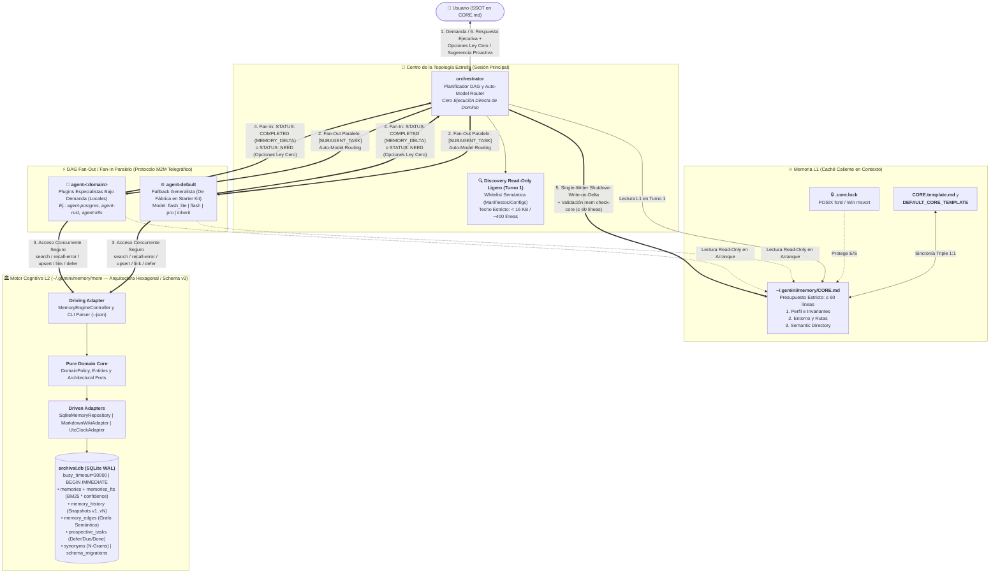
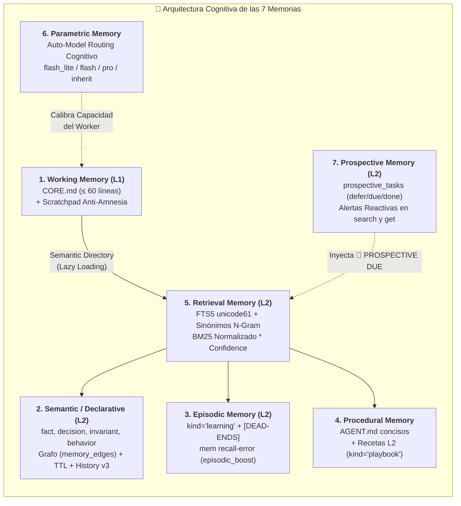
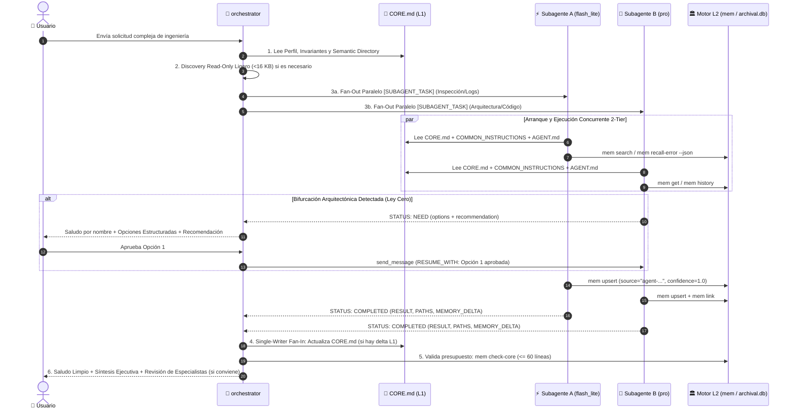

# 🚀 Antigravity: Ecosistema Multiagente en Topología Estrella Global y Motor de Memoria Cognitiva Híbrida

🌐 **Idiomas / Languages:** [Português (BR)](README.md) | [English](README.en.md) | **Español** | [简体中文](README.zh-CN.md)

[](#2-pilares-arquitectónicos)
[-007ec6?style=flat-square)](#3-arquitectura-cognitiva-híbrida-de-las-7-memorias)
[](#4-ingeniería-interna-del-motor-l2-geminimemorymem)
[-ffd343?style=flat-square)](#4-ingeniería-interna-del-motor-l2-geminimemorymem)
[-brightgreen?style=flat-square)](#10-suite-de-pruebas-automatizadas)

**Antigravity** es un framework de orquestación multiagente en **Topología Estrella Estricta** y un motor de **Memoria Cognitiva Híbrida de 2 Niveles (Schema L2 v3)** diseñado para operar de forma nativa sobre el directorio global `~/.gemini`. Transforma sesiones aisladas de LLMs en un sistema distribuido determinista de ingeniería de software, combinando planificación paralela en grafos acíclicos dirigidos (**DAG Fan-Out / Fan-In**), enrutamiento cognitivo dinámico de modelos (**Auto-Model Routing**), gobernanza **Zero Assumptions (Ley Cero)** y persistencia transaccional concurrente en SQLite WAL + FTS5 sin ninguna dependencia externa.

---

## 📑 Índice

1. [Propuesta de Valor y Filosofía de Ingeniería](#1-propuesta-de-valor-y-filosofía-de-ingeniería)
2. [Pilares Arquitectónicos](#2-pilares-arquitectónicos)
3. [Arquitectura Cognitiva Híbrida de las 7 Memorias](#3-arquitectura-cognitiva-híbrida-de-las-7-memorias)
4. [Ingeniería Interna del Motor L2 (`~/.gemini/memory/mem`)](#4-ingeniería-interna-del-motor-l2-geminimemorymem)
5. [Ciclo de Vida End-to-End (Recorrido en 4 Fases)](#5-ciclo-de-vida-end-to-end-recorrido-en-4-fases)
6. [Estructura del Repositorio y Aislamiento Git (Starter Kit)](#6-estructura-del-repositorio-y-aislamiento-git-starter-kit)
7. [Instalación, Privilegio Mínimo y First-Boot Onboarding](#7-instalación-privilegio-mínimo-y-first-boot-onboarding)
8. [Ecosistema de Subagentes y Creación de Especialistas (`agent-<domain>`)](#8-ecosistema-de-subagentes-y-creación-de-especialistas-agent-domain)
9. [Referencia Completa de la CLI `~/.gemini/memory/mem`](#9-referencia-completa-de-la-cli-geminimemorymem)
10. [Suite de Pruebas Automatizadas](#10-suite-de-pruebas-automatizadas)
11. [Gobernanza de Git, Seguridad e Invariantes de Código](#11-gobernanza-de-git-seguridad-e-invariantes-de-código)

---

## 1. Propuesta de Valor y Filosofía de Ingeniería

Los asistentes basados en LLMs convencionales sufren cuatro fallos estructurales graves cuando se aplican a proyectos reales de ingeniería de software:

| Patología Clásica de Agentes LLM | Solución de Ingeniería de Antigravity |
| :--- | :--- |
| **1. Amnesia entre Sesiones y Repetición de Errores** | **Memoria Híbrida de 2 Niveles + Recall Episódico (`recall-error`):** Caché caliente L1 (`CORE.md` $\le 60$ líneas) siempre en contexto emparejada con una base de archivo L2 (`archival.db` en SQLite WAL + FTS5) que almacena hechos, decisiones, grafos semánticos, historial de versiones (`memory_history`) y lecciones aprendidas (`learning`) que contienen obligatoriamente la sección `[DEAD-ENDS / TENTATIVAS DESCARTADAS]`. |
| **2. Explosión de Contexto y Degradación de Atención (*Context Rot*)** | **Topología Estrella + Differential Context Passing (M2M):** El agente principal (`orchestrator`) nunca ejecuta código directamente ni acumula volcados en bruto. Descompone las demandas en subtareas atómicas e inyecta en los subagentes exclusivamente las rutas e invariantes necesarios en formato telegráfico libre de ruido. Las salidas extensas se escriben obligatoriamente en disco (Anti-Amnesia). |
| **3. Condiciones de Carrera en Ejecución Multiagente Paralela** | **Single-Writer L1 + Concurrencia Transaccional L2:** Durante un Fan-Out paralelo, los subagentes **jamás** editan `CORE.md`; escriben concurrentemente en SQLite L2 (protegido por `WAL`, `busy_timeout=30000` y transacciones reentrantes `BEGIN IMMEDIATE`) y devuelven `MEMORY_DELTA`. Solo el `orchestrator` actualiza `CORE.md` en el Fan-In bajo bloqueo exclusivo de archivo (`fcntl`/`msvcrt`). |
| **4. Alucinaciones Arquitectónicas y Decisiones Silenciosas** | **Ley Cero Inviolable (Protocolo Zero Assumptions):** Ningún agente puede asumir requisitos, arquitectura, contratos públicos, adición de bibliotecas ni alcance. Ante bifurcaciones técnicas, el subagente interrumpe la ejecución con `STATUS: NEED`, y el `orchestrator` delega la decisión al usuario con opciones estructuradas y recomendación técnica fundamentada. |

---

## 2. Pilares Arquitectónicos

### 2.1. Topología Estrella Estricta (`orchestrator` Central)
El ecosistema prohíbe la comunicación lateral directa entre subagentes (*mesh* caótico). El **`orchestrator`** ocupa el centro de la estrella como único punto de contacto con el usuario y único planificador de tareas:
* **Prohibición Absoluta de Ejecución Directa por el Orquestador:** El `orchestrator` jamás edita código de proyectos, crea consultas SQL, ejecuta comandos de terminal de dominio ni manipula contenedores.
* **Discovery Read-Only Ligero en el Turno 1 (Whitelist Semántica):** Cuando el contexto inicial no informa la estructura del proyecto objetivo, el `orchestrator` tiene permiso estricto para realizar una lectura ligera de reconocimiento a través de una *whitelist* semántica —listado del directorio raíz y lectura de manifiestos o configuraciones de nivel superior (`package.json`, `pyproject.toml`, `Cargo.toml`, `go.mod`, `docker-compose.yml`, `Makefile`, `README.md`, etc.) respetando un **techo seguro de `< 16 KB` (~400 líneas)**— exclusivamente para planificar el grafo DAG con precisión. Todo análisis profundo y mutación se delegan a los subagentes.
* **Saludo Obligatorio Limpio (Zero Boot/Status Report):** El `orchestrator` inicia siempre sus respuestas saludando al usuario por el nombre registrado en `CORE.md`, sin emitir jamás informes robóticos de arranque (como *"memoria L1 sincronizada"* o *"directivas cargadas"*), salvo que se solicite explícitamente.

### 2.2. Descomposición Atómica en DAG y Paralelismo Fan-Out / Fan-In
Toda solicitud compleja se divide en el mayor número posible de **subtareas atómicas, ortogonales e independientes**:
* **Fan-Out Simultáneo:** Todas las subtareas con grado de entrada cero (sin dependencias pendientes) se lanzan **simultáneamente en el mismo turno** mediante múltiples llamadas paralelas a `invoke_subagent`.
* **Reutilización Inteligente de Sesión vs. Paralelismo:** Las subtareas concurrentes utilizan instancias paralelas mediante `invoke_subagent`; las etapas secuenciales en el mismo dominio que se benefician de la caché de contexto reutilizan el `conversationId` existente mediante `send_message`.

### 2.3. Auto-Model Routing Cognitivo
Al invocar subagentes (`invoke_subagent(TypeName="self", Model=...)`) o workers (`swarm`), el `orchestrator` selecciona el modelo y nivel de esfuerzo (`low`, `medium`, `high`, `xhigh`, `max`) más pequeños capaces de resolver la subtarea con excelencia, optimizando la latencia y el costo de tokens sobre el catálogo real de **23 modelos** de `agy`:

| Parámetro `Model` | Complejidad y Esfuerzo | Casos de Uso Ideales, Catálogo Completo (23 Modelos) y Regímenes de Cuota |
| :--- | :--- | :--- |
| **`"flash_lite"`** | **Tier 1: Baja (Esfuerzo `low` — E/S y Mecánica)** | Lectura de archivos/configs/logs, listados de directorios, `git status`/`diff`, búsquedas rápidas en L2 (`mem search`), comprobación de puertos y formateo. **Reinicio Diario:** `gemini-3.8-flash-low`, `gemini-4-hydrogen-low`, `gemini-4-neon-low`, `claude-sonnet-5-5-low`, `claude-opus-5-5-low` \| **Reinicio Semanal (7d):** `gemini-4-argon-low`. |
| **`"flash"`** | **Tier 2: Media (Esfuerzo `medium` — Operacional Estándar)** | Implementación de clases/funciones delimitadas, pruebas unitarias, scripts de automatización, Dockerfiles, consultas SQL (DDL/DML) y configuraciones de compilación. **Reinicio Diario:** `gemini-3.8-flash-medium`, `gemini-3.8-flash-high`, `gpt-oss-120b-medium`, `gemini-4-hydrogen-medium`, `gemini-4-neon-medium`, `claude-sonnet-5-5-medium`. |
| **`"pro"`** | **Tier 3: Alta (Esfuerzo `high` / `xhigh` — Arquitectura Profunda)** | Clean Architecture / Ports & Adapters, concurrencia crítica, refactorización estructural pesada, BVA y depuración compleja preservando la cuota semanal de Argon. **Reinicio Diario:** `gemini-4-neon-high`, `gemini-4-hydrogen-high`, `claude-sonnet-5-5-high`, `claude-opus-5-5-medium`, `gemini-4-neon-xhigh`, `gemini-4-hydrogen-xhigh`. |
| **`"inherit"`** | **Tier 4: Frontera (Esfuerzo `xhigh` / `max` / `high` Frontier)** | Decisiones arquitectónicas inéditas, desafíos *frontier* extremos y auditoría adversarial. **Reinicio Diario:** `claude-opus-5-5-high`, `gemini-4-neon-xhigh`, `gemini-4-hydrogen-xhigh`, `gemini-pro-orchestrator-neon` \| **Reinicio Semanal (7d):** `gemini-4-argon-medium`, `gemini-4-argon-high`, `gemini-pro-orchestrator-g1-pro`. |

* **Auto-Failover Inteligente de Cuota (429 / Quota Exhaustion):** Dado que el catálogo cuenta con 23 modelos y 5 niveles de esfuerzo (`low`, `medium`, `high`, `xhigh`, `max`) distribuidos en fondos de cuota independientes, si un worker encuentra agotamiento de cuota (`RESOURCE_EXHAUSTED` / HTTP 429) antes o a mitad de una tarea, el `orchestrator` redirige automáticamente la ejecución hacia un modelo/tier de capacidad y esfuerzo equivalentes con cuota disponible (`flash_lite` $\leftrightarrow$ `flash` $\leftrightarrow$ `pro` $\leftrightarrow$ `inherit`, o cambio *in-place* entre las familias Gemini 3.8 Flash, Gemini 4 Neon/Hydrogen/Argon, GPT-OSS, Claude Sonnet/Opus 5.5 y Orchestrator preservando el progreso parcial), concluyendo la tarea de forma transparente sin interrumpir el flujo.

### 2.4. Ley Cero Inviolable (Protocolo Zero Assumptions)
Ningún agente (`orchestrator` o subagente) puede deducir o elegir silenciosamente ante incertidumbres en:
1. **Requisitos y Reglas de Negocio**
2. **Arquitectura de Software** (capas, Ports & Adapters, contratos internos)
3. **Contratos Públicos de API y Esquemas de Base de Datos**
4. **Elección o Adición de Bibliotecas, Frameworks y Dependencias**
5. **Seguridad, Permisos y Alcance**

* **Calibración Operacional:** Los detalles puramente mecánicos o sintácticos internos que sigan estrictamente los principios SOLID y las convenciones ya existentes en el repositorio tienen autonomía técnica y no generan interrupciones innecesarias.
* **Flujo de Delegación Activa:** Ante cualquier duda o decisión estructural, el subagente se detiene de inmediato y emite `STATUS: NEED` (`target_domain: "orchestrator"`) listando `options: ["Opción 1 [Recomendada]", "Opción 2"]` y `recommendation`. El `orchestrator` pausa el flujo y somete las opciones y la recomendación técnica al usuario, a quien corresponde exclusivamente la decisión final.

### 2.5. Regla Single-Writer L1 e Invariante de Sincronía Triple 1:1
* **Single-Writer de `CORE.md`:** Solo el `orchestrator` tiene permiso de escritura en `~/.gemini/memory/CORE.md` durante el cierre del turno (*Shutdown Write-on-Delta* en el Fan-In), validando obligatoriamente el presupuesto de $\le 60$ líneas mediante `~/.gemini/memory/mem check-core`.
* **Invariante de Sincronía Triple 1:1 (`core-template-sync-invariant`):** Siempre que `~/.gemini/memory/CORE.template.md` sea actualizado, el `orchestrator` debe actualizar en el mismo turno `~/.gemini/memory/CORE.md` y la constante `DEFAULT_CORE_TEMPLATE` dentro de `~/.gemini/memory/mem` (y viceversa), garantizando paridad estricta línea a línea (variando únicamente en los marcadores `{{USER_NAME}}`, `{{USER_LANG}}` y `{{DEFAULT_WORKSPACE}}`).
* **SSOT de Identidad:** Los datos personales del usuario (nombre, idioma, rutas de proyectos privados) residen exclusivamente en `CORE.md` y en el registro `global:user-profile` de la base L2 (`archival.db`), quedando prohibido codificarlos de forma fija (*hardcode*) en archivos procedimentales versionados (`GEMINI.md`, `COMMON_INSTRUCTIONS.md`, `AGENT.md`, `README.md`).

### 2.6. Protocolo M2M Telegráfico (Differential Context Passing)
La comunicación Máquina $\leftrightarrow$ Máquina elimina el 100% de los preámbulos conversacionales:

````carousel
```markdown
# 1. Lanzamiento de Subtarea Atómica (orchestrator -> Subagente)
[SUBAGENT_TASK]
AGENT_ID: <agent-<domain> | agent-default>
AGENT_DEF: ~/.gemini/agents/<agent-id>/AGENT.md
ATOMIC_GOAL: <Objetivo único, directo y verificable>
CONTEXT: <Solo rutas, fragmentos e invariantes estrictamente necesarios>
```
<!-- slide -->
```yaml
# 2. Escalamiento de Duda / Dependencia / Handoff QA+AppSec (Subagente -> orchestrator)
STATUS: NEED
AGENT: <mi-agent-id>
NEEDS:
  - target_domain: "<domain | default | orchestrator>" # Cadena única O lista (ej: ["qa", "appsec"])
    atomic_goal: "<Acción requerida de otro dominio/gates O duda/decisión a delegar al usuario>"
    context: "<Resumen de cambios, comandos de build/test, riesgos o escenario técnico>"
    options: ["<Opción 1 [Recomendada]>", "<Opción 2>"] # Obligatorio para dudas/decisiones
    recommendation: "<Fundamentación técnica objetiva de la opción recomendada>"
PATHS: ["<rutas absolutas creadas/modificadas/inspeccionadas>"]
MEMORY_DELTA: "<none | namespace/topic grabado en L2 vía mem upsert/link/defer>"
RESUME_WITH: "<Dato/decisión exacta necesaria para continuar O confirmación QA+AppSec>"
```
<!-- slide -->
```yaml
# 3. Finalización de Subtarea (Subagente -> orchestrator)
STATUS: COMPLETED
AGENT: <mi-agent-id>
RESULT: "<Síntesis técnica densa y directa de lo ejecutado/validado>"
PATHS: ["<rutas absolutas creadas/modificadas/inspeccionadas>"]
MEMORY_DELTA: "<none | namespace/topic grabado en L2 vía mem upsert/link/defer>"
```
````

> [!NOTE]
> El campo `target_domain` en `STATUS: NEED` acepta tanto una cadena única (ej.: `"rust"`, `"orchestrator"`) como una lista de dominios (ej.: `["qa", "appsec"]`). Todo agente de desarrollo (`EXTENDS: agent-dev-base`, excepto `agent-qa` y `agent-appsec` en auditoría) finaliza los cambios de código/configuración/infraestructura/scripts emitiendo obligatoriamente `STATUS: NEED` con `target_domain: ["qa", "appsec"]`; recíprocamente, ante cualquier fallo o vulnerabilidad, `agent-qa` y `agent-appsec` emiten `STATUS: NEED` con `target_domain: "<dev-stack>"` para su corrección en el código, repitiendo el ciclo hasta obtener un doble `STATUS: COMPLETED`.

### 2.7. Dynamic Specialist Plugin Registry y Revisión de Fin de Conversación
Los subagentes especialistas (`~/.gemini/agents/agent-<domain>/AGENT.md`) funcionan como plugins dinámicos indexados en la Sección 3 (`Semantic Directory`) de `CORE.md`.
* **Análisis Obligatorio de Fin de Conversación y Sugerencia Proactiva de Especialistas (`end-of-conversation-specialist-review` / `proactive-specialist-suggestion`):** Al final de **toda** conversación o entrega con el usuario —independientemente de si ocurrió un fallback a `agent-default` o no—, el `orchestrator` analiza la conversación en su conjunto para evaluar si conviene crear nuevos agentes especialistas (ej.: nuevo dominio/stack/flujo recurrente, herramienta especializada o sobrecarga de un especialista existente). Cuando convenga, el `orchestrator` está **obligado** a incluir en la respuesta final una propuesta estructurada de los especialistas recomendados, especificando:
  1. **Nombre del Agente:** `agent-<domain>`
  2. **Ruta:** `~/.gemini/agents/agent-<domain>/AGENT.md`
  3. **Herencia (`EXTENDS`):** Aplicable al dominio, si corresponde
  4. **Alcance e Invariantes del Dominio**
  5. **Namespace L2 Primario:** `<domain>`
  6. **Justificación del Beneficio**
* *Calibración Anti-Ruido:* Cuando no convenga (dominio ya bien cubierto por los especialistas actuales o demanda puramente trivial/puntual), el `orchestrator` no debe forzar sugerencias artificiales.

### 2.8. Pipeline Universal de Calidad (`dev <-> qa / appsec`)
Toda demanda de desarrollo de software en el ecosistema (independientemente del lenguaje o stack tecnológico) ejecuta un ciclo bidireccional obligatorio en el DAG antes de la entrega final al usuario:
1. **`dev` (Especialista del Lenguaje/Stack):** Implementación o refactorización adherente a SOLID, Clean Architecture / Ports & Adapters e invariantes del dominio. Antes de concluir cambios de código (funcionalidades, correcciones, contratos, CLI/flags, APIs, dependencias o configuraciones), verifica y actualiza obligatoriamente las documentaciones afectadas (`README.md`, `docs/`, `CHANGELOG.md`, guías/esquemas) en el mismo turno (**Doc-Sync Gate**) y ejecuta el **Local CI Gate** (simulación local 1:1 de `.github/workflows/*.yml` con `zizmor` pedante, `actionlint`, comprobación de SHAs en Git Tags inmutables/Node.js y ejecución real de linters/pruebas/SCA/`run:` de CI). Al concluir cualquier cambio de código, configuración, infraestructura o scripts (incluso tras superar las pruebas locales), todo agente que hereda de `agent-dev-base` DEBE cerrar emitiendo obligatoriamente `STATUS: NEED` con `target_domain: ["qa", "appsec"]` (y no `STATUS: COMPLETED` aislado), informando el resumen objetivo de los cambios, `PATHS`, comandos de build/test ejecutados, estado del Doc-Sync Gate, evidencias del Local CI Gate y riesgos/puntos de atención.
2. **`qa` (`agent-qa`):** Quality Gate adversarial independiente con pruebas de frontera (BVA), *fuzzing*/*chaos*, linters, auditoría estricta de invariantes, ejecución obligatoria del **Local CI Gate** 1:1 con `.github/workflows/*.yml` antes de declarar `COMPLETED` y verificación de adherencia documental (detección de *drift* entre código y documentación/esquemas).
3. **`appsec` (`agent-appsec`):** Revisión continua de seguridad que abarca OWASP/CWE, SAST, saneamiento de entradas y hardening de *supply-chain*.
* **Devolución Obligatoria y Bucle de Bloqueo (`qa/appsec -> "<dev-stack>"`):** Siempre que `agent-qa` o `agent-appsec` encuentre **cualquier** fallo, regresión, violación de invariante, error, vulnerabilidad o hallazgo de seguridad, DEBE emitir obligatoriamente `STATUS: NEED` dirigido al `target_domain: "<dev-stack>"` del agente dev especialista adecuado con un informe forense accionable (archivo, línea, causa raíz, severidad, reproducción/evidencia y corrección esperada) para que el dev corrija el código —jamás cerrando con `STATUS: COMPLETED` con hallazgos abiertos—. Tras corregir, el dev vuelve a emitir `STATUS: NEED` (`target_domain: ["qa", "appsec"]`), repitiendo el ciclo hasta que ambos aprueben con `STATUS: COMPLETED`.
* **Salvaguarda Anti-Bucle:** `agent-qa` y `agent-appsec` (que también heredan de `agent-dev-base`) están exentos del handoff `["qa", "appsec"]` al concluir sus validaciones/auditorías —emiten `STATUS: COMPLETED` solo cuando está 100% aprobado (cero hallazgos abiertos) o `STATUS: NEED` hacia `"<dev-stack>"` cuando existan hallazgos—.
* **Excepciones Estrictas de Alcance:** El handoff y el encadenamiento completo se eximen únicamente en tareas estrictamente *read-only* (sin edición de archivos), generación de mensajes de commit/PR o ajustes textuales triviales sin cambios de código/configuración/infraestructura/scripts.

### 2.9. Diagrama Arquitectónico Completo



---

## 3. Arquitectura Cognitiva Híbrida de las 7 Memorias

Inspirada en la convergencia entre arquitecturas cognitivas modernas (*Letta/MemGPT, CoALA, Mem0 y Zep/Graphiti*), la capa de persistencia de Antigravity divide el conocimiento en **2 Niveles físicos** y **7 subsistemas cognitivos especializados**:



### 3.1. Working Memory (Memoria de Trabajo L1 + Scratchpad Físico Anti-Amnesia)
* **Caché Caliente L1 (`~/.gemini/memory/CORE.md`):** Mantenida bajo un presupuesto estricto de **$\le 60$ líneas** (auditado mediante `mem check-core`, configurable por `--max-lines` o mediante la variable de entorno `ANTIGRAVITY_CORE_MAX_LINES`). Estructurada en 3 secciones fijas:
  1. *Perfil e Invariantes Globales del Usuario (SSOT de Identidad)*
  2. *Entorno Activo y Rutas Clave*
  3. *Semantic Directory (Punteros L2 y Plugins Especialistas)*
* **Persistencia Física Anti-Amnesia:** Queda prohibido truncar o resumir salidas voluminosas en el chat. Cualquier procesamiento extenso, registro (*log*) o diff largo debe escribirse íntegramente en un archivo físico (ej.: `output_full.txt` o `.task_context`) y devolver su ruta absoluta en el arreglo `PATHS` del payload M2M.

### 3.2. Semantic & Declarative Memory (Memoria Semántica, Grafo, Procedencia y Versionado L2 v3)
Reside en la tabla `memories` de SQLite L2 (`archival.db`) organizada por `namespace` (`<domain>` o `proj:<repo>`) y `topic`:
* **Tipos Declarativos (`kind`):**
  * `fact`: Hechos objetivos, versiones, puertos, rutas y configuraciones (recibe **TTL por defecto de 30 días** automáticamente si se omite `--ttl`).
  * `decision`: Decisiones arquitectónicas y técnicas aprobadas (ADRs concisos, TTL infinito por defecto).
  * `invariant`: Reglas técnicas inviolables y restricciones permanentes del dominio.
  * `behavior`: Heurísticas operacionales y preferencias de ejecución.
* **Frescura Semántica (TTL y Revalidación):** Los registros con `ttl_days` definido se supervisan continuamente. Cuando $\text{elapsed\_days} > \text{ttl\_days}$, las lecturas mediante `search`, `get` o `recall-error` emiten automáticamente la alerta:
  `⚠️ STALE MEMORY (verificada há Xd, TTL=Yd — revalide no ambiente e rode 'mem verify <ns> "<topic>"')`.
* **Grafo Semántico Dirigido (`memory_edges`):** Los tópicos se conectan mediante aristas tipadas (`DEPENDS_ON`, `RELATES_TO`, `SUPERSEDES`, etc.) vía `mem link`, con borrado en cascada (`ON DELETE CASCADE`) y visualización bidireccional (`out` `--(REL)-->` e `in` `<--(REL)--`) en el comando `mem get`.
* **Versionado Automático, Procedencia y Soft-Delete (Schema v3):**
  * Cada registro posee `version` (iniciado en `1` y autoincrementado en cada `upsert` o `import-md`), `source` (identificador del agente o autor, ej.: `--source "agent-default"`) y `confidence` (factor de confianza en el intervalo $[0.0, 1.0]$).
  * Antes de cualquier actualización o soft-delete, el estado anterior completo se archiva de forma inmutable en la tabla **`memory_history`**, auditable vía `mem history <ns> "<topic>" [--json]`.
  * El comando `mem delete <ns> "<topic>"` ejecuta **soft-delete por defecto** (rellenando `deleted_at` y eliminando la entrada del índice FTS5 activo sin perder el registro ni su historial), permitiendo la recuperación inmediata mediante `mem restore <ns> "<topic>"`. El borrado físico ocurre solo cuando se indica explícitamente `--hard`.
* **Interoperabilidad Wiki Markdown (`export-md` / `import-md`):** Exporta e importa toda la base L2 (incluidos metadatos v3 y aristas del grafo convertidas en WikiLinks `[[ns/topic]]`) a archivos Markdown compatibles con Obsidian/Logseq e índice `INDEX.md`. Para evitar colisiones de nombres en tópicos que difieren únicamente en puntuación o mayúsculas/minúsculas, `MarkdownWikiAdapter` aplica un sufijo determinista de **6 caracteres hexadecimales SHA-256** (`<slug>_<sha256[:6]>.md`).

### 3.3. Episodic Memory (Memoria Episódica y Diagnóstico de Errores)
* **Registros `kind='learning'` con Dead-Ends Obligatorios:** Toda lección aprendida tras la resolución de un error o problema complejo debe contener la sección **`[DEAD-ENDS / TENTATIVAS DESCARTADAS]`**, documentando qué falló y por qué, evitando que futuros agentes repitan hipótesis inválidas.
* **Motor `mem recall-error "<snippet_o_stacktrace>"`:**
  1. Extrae palabras alfanuméricas ($\ge 3$ caracteres) del stacktrace o mensaje de error.
  2. Realiza un *split* automático de identificadores `CamelCase` (`CAMEL_CASE_SPLIT`) y `snake_case`, preservando tanto el token compuesto como sus partes elementales.
  3. Filtra ruido frente a un conjunto estricto de **46 `ERROR_STOPWORDS`** de lenguajes y runtimes (`error`, `exception`, `traceback`, `null`, `java`, `lang`, `runtime`, `function`, `method`, etc.).
  4. Ordena los candidatos por especificidad (longitud descendente `(-len(x), x)`), selecciona hasta **24 términos** y ejecuta la búsqueda FTS5 con **`prioritize_episodic=True`**, activando la columna calculada `episodic_boost = 1` para posicionar registros `learning` y `playbook` en lo más alto de los resultados.

### 3.4. Procedural Memory (Memoria Procedimental)
Dividida en dos capas complementarias:
1. **Instrucciones Estáticas Concisas (`AGENT.md`):** Definiciones de roles, fronteras de dominio e invariantes operacionales en `~/.gemini/agents/<agent-id>/AGENT.md`.
2. **Playbooks Dinámicos (`kind='playbook'` en L2):** Recetas paso a paso reutilizables (procedimientos de compilación, migraciones, despliegues, listas de comprobación de diagnóstico) almacenadas y versionadas en la base `archival.db`.

### 3.5. Retrieval Memory (Motor de Búsqueda Híbrida FTS5, Sinónimos N-Gram y Ranking BM25)
* **Indexación Léxica Insensible a Diacríticos:** Utiliza la tabla virtual `memories_fts` con `fts5(..., content='memories', content_rowid='id', tokenize='unicode61 remove_diacritics 2')`. Los términos simples de al menos 2 caracteres (`MIN_TOKEN_LENGTH = 2`) reciben búsqueda por prefijo (`"término"*`), mientras que las frases o términos entre comillas dobles realizan búsqueda exacta (`"término"`).
* **Expansión Dinámica de Sinónimos (1-Gram, 2-Gram y 3-Gram):** Antes de consultar FTS5, `DomainPolicy.build_fts_query` analiza la consulta completa, trigramas, bigramas y unigramas contra la tabla `synonyms` (precargada en el arranque con **12 grupos de sinónimos técnicos** `DEFAULT_SYNONYM_GROUPS`, como `k8s` $\leftrightarrow$ `kubernetes`, `loom` $\leftrightarrow$ `virtual threads`, `hexagonal` $\leftrightarrow$ `ports and adapters` $\leftrightarrow$ `clean architecture`, `postgres` $\leftrightarrow$ `postgresql` $\leftrightarrow$ `psql`, etc., y extensible vía `mem syn add`).
* **Fórmula Matemática de Ranking Híbrido (BM25 Normalizado + Hits + Confianza + Decaimiento Temporal):**
  Dado que la función nativa `bm25()` de SQLite FTS5 devuelve valores negativos (donde valores más negativos indican mayor relevancia), multiplicarla directamente por factores de impulso invertiría el ordenamiento. El motor `mem` normaliza la puntuación invirtiendo su signo (`-1.0 * bm25(...)`) con suelo `0.0001`, aplica pesos diferenciados por columna (`topic=5.0`, `content=1.0`, `tags=3.0`, `namespace=0.5`), escala por los accesos (`access_count` con tope de 30 hits), pondera por el factor `confidence` del Schema v3 y aplica un decaimiento temporal suave en días:

$$\text{relevance\_score} = \frac{\max\left(0.0001,\; -1.0 \times \text{bm25}(\text{memories\_fts},\; 5.0,\; 1.0,\; 3.0,\; 0.5)\right) \times \left(1.0 + 0.15 \times \min(\text{access\_count},\; 30)\right) \times \text{confidence}}{1.0 + 0.02 \times \max\left(0.0,\; \text{julianday}(\text{'now'}) - \text{julianday}(\text{updated\_at})\right)}$$

> [!NOTE]
> Toda lectura exitosa mediante `mem get`, `mem search` o `mem recall-error` incrementa transaccionalmente el contador `access_count` de los registros devueltos, retroalimentando la relevancia de los conocimientos más útiles y habilitando su promoción a `CORE.md` vía `mem promote`.

### 3.6. Parametric Memory (Memoria Paramétrica mediante Auto-Model Routing)
Trata la capacidad intrínseca de los distintos pesos de modelos (`flash_lite`, `flash`, `pro`, `inherit` / **Gemini 4 Argon**) como un recurso cognitivo enrutable por subtarea por el `orchestrator` (como se detalla en la [Sección 2.3](#23-auto-model-routing-cognitivo)).

### 3.7. Prospective Memory (Memoria Prospectiva y Disparadores Asíncronos)
Gestionada en la tabla `prospective_tasks` mediante los comandos `mem defer`, `mem due` y `mem done`:
* Permite que cualquier subagente programe recordatorios técnicos o acciones futuras vinculadas a una condición de disparo (`trigger_cond`) dentro de un `namespace`.
* **Inyección Reactiva Automática:** Siempre que un agente ejecuta `mem search` o `mem get` (en modo texto estándar) sobre un namespace que tiene tareas prospectivas con `status = 'pending'`, el controlador inyecta automáticamente en la parte superior de la salida la alerta:
  `🔔 PROSPECTIVE DUE [<namespace>]: #<id> [<trigger_cond>] -> <action>`
* Las tareas pendientes también se consolidan y reportan globalmente en la auditoría `mem check-core`.

---

## 4. Ingeniería Interna del Motor L2 (`~/.gemini/memory/mem`)

El ejecutable [`~/.gemini/memory/mem`](memory/mem) (~2.600 líneas) fue diseñado como un binario Python 3 autónomo (**cero dependencias externas**, utilizando exclusivamente la biblioteca estándar: `argparse`, `contextlib`, `hashlib`, `json`, `os`, `re`, `sqlite3`, `sys`, `dataclasses`, `datetime`, `typing`, `fcntl`/`msvcrt`), estructurado rigurosamente según **Clean Architecture (Ports & Adapters)** y los principios **SOLID**.

### 4.1. Capas de la Arquitectura Hexagonal en Archivo Único

| Sección Arquitectónica en el Código | Componentes Principales | Responsabilidad Estricta |
| :--- | :--- | :--- |
| **1. Domain Exceptions & Entities** | `DomainValidationError`, `ResourceNotFoundError`, `MemoryRecord`, `MemoryHistoryRecord`, `SemanticEdge`, `ProspectiveTask`, `NamespaceStat`, `StorageStats`, `WikiDocument` | Objetos de valor inmutables (`@dataclass(frozen=True, slots=True)`) y excepciones semánticas de negocio sin acoplamiento de E/S. |
| **2. Architectural Ports** | `ClockPort`, `MemoryRepositoryPort` (`typing.Protocol`) | Contratos abstractos (Interfaces) que invierten la dependencia (DIP) entre las reglas de negocio/controlador y la infraestructura física. |
| **3. Pure Domain Policies** | `DomainPolicy` | Validación de namespaces (`^[a-z0-9][a-z0-9_-]*$` o `^proj:[a-zA-Z0-9._-]+$`), `VALID_KINDS`, `confidence` ($[0.0, 1.0]$), parseo de TTL, cálculo de *staleness*, construcción de consultas FTS5 con n-gramas de sinónimos y tokenización de stacktraces. |
| **4. Driven Adapters (Infra)** | `file_lock`, `immediate_transaction`, `UtcClockAdapter`, `SqliteMemoryRepository`, `MarkdownWikiAdapter` | Persistencia SQLite WAL + FTS5, migraciones automáticas de esquema, bloqueo de archivo multiplataforma y parser resiliente de YAML Frontmatter / WikiLinks. |
| **5. Driving Adapter (App/CLI)** | `MemoryEngineController`, `build_parser`, `main` | Orquestación de casos de uso, formateo de salida dual (Humana o JSON estructurado vía `--json`) y manejo limpio de errores en el borde (`sys.exit(1)` sin exponer tracebacks sin procesar al agente). |

### 4.2. Control de Concurrencia, Transacciones Reentrantes y File Locking
Para soportar decenas de subagentes ejecutándose en paralelo durante un Fan-Out del DAG sin errores de `SQLITE_BUSY` ni corrupción de archivos:
1. **Pragmas de Alta Concurrencia:** Al abrir cada conexión, `SqliteMemoryRepository._get_conn()` aplica:
   * `PRAGMA busy_timeout=30000;` (30 segundos de espera activa ante contención de escritura)
   * `PRAGMA journal_mode=WAL;` (*Write-Ahead Logging* que permite lecturas paralelas sin bloqueo durante escrituras)
   * `PRAGMA synchronous=NORMAL;`, `PRAGMA temp_store=MEMORY;` y `PRAGMA foreign_keys=ON;`
2. **Context Manager Reentrante `immediate_transaction(conn)`:** Utiliza conexiones en modo `isolation_level=None` (autocommit nativo del driver) y gestiona transacciones explícitamente con `BEGIN IMMEDIATE;`. Al comprobar `is_outer = not conn.in_transaction`, permite la composición segura de métodos internos con commit/rollback atómico únicamente en el ámbito más externo.
3. **File Lock Multiplataforma (`file_lock`):** Las operaciones sobre `CORE.md` (`init` y `check-core`) adquieren un bloqueo exclusivo del sistema operativo sobre `~/.gemini/memory/.core.lock`, utilizando `fcntl.flock(fd, fcntl.LOCK_EX)` en sistemas POSIX (Linux/macOS) y `msvcrt.locking(fd, msvcrt.LK_LOCK, 1)` en Windows (`nt`).
4. **Hot Backup Online (`mem backup`):** Utiliza la API nativa `sqlite3.Connection.backup()` para copiar páginas de la base de forma transaccionalmente consistente hacia `~/.gemini/memory/backups/archival_<timestamp>.db` (o una ruta personalizada) sin interrumpir escrituras concurrentes.

### 4.3. Máquina de Estados de los Triggers FTS5 External Content (Guarda de 5 Transiciones)
La tabla virtual `memories_fts` utiliza `content='memories'` (*External Content Table*) para evitar la duplicación de texto en disco. En SQLite FTS5, emitir el comando `'delete'` en la tabla virtual para un `rowid` que ya había sido eliminado en un soft-delete anterior **no es idempotente** —esto genera inconsistencia en el árbol B invertido y corrompe la base de datos con `SQLITE_CORRUPT (database disk image is malformed)`.

Para resolverlo matemáticamente, los triggers `memories_ai`, `memories_ad` y `memories_au` implementan una **Máquina de Estados Determinista con Doble Guarda** (`WHERE old.deleted_at IS NULL` y `WHERE new.deleted_at IS NULL`):

```sql
CREATE TRIGGER IF NOT EXISTS memories_au
AFTER UPDATE OF topic, content, tags, namespace, deleted_at ON memories BEGIN
    -- Solo elimina del índice FTS5 si el estado ANTERIOR estaba ACTIVO:
    INSERT INTO memories_fts(memories_fts, rowid, topic, content, tags, namespace)
    SELECT 'delete', old.id, old.topic, old.content, old.tags, old.namespace
    WHERE old.deleted_at IS NULL;

    -- Solo inserta en el índice FTS5 si el estado NUEVO permanece/pasa a estar ACTIVO:
    INSERT INTO memories_fts(rowid, topic, content, tags, namespace)
    SELECT new.id, new.topic, new.content, new.tags, new.namespace
    WHERE new.deleted_at IS NULL;
END;
```

Esta guarda cubre con un 100% de seguridad todas las **5 transiciones de estado posibles**:
1. **Creación (`None` $\rightarrow$ `Activo`):** `memories_ai` inserta en FTS5 (`WHEN new.deleted_at IS NULL`).
2. **Actualización Activa (`Activo` $\rightarrow$ `Activo`):** `memories_au` elimina los términos antiguos (`old.deleted_at IS NULL`) e indexa los nuevos (`new.deleted_at IS NULL`).
3. **Soft-Delete (`Activo` $\rightarrow$ `Soft-Deleted`):** `memories_au` elimina los términos antiguos de FTS5 (`old.deleted_at IS NULL`) y omite la reinserción (`new.deleted_at IS NOT NULL`).
4. **Mutación de Registro Archivado (`Soft-Deleted` $\rightarrow$ `Soft-Deleted`):** `memories_au` opera como **NO-OP** puro (ningún `SELECT` devuelve filas), previniendo doble borrado y corrupción del árbol B.
5. **Reactivación vía `restore` o `upsert` (`Soft-Deleted` $\rightarrow$ `Activo`):** `memories_au` omite el borrado (`old.deleted_at IS NOT NULL`) e indexa únicamente el nuevo estado activo (`new.deleted_at IS NULL`).

---

## 5. Ciclo de Vida End-to-End (Recorrido en 4 Fases)



1. **Fase 1 — Arranque L1 y Discovery Ligero (Turno 1):** El `orchestrator` recibe el mensaje del usuario y lee `~/.gemini/memory/CORE.md` para identificar el nombre del usuario, sus invariantes y los especialistas disponibles en el `Semantic Directory`. Si necesita reconocer la estructura del repositorio objetivo, lee únicamente manifiestos de nivel superior dentro de la whitelist semántica (`< 16 KB`).
2. **Fase 2 — Descomposición DAG, Auto-Model Routing y Ley Cero:** El `orchestrator` divide el problema en subtareas ortogonales, selecciona el `Model` ideal (`flash_lite`, `flash`, `pro` o `inherit`) y lanza múltiples subagentes en paralelo con la cabecera `[SUBAGENT_TASK]`. Si surge cualquier duda de negocio, contrato o arquitectura, el flujo se pausa vía `STATUS: NEED` y consulta al usuario con opciones y recomendación técnica.
3. **Fase 3 — Ejecución 2-Tier y Persistencia L2 Concurrente:** Cada subagente realiza el arranque conciso leyendo en paralelo `CORE.md`, `COMMON_INSTRUCTIONS.md` y su `AGENT.md`. Consulta L2 bajo demanda (`mem search`, `mem get` o `mem recall-error` ante fallos), ejecuta su tarea estrictamente dentro del dominio, graba nuevos aprendizajes en L2 (`mem upsert` con `--source` y `--confidence`) sin tocar `CORE.md`, y devuelve `STATUS: COMPLETED` informando `MEMORY_DELTA` y `PATHS`.
4. **Fase 4 — Fan-In Single-Writer, Auditoría `check-core` y Respuesta Final:** El `orchestrator` consolida los resultados, actualiza `CORE.md` si existen nuevos punteros estructurales (manteniendo la sincronía triple 1:1 en caso de modificar el template), ejecuta `mem check-core` para certificar el límite de $\le 60$ líneas y entrega la respuesta iniciando con el saludo limpio por el nombre del usuario —incluyendo la revisión de fin de conversación con sugerencia estructurada de nuevos `agent-<domain>` siempre que el contexto demuestre beneficio real (sin forzar sugerencias artificiales en demandas triviales o ya bien cubiertas)—.

---

## 6. Estructura del Repositorio y Aislamiento Git (Starter Kit)

El archivo [`.gitignore`](.gitignore) adopta una política **Default-Deny (`*`) con Whitelist Explícita**, separando rigurosamente el **Starter Kit Portable** (versionado en Git —que incluye de fábrica **únicamente** los agentes `orchestrator` y `agent-default`—) del **Estado Local y Privado del Usuario** (ignorado por Git, incluida la base de datos, `CORE.md` y cualquier especialista `agent-<domain>` creado bajo demanda):

```text
~/.gemini/
├── .gitignore                        # ✅ [Versionado - Starter Kit] Regla '*' + Whitelist estricta del Starter Kit
├── GEMINI.md                         # ✅ [Versionado - Starter Kit] Constitución Global (Ley Cero, Estrella, M2M, 7 Memorias)
├── README.md                         # ✅ [Versionado - Starter Kit] Documentación Arquitectónica y Operacional Completa
├── README.en.md                      # ✅ [Versionado - Starter Kit] Documentación Arquitectónica y Operacional (English)
├── README.es.md                      # ✅ [Versionado - Starter Kit] Documentación Arquitectónica y Operacional (Español)
├── README.zh-CN.md                   # ✅ [Versionado - Starter Kit] Documentación Arquitectónica y Operacional (简体中文)
│
├── agents/
│   ├── COMMON_INSTRUCTIONS.md        # ✅ [Versionado - De Fábrica] Protocolo compartido 2-Tier, CLI mem y M2M
│   ├── orchestrator/
│   │   └── AGENT.md                  # ✅ [Versionado - De Fábrica] Planificador DAG, Auto-Model Router y Single-Writer L1
│   ├── agent-default/
│   │   └── AGENT.md                  # ✅ [Versionado - De Fábrica] Subagente Generalista Ejecutor (Fallback y Bootstrap)
│   ├── agent-dev-base/               # 🔒 [Ignorado - Local] Base abstracta SSOT (EXTENDS) con 9 invariantes de ingeniería
│   │   └── AGENT.md
│   └── agent-<domain>/               # 🔒 [Ignorado - Local] Plugins especialistas creados bajo demanda por el usuario
│       └── AGENT.md                  #    (19 plugins locales activos: 15 EXTENDS agent-dev-base + 4 independientes — ver Sección 8.1)
│
├── memory/
│   ├── mem                           # ✅ [Versionado - Starter Kit] Motor Cognitivo L2 Hexagonal en Python 3 (Schema v3)
│   ├── CORE.template.md              # ✅ [Versionado - Starter Kit] Plantilla canónica de la Memoria Caliente L1 (<= 60 líneas)
│   ├── tests/
│   │   ├── test_mem.py               # ✅ [Versionado - Starter Kit] Suite con 21 pruebas automatizadas del motor L2 (unittest stdlib)
│   │   └── test_catalog_parity.py    # ✅ [Versionado - Starter Kit] Suite de paridad de catálogo (agentes/CORE/dev-base/README)
│   ├── CORE.md                       # 🔒 [Ignorado - Local] Caché L1 renderizada con la identidad real del usuario
│   ├── .core.lock                    # 🔒 [Ignorado - Local] Lockfile multiplataforma de exclusión mutua de CORE.md
│   ├── archival.db                   # 🔒 [Ignorado - Local] Base SQLite WAL + FTS5 local ( + -wal / -shm )
│   ├── backups/                      # 🔒 [Ignorado - Local] Snapshots online generados por 'mem backup'
│   └── wiki/                         # 🔒 [Ignorado - Local] Exportaciones Markdown generadas por 'mem export-md'
│
└── antigravity-cli/                  # 🔒 [Ignorado - Local] Configuraciones locales del cliente CLI (settings.json)
```

---

## 7. Instalación, Privilegio Mínimo y First-Boot Onboarding

### 7.1. Requisitos del Sistema
* **Sistema Operativo:** Linux, macOS o Windows.
* **Runtime:** `python3` ($\ge 3.10$) con el módulo estándar `sqlite3` compilado con soporte para la extensión **FTS5** (habilitado por defecto en las distribuciones modernas de Python 3).
* **Dependencias Externas (`pip`):** **Ninguna** (Cero dependencias).

### 7.2. Instalación Rápida
```bash
# 1. Clona el Starter Kit directamente en ~/.gemini (o copia los archivos allí)
git clone <url-del-repositorio> ~/.gemini

# 2. Garantiza el permiso de ejecución para la CLI del motor de memoria L2
chmod +x ~/.gemini/memory/mem

# 3. Ejecuta la suite de pruebas para validar el entorno Python + SQLite FTS5
python3 -m unittest discover -s ~/.gemini/memory/tests/ -v
```

### 7.3. Configuración de Privilegio Mínimo (`~/.gemini/antigravity-cli/settings.json`)
Para que el `orchestrator` y los subagentes lean/escriban memorias técnicas sin fricción y operen con el modelo frontera por defecto (**Gemini 4 Argon**), configura los permisos explícitos en `~/.gemini/antigravity-cli/settings.json` (sustituyendo `<tu_usuario>` por tu usuario del sistema):

```json
{
  "allowNonWorkspaceAccess": true,
  "model": "Gemini 4 Argon (Medium)",
  "permissions": {
    "allow": [
      "read_file(/home/<tu_usuario>/.gemini/memory)",
      "write_file(/home/<tu_usuario>/.gemini/memory)",
      "read_file(/home/<tu_usuario>/.gemini/agents)",
      "write_file(/home/<tu_usuario>/.gemini/agents)",
      "read_file(/home/<tu_usuario>/.gemini/GEMINI.md)",
      "write_file(/home/<tu_usuario>/.gemini/GEMINI.md)",
      "command(/home/<tu_usuario>/.gemini/memory/mem)",
      "command(ls)",
      "command(grep)",
      "command(wc)"
    ]
  },
  "trustedWorkspaces": [
    "/home/<tu_usuario>/.gemini",
    "/home/<tu_usuario>/.gemini/memory",
    "/home/<tu_usuario>/.gemini/agents"
  ]
}
```

### 7.4. First-Boot Onboarding (2 Modos)

#### Opción A: Onboarding Interactivo Automático vía Chat
Al iniciar la primera conversación cuando `CORE.md` aún no existe o contiene `Usuário: [UNCONFIGURED]`, el `orchestrator` ejecuta automáticamente el **First-Boot Onboarding Protocol**:
1. Activa `agent-default` para inicializar la infraestructura (`~/.gemini/memory/mem init`).
2. Pregunta al usuario su **Nombre visible**, **Idioma preferido** y **Workspace por defecto**.
3. Renderiza `~/.gemini/memory/CORE.md` y guarda el registro `global:user-profile` en la base L2.

#### Opción B: Onboarding Directo vía Terminal (CLI)
Puedes inicializar la base `archival.db` (cargando los 8 registros fundacionales del namespace `global` y sus aristas semánticas) y generar `CORE.md` en un único comando:

```bash
~/.gemini/memory/mem init \
  --user "TuNombre" \
  --lang "es" \
  --workspace "/home/<tu_usuario>/workspace" \
  --force
```

### 7.5. Variables de Entorno Soportadas por el Motor `mem`
El motor `~/.gemini/memory/mem` permite sobrescribir sus rutas y límites mediante variables de entorno (útil para aislamiento de pruebas o workspaces personalizados):

| Variable de Entorno | Valor por Defecto | Descripción |
| :--- | :--- | :--- |
| `ANTIGRAVITY_DB_PATH` | `~/.gemini/memory/archival.db` | Ruta absoluta del archivo de base de datos SQLite L2. |
| `ANTIGRAVITY_CORE_PATH` | `~/.gemini/memory/CORE.md` | Ruta absoluta del archivo de Memoria Caliente L1. |
| `ANTIGRAVITY_CORE_TEMPLATE_PATH` | `~/.gemini/memory/CORE.template.md` | Ruta de la plantilla base usada por el comando `mem init`. |
| `ANTIGRAVITY_CORE_LOCK_PATH` | `~/.gemini/memory/.core.lock` | Ruta del archivo de bloqueo exclusivo multiplataforma. |
| `ANTIGRAVITY_CORE_MAX_LINES` | `60` | Presupuesto máximo de líneas validado por `mem check-core`. |

---

## 8. Ecosistema de Subagentes y Creación de Especialistas (`agent-<domain>`)

Solo **dos agentes vienen de fábrica en el Starter Kit versionado en Git**: el **`orchestrator`** y el **`agent-default`**. Todos los demás subagentes especialistas (`~/.gemini/agents/agent-<domain>/AGENT.md`) funcionan como **Plugins Especialistas Dinámicos creados bajo demanda por el usuario** (y permanecen ignorados en Git vía `.gitignore` para preservar la personalización local de cada entorno).

### 8.1. Tabla de Agentes del Ecosistema (De Fábrica vs. Plugins Bajo Demanda)

| ID del Agente | Ruta de la Definición | Estado en el Starter Kit (`.gitignore`) | Namespace L2 Primario | Rol y Alcance Operacional |
| :--- | :--- | :--- | :--- | :--- |
| **`orchestrator`** | [`~/.gemini/agents/orchestrator/AGENT.md`](agents/orchestrator/AGENT.md) | ✅ **De Fábrica (Versionado)** | `global` | **Agente Default de la Sesión Principal:** Planificador DAG, Auto-Model Router cognitivo, Discovery Read-Only Ligero (`< 16 KB`), Single-Writer exclusivo de `CORE.md` e interfaz ejecutiva con el usuario. |
| **`agent-default`** | [`~/.gemini/agents/agent-default/AGENT.md`](agents/agent-default/AGENT.md) | ✅ **De Fábrica (Versionado)** | `default` *(o `proj:<repo>`)* | **Subagente Generalista Ejecutor:** Fallback para dominios sin especialista dedicado (Discovery, Shell, automatización genérica, Web Search), bootstrap de nuevos especialistas y First-Boot Onboarding. |
| **`agent-<domain>`**<br/>*(Plugins locales bajo demanda)* | `~/.gemini/agents/agent-<domain>/AGENT.md` | 🔒 **Plugin Creado Bajo Demanda por el Usuario (Ignorado en Git)** | `<domain>` | **Plugins Especialistas Dinámicos:** Creados bajo demanda (mediante sugerencia proactiva en la revisión de fin de conversación del `orchestrator` o manualmente) para aislar invariantes profundas de un stack, lenguaje o arquitectura recurrente. Los especialistas de ingeniería de software heredan la base abstracta [`agent-dev-base`](~/.gemini/agents/agent-dev-base/AGENT.md) vía `EXTENDS`. |

#### Catálogo Completo de Especialistas Locales Registrados (19 Plugins Bajo Demanda)

Todos los especialistas siguientes residen localmente en `~/.gemini/agents/agent-<domain>/AGENT.md` (ignorados en Git por el `.gitignore` Default-Deny). Los **15 especialistas de ingeniería** heredan íntegramente los 9 invariantes de [`agent-dev-base`](~/.gemini/agents/agent-dev-base/AGENT.md) (SOLID, Ports & Adapters, KISS, DRY, Rendimiento Extremo, Zero-Comments Gate, Sugerencia Proactiva, Matriz Exhaustiva de Pruebas Failure-First y GoF bajo demanda), mientras que los **4 especialistas independientes** (`agent-android-re`, `agent-git`, `agent-linux-desktop`, `agent-linux-gaming`) operan con directivas propias centradas en análisis estático, control de versiones, sistema y optimización de juegos:

| ID del Agente | Ruta de la Definición | Namespace L2 Primario | Herencia (`EXTENDS`) | Alcance e Invariantes Especializados |
| :--- | :--- | :--- | :--- | :--- |
| **`agent-android-dev`** | `~/.gemini/agents/agent-android-dev/AGENT.md` | `android-dev` | `agent-dev-base` | Desarrollo Android nativo (Kotlin, Jetpack Compose, Coroutines/Flow, Gradle Kotlin DSL), Clean Architecture/MVVM, reconstrucción *clean-room*, servicios de sistema (`MediaProjection`, `AccessibilityService`, overlays) e IA *on-device* (ML Kit, ONNX Runtime, OpenCV). |
| **`agent-android-re`** | `~/.gemini/agents/agent-android-re/AGENT.md` | `android-re` | Independiente | Ingeniería inversa estática defensiva y triaje *read-only* de paquetes Android (`.apk`, `.apkm`, `.xapk`, `.aab`): decodificación binaria AXML, inventario de splits/DEX/bibliotecas `.so`, extracción de assets y JADX headless (`rea inspect-android-package`). |
| **`agent-appsec`** | `~/.gemini/agents/agent-appsec/AGENT.md` | `appsec` | `agent-dev-base` | Ingeniería AppSec y pentesting autónomo: skills ofensivas (OWASP/API/LLM/Agentic), reglas SAST (`OpenGrep`/`Semgrep`/`AST-grep`), modelado `STRIDE`, calibración `CVSS 3.1`, `SARIF 2.1.0` con URIs seguros, proxy `Caido`/`HTTPQL`, `Strix` CLI/Cloud, PoC reproducible y saneamiento `CWE-1236`. |
| **`agent-ci-cd`** | `~/.gemini/agents/agent-ci-cd/AGENT.md` | `ci-cd` | `agent-dev-base` | Ingeniería de pipelines CI/CD y GitHub Actions: derivación estricta al manifiesto/CLI (anti-copy-paste), hardening de supply-chain (`zizmor --persona=pedantic` con 0 findings/suppressed, SHA-40 en Git Tag inmutable y cero Node.js depreciado, `actionlint`, `permissions: contents: read`, `persist-credentials: false`, `concurrency`, anti-injection vía `env:`, SCA), Local CI Gate 1:1 pre-commit, builds reproducibles/estáticos `musl` multi-arch (`--locked`, caché segregada, `strip`, `SHA256SUMS.txt`), smoke tests por arquitectura y `.github/dependabot.yml`. |
| **`agent-docker-sandbox`** | `~/.gemini/agents/agent-docker-sandbox/AGENT.md` | `docker-sandbox` | `agent-dev-base` | Ingeniería Docker/OCI y sandboxing seguro: Dockerfiles multi-stage fijados por `@sha256:`, *least privilege* (no-root, cero `sudo NOPASSWD:ALL`, `cap_drop=["ALL"]`, cero CA/claves horneadas), `.git` `:ro`, protección TOCTOU y `tar --no-same-owner`, aislamiento de red, cgroups/log-rotation, PKI efímera, sidecars y `docker-py` anti-drift. |
| **`agent-epub-translator`** | `~/.gemini/agents/agent-epub-translator/AGENT.md` | `epub-translator` | `agent-dev-base` | Traducción autónoma de EPUBs mediante la CLI global `epub-translator-google` (`--headless`, proveedores `antigravity`/`google-free`/`google-cloud`), conformidad IDPF OCF, validación `verify`, control de concurrencia, caché ZSTD + SQLite WAL y mantenimiento de la base Rust Hexagonal. |
| **`agent-git`** | `~/.gemini/agents/agent-git/AGENT.md` | `git` | Independiente | Control de versiones Git (*read-only* por defecto): mensajes *Conventional Commits* (3 bloques) y PRs (4 bloques) escritos en `/tmp/` (devolviendo la ruta absoluta literal sin volcar el contenido), auditoría proactiva de versión SemVer en el manifiesto SSOT (`commit-semver-audit`), gestión de ramas/worktrees/conflictos y auditoría antifugas SSOT pre-commit. |
| **`agent-go`** | `~/.gemini/agents/agent-go/AGENT.md` | `go` | `agent-dev-base` | Ingeniería Go 1.24+ idiomática: CLIs/TUIs Charmbracelet (`bubbletea`/`bubbles`/`lipgloss`/`chroma`), sidecars IPC (`socketpair` POSIX / TCP loopback + HMAC-SHA256 en Windows, framing length-prefixed JSON, deltas), concurrencia segura (`context`/`errgroup`), Ports & Adapters y builds estáticos `CGO_ENABLED=0`. |
| **`agent-kotlin`** | `~/.gemini/agents/agent-kotlin/AGENT.md` | `kotlin` | `agent-dev-base` | Ingeniería Kotlin 2.x (JVM/KMP, Gradle Kotlin DSL, Coroutines & Flow) alineada a las *Kotlin Coding Conventions* oficiales, modelado algebraico de dominio, `@JvmInline value class`, Ports & Adapters y pruebas con JUnit 5 y MockK. |
| **`agent-linux-desktop`** | `~/.gemini/agents/agent-linux-desktop/AGENT.md` | `linux-desktop` | Independiente | Administración Linux Desktop *host-agnostic*: detección dinámica de distro/gestor (`pacman`/`apt`/`dnf`/`zypper`/Flatpak `--user`), estándares XDG, servidores gráficos Wayland/X11, red dual-stack (IPv4/IPv6) y supervisión de procesos de usuario. |
| **`agent-linux-gaming`** | `~/.gemini/agents/agent-linux-gaming/AGENT.md` | `linux-gaming` | Independiente | Optimización de rendimiento y compatibilidad de juegos en Linux *host-agnostic* (Steam/Proton, Heroic, Lutris, VKD3D-Proton, DXVK, NVIDIA PRIME/RADV/ANV, `ntsync`, `gamemode`, `gamescope`, `mangohud`, `scx`, `protontricks`, cachés de shaders y ajustes por motor), con edición VDF segura, copias de seguridad `.bak.<timestamp>`, gestión de VRAM y persistencia por AppID en L2. |
| **`agent-llm-agents`** | `~/.gemini/agents/agent-llm-agents/AGENT.md` | `llm-agents` | `agent-dev-base` | Arquitecturas multiagente y sistemas LLM: `openai-agents`, LiteLLM, MCP bajo demanda, enrutamiento multimodelo, Jinja (`StrictUndefined`) + prefix caching (`<cache_point>`), coerción JSON Schema, spill de salidas, compactación segura `tool_call`/`tool_result`, guardrails deterministas, `RunContext`, RBAC real y LLM-as-a-Judge. |
| **`agent-oreilly-dl`** | `~/.gemini/agents/agent-oreilly-dl/AGENT.md` | `oreilly-dl` | `agent-dev-base` | Ingeniería y pipeline de la CLI Python `oreilly-dl` (`oreilly-epub-downloader`): `click`/`rich`, fast-path directo, validación JWT (`orm-jwt`), scraping resiliente IPv4/Firefox UA, descarga concurrente (`httpx`/`asyncio`), saneamiento XHTML y empaquetado EPUB 3.0 (`ebooklib`). |
| **`agent-python`** | `~/.gemini/agents/agent-python/AGENT.md` | `python` | `agent-dev-base` | Ingeniería Python 3.11+ moderna: empaquetado PEP 517/621 (`hatchling`/`uv`/`venv`), CLIs (`click`/`rich`), HTTP/scraping resiliente (`httpx` IPv4/WAF, `beautifulsoup4`, `lxml`), generación de EPUB (`ebooklib`) y arquitectura Ports & Adapters. |
| **`agent-qa`** | `~/.gemini/agents/agent-qa/AGENT.md` | `qa` | `agent-dev-base` | Quality Gate adversarial independiente: fuzzing, *chaos engineering*, BVA, simulación de fallos de E/S y concurrencia, auditoría estricta de invariantes (cero comentarios, linters, `audit` de CVEs), Local CI Gate 1:1 pre-commit (`.github/workflows/*.yml`), validación E2E y benchmarks/stress testing. |
| **`agent-react-ts`** | `~/.gemini/agents/agent-react-ts/AGENT.md` | `react-ts` | `agent-dev-base` | Ingeniería SPA moderna: React 19+, TypeScript estricto (`strict: true`, cero `any`), Vite, Tailwind CSS v4, `@xyflow/react`, Markdown anti-XSS (AST React / `DOMPurify`), polling/streaming con `AbortController`, auth `HttpOnly`/`SameSite=Strict` (cero secretos en `localStorage`) y WCAG 2.1 AA. |
| **`agent-rust`** | `~/.gemini/agents/agent-rust/AGENT.md` | `rust` | `agent-dev-base` | Ingeniería Rust 2024/2021 de alto rendimiento: Ports & Adapters, borrow checker, runtime Tokio (concurrencia/semáforos), manejo explícito `Result`/`Option` (cero panics), `clap`, `reqwest`, streaming ZIP/EPUB y persistencia `rusqlite`. |
| **`agent-ts-mcp`** | `~/.gemini/agents/agent-ts-mcp/AGENT.md` | `ts-mcp` | `agent-dev-base` | Ingeniería TypeScript/Node.js moderna: servidores y clientes Model Context Protocol (MCP), CLIs, herramientas de análisis (REA), contratos JSON Schema, álgebra `Result`, procedencia de evidencias y arquitectura Ports & Adapters. |
| **`agent-web`** | `~/.gemini/agents/agent-web/AGENT.md` | `web` | `agent-dev-base` | Ingeniería Web Frontend moderna y aplicaciones estáticas: HTML5 semántico, CSS3 responsivo (Flexbox/Grid/`sticky`), Vanilla JS ES6+/ES Modules, Web APIs, a11y, Core Web Vitals, GitHub Pages y uso de la skill `modern-web-guidance`. |

### 8.2. Modo 1: Creación Automática vía Revisión de Fin de Conversación y Sugerencia Proactiva
1. Solicitas tareas que involucran un nuevo dominio/stack/flujo recurrente, herramienta especializada, o que sobrecargan a un especialista existente (con o sin fallback a `agent-default`; ejemplos ilustrativos: optimizar consultas en PostgreSQL, crear un servicio en Rust o configurar manifiestos de Kubernetes).
2. Al final de la conversación/entrega, el `orchestrator` analiza todo el contexto y, cuando convenga, presenta la **Sugerencia Proactiva de Especialista** proponiendo de forma estructurada la creación de los plugins recomendados (Nombre, Ruta, Herencia `EXTENDS`, Alcance/Invariantes, Namespace L2 y justificación del beneficio). Cuando no convenga, no fuerza ninguna sugerencia artificial.
3. Al recibir tu *"Sí / Puedes crearlo"*, el `orchestrator` delega a `agent-default` la creación de `~/.gemini/agents/agent-<domain>/AGENT.md`, inicializa el namespace `<domain>` en L2 y registra el nuevo puntero en el `Semantic Directory` de `CORE.md` (validando `mem check-core`).

### 8.3. Modo 2: Creación Manual Paso a Paso (Estándar Schema L2 v3)
Para crear manualmente un plugin especialista local (ej.: `agent-postgres`):

**Paso 1:** Crea el archivo `~/.gemini/agents/agent-<domain>/AGENT.md` siguiendo el estándar conciso compatible con el **Schema L2 v3** (heredando la Ley Cero y las instrucciones compartidas por referencia DRY, idéntico al patrón de [`agents/agent-default/AGENT.md`](agents/agent-default/AGENT.md)):

```markdown
# 🧩 Subagente Especialista en <Dominio> (`agent-<domain>`)

> **ID:** `agent-<domain>` | **Namespace L2 Primario:** `<domain>` (o `proj:<repo>` para proyectos locales)
> **Alcance:** <Descripción concisa de las responsabilidades exclusivas del especialista y lo que debe delegarse a otros agentes>.
> **Constitución:** Hereda íntegramente la Ley Cero y normas de [`~/.gemini/GEMINI.md`](~/.gemini/GEMINI.md) y [`~/.gemini/agents/COMMON_INSTRUCTIONS.md`](~/.gemini/agents/COMMON_INSTRUCTIONS.md).

---

## 🛠️ Directivas Operacionales de Ejecución

1. **Herencia de la Ley Cero (Zero Assumptions):**
   * **NUNCA SUPONER NADA.** Ante cualquier incertidumbre, ambigüedad de requisitos, decisiones de arquitectura/negocio o múltiples caminos viables, detente de inmediato.
   * Emite `STATUS: NEED` con `target_domain: "orchestrator"` exponiendo las opciones identificadas (`Opción 1 [Recomendada]`, `Opción 2`) y recomendación técnica fundamentada para deliberación del usuario.
2. **Prohibición Absoluta de Git Commit/Push Autónomo:**
   * Jamás ejecutes `git commit` o `git push` sin autorización previa y expresa del usuario en el turno actual.
3. **Invariantes Técnicas Específicas del Dominio (`<domain>`):**
   * <Invariante 1 específica del dominio>
   * <Invariante 2 específica del dominio>
4. **Ingeniería de Software Rigurosa (SOLID y Clean Architecture):**
   * Todo código escrito o refactorizado debe obedecer estrictamente a **SOLID**, **Clean Architecture / Ports & Adapters**, tipado estricto y manejo explícito de errores.
5. **Regla Single-Writer de `CORE.md` y Curaduría L2 (Schema v3):**
   * El `agent-<domain>` **NUNCA** edita `CORE.md` directamente.
   * Los conocimientos adquiridos (configuraciones, playbooks, dead-ends) deben grabarse en L2 vía `~/.gemini/memory/mem upsert` informando procedencia (`--source "agent-<domain>"` y `--confidence 1.0`), o vía `link`/`defer`, e informarse en el campo `MEMORY_DELTA` del payload `STATUS: COMPLETED`.
   * **Gobernanza y Resiliencia L2 v3:** Utiliza `mem history <domain> "<topic>" [--json]` para auditar versiones anteriores antes de sobrescribir, `mem delete` (soft-delete seguro) y `mem restore` para recuperación si es necesario, `mem backup` para snapshots preventivos y el flag `--json` para integración determinista sin parseo manual.
6. **Anti-Amnesia y M2M Telegráfico:**
   * Prohibido resumir salidas extensas en el chat (realiza volcado físico y apúntalo en `PATHS`). Comunicación con el `orchestrator` 100% telegráfica y sin saludos.
```

**Paso 2:** Añade el puntero en la Sección 3 (`Semantic Directory`) de `~/.gemini/memory/CORE.md` y valida el presupuesto de líneas:
```bash
~/.gemini/memory/mem check-core
```

---

## 9. Referencia Completa de la CLI `~/.gemini/memory/mem`

Todos los comandos siguientes reflejan exactamente la especificación implementada en `build_parser()` de [`~/.gemini/memory/mem`](memory/mem).
> [!TIP]
> **Flag Global/Subcomando `--json`:** Puede pasarse tanto antes del subcomando (`mem --json get ...`) como después de los subcomandos compatibles (`search`, `get`, `list`, `history`, `backup`, `stats`/`status`, `due`, `recall-error`, `check-core`). Cuando `--json` está presente y ocurre un error de dominio, SQLite o E/S, el motor escribe `{"status": "error", "error": "<mensaje>"}` en `stderr` y finaliza con código `1`.

### 9.1. Tabla Resumen de Comandos y Flags Exactos

| Subcomando | Sintaxis Exacta y Flags Soportados | Descripción Funcional |
| :--- | :--- | :--- |
| **`init`** | `mem init [--user <nombre>] [--lang <idioma>] [--workspace <path>] [--force]` | Inicializa `archival.db` en el Schema v3, carga los 8 registros fundacionales en `global` (y sus aristas) y genera `CORE.md` a partir de `CORE.template.md` (`--force` sobrescribe el `CORE.md` existente). |
| **`search`** | `mem search "<query>" [--ns <ns>] [--limit <N>] [--json]` | Búsqueda híbrida FTS5 BM25 normalizada ponderada por `confidence`, `access_count` y recencia, con expansión automática de sinónimos n-gram (por defecto `--limit 5`). |
| **`get`** | `mem get <namespace> "<topic>" [--json]` | Recupera un registro activo exacto, incrementa `access_count`, verifica alertas `STALE` / `PROSPECTIVE DUE` y muestra aristas de entrada/salida del grafo (`memory_edges`). |
| **`upsert`** | `mem upsert <namespace> <kind> "<topic>" "<content>" ["<tags>"] [--ttl <días\|0\|none>] [--source "<origen>"] [--confidence <0.0..1.0>]` | Inserta o actualiza atómicamente un registro (`kind` $\in$ `{fact, learning, behavior, decision, invariant, playbook}`). Si ya existe, archiva la versión anterior en `memory_history` e incrementa `version`. |
| **`verify`** | `mem verify <namespace> "<topic>" [--ttl <días\|0\|none>]` | Revalida la frescura semántica de un registro activo actualizando `updated_at` al timestamp UTC actual y redefiniendo opcionalmente su `ttl_days`. |
| **`list`** | `mem list [--ns <ns>] [--json]` | Lista todos los registros activos (`deleted_at IS NULL`), opcionalmente filtrados por namespace, ordenados por `namespace, topic`. |
| **`delete`** | `mem delete <namespace> "<topic>" [--hard]` | Realiza **soft-delete por defecto** (archiva snapshot en `memory_history`, establece `deleted_at` y elimina del índice FTS5). Con `--hard`, ejecuta un `DELETE` físico permanente. |
| **`restore`** | `mem restore <namespace> "<topic>"` | Restaura un registro con soft-delete (`deleted_at = NULL`), reindexándolo automáticamente en FTS5 mediante el trigger `memories_au`. |
| **`history`** | `mem history <namespace> "<topic>" [--json]` | Muestra el estado actual (activo, soft-deleted o eliminado) y todas las versiones anteriores archivadas en `memory_history` en orden cronológico de versión (`version ASC`). |
| **`backup`** | `mem backup [dest_path] [--json]` | Crea un hot backup online consistente usando `sqlite3.Connection.backup()`. Si se omite `dest_path`, guarda en `~/.gemini/memory/backups/archival_<timestamp>.db`. |
| **`promote`** | `mem promote [--ns <ns>] [--limit <N>] [--by {hits,recent}] [--min-hits <N>]` | Identifica candidatos de alto tráfico o recencia en L2 y genera un fragmento Markdown listo para pegar en el `Semantic Directory` de `CORE.md`. |
| **`stats`** *(o `status`)* | `mem stats [--json]` / `mem status [--json]` | Muestra métricas consolidadas por namespace, conteo de registros *stale*, tareas prospectivas, aristas semánticas, sinónimos, soft-deletes, versiones en el historial y Top 5 de registros más accedidos. |
| **`link`** | `mem link <src_ns>:<src_topic> <RELATION> <dst_ns>:<dst_topic>` | Crea una arista dirigida en la tabla `memory_edges` entre dos tópicos activos (ej.: `RELATES_TO`, `DEPENDS_ON`, `SUPERSEDES`). |
| **`defer`** | `mem defer <namespace> "<trigger_cond>" "<action>"` | Programa una tarea en la Memoria Prospectiva (`prospective_tasks`) con `status='pending'`. |
| **`due`** | `mem due [--ns <ns>] [--json]` | Lista todas las tareas prospectivas pendientes (globalmente o filtradas por `--ns`). |
| **`done`** | `mem done <task_id>` | Marca la tarea prospectiva `<task_id>` como completada (`status='done'`, rellenando `completed_at`). |
| **`syn`** *(o `syn-list`)* | `mem syn [list \| add <term> "<syn1,syn2,...>"]` | Lista los sinónimos dinámicos configurados en FTS5 (`mem syn` / `mem syn list` / `mem syn-list`) o añade/actualiza expansiones (`mem syn add <término> "s1,s2"`). |
| **`recall-error`** | `mem recall-error "<error_snippet>" [--ns <ns>] [--limit <N>] [--json]` | Tokeniza mensajes de error o stacktraces (split `CamelCase`/`snake_case` + filtro de 46 stopwords) y busca soluciones en L2 priorizando `learning` y `playbook` (`episodic_boost`). |
| **`check-core`** | `mem check-core [--max-lines <N>] [--json]` | Audita el presupuesto de líneas de `CORE.md` (por defecto `60` o `$ANTIGRAVITY_CORE_MAX_LINES`), calcula densidad de palabras/bytes/tokens estimados y lista tareas prospectivas pendientes. Devuelve **exit code `1`** si excede el límite. |
| **`export-md`** | `mem export-md [dir] [--ns <ns>]` | Exporta memorias activas a archivos Markdown con YAML Frontmatter y WikiLinks `[[ns/topic]]` + `INDEX.md` (por defecto `~/.gemini/memory/wiki`). En exportación completa (sin `--ns`), elimina archivos `.md` huérfanos. |
| **`import-md`** | `mem import-md [dir]` | Importa archivos Markdown de la Wiki (por defecto `~/.gemini/memory/wiki`) preservando el historial en `memory_history`, incrementando `version` y reconstruyendo aristas en `memory_edges`. |

### 9.2. Ejemplos Prácticos de Uso de la CLI

```bash
# 1. Grabar un aprendizaje episódico (learning) con procedencia y Dead-Ends obligatorios
~/.gemini/memory/mem upsert postgres learning "pgbouncer-prepared-statements-error" \
  "Transaction pooling en PgBouncer exige protocol-level prepared statements o desactivación en el driver.
[DEAD-ENDS / TENTATIVAS DESCARTADAS]:
- Aumentar max_prepared_transactions en postgresql.conf no resuelve porque el error ocurre en el multiplexador de sesión de PgBouncer." \
  "postgres,pgbouncer,pooling" --source "agent-default" --confidence 0.95

# 2. Consultar soluciones para una excepción/stacktrace mediante Recall Episódico en JSON
~/.gemini/memory/mem recall-error "PSQLException: prepared statement S_1 already exists in PgBouncer" --ns postgres --json

# 3. Conectar dos tópicos en el Grafo Semántico e inspeccionar los enlaces
~/.gemini/memory/mem link postgres:pgbouncer-prepared-statements-error RELATES_TO global:agent-memory-architecture
~/.gemini/memory/mem get postgres "pgbouncer-prepared-statements-error"

# 4. Auditar el historial de versiones (Schema v3) y realizar un Hot Backup preventivo
~/.gemini/memory/mem history postgres "pgbouncer-prepared-statements-error" --json
~/.gemini/memory/mem backup --json

# 5. Programar, listar y completar un pendiente en la Memoria Prospectiva
~/.gemini/memory/mem defer proj:api-pagamentos "Al migrar a PostgreSQL 17" "Revalidar parámetros de vacuum y ejecutar mem verify"
~/.gemini/memory/mem due --ns proj:api-pagamentos
~/.gemini/memory/mem done 1

# 6. Validar el presupuesto de la Memoria Caliente L1 (<= 60 líneas)
~/.gemini/memory/mem check-core --json
```

---

## 10. Suite de Pruebas Automatizadas

El ecosistema cuenta con suites automatizadas construidas sobre el módulo estándar `unittest` (sin dependencias externas):

### 10.1. Cómo Ejecutar las Pruebas
```bash
# Suites del motor L2 y paridad de catálogo (31 pruebas)
python3 -m unittest discover -s ~/.gemini/memory/tests/ -v
```

* **`GEMINI_README_PATH` (opcional):** Sobrescribe la ruta de `README.md` en la suite [`test_catalog_parity.py`](memory/tests/test_catalog_parity.py). Cuando no está definida y el archivo por defecto `~/.gemini/README.md` está oculto por aislamiento de sandbox, las comprobaciones específicas de `README.md` hacen `skip` elegante manteniendo la verificación de paridad entre `agents/` y `agent-dev-base`.

### 10.2. Cobertura de las Suites (`test_mem.py` y `test_catalog_parity.py`)

* **[`~/.gemini/memory/tests/test_mem.py`](memory/tests/test_mem.py) (21 pruebas):** Cobertura unitaria, de componente, CLI `--json`/texto, BVA de presupuesto (`59`/`60`/`61` líneas) y estrés concurrente SQLite WAL (`TestDomainPolicyUnit`, `TestMarkdownWikiAdapterUnit`, `TestSqliteRepositoryComponent`, `TestControllerAndCliIntegration`, `TestConcurrencyAndStress`).
* **[`~/.gemini/memory/tests/test_catalog_parity.py`](memory/tests/test_catalog_parity.py) (10 pruebas):** Validación de resolución de `README.md` vía `GEMINI_README_PATH` / `Path(__file__).resolve().parents[2]`, registro en `CORE.md`, listado en la Sección 8.1 de `README.md` y paridad bidirecional con `agent-dev-base/AGENT.md`.

---

## 11. Gobernanza de Git, Seguridad e Invariantes de Código

### 11.1. Prohibición Absoluta de Commit y Push Autónomos
Según lo determinado por la **Ley Cero (Cláusula 3 de `GEMINI.md`)**, ningún agente (`orchestrator`, `agent-default` o cualquier subagente especialista `agent-<domain>`) tiene permiso para ejecutar `git commit` o `git push` por iniciativa propia. Toda operación que altere el historial o envíe código al repositorio remoto exige autorización previa y expresa del usuario en el turno actual.

### 11.2. Estándar Obligatorio de Mensajes de Commit (3 Bloques)
Todo mensaje de commit generado en el ecosistema debe contener **obligatoriamente 3 bloques estructurados en este orden exacto** (quedando terminantemente prohibido saltar de la línea de título directamente a la lista de viñetas):

```text
<type>(<scope>): <título imperativo conciso de hasta 72 caracteres>

<Bloque 2 — Descripción en Prosa: Párrafo denso contextualizando el PORQUÉ del cambio, el problema o limitación del estado anterior y la decisión arquitectónica/técnica adoptada.>

- <Bloque 3 — Lista de Cambios: Acción concreta realizada, archivos/clases afectados y justificación>
- <Elemento adicional detallando cambios de esquema, flags o pruebas>
```
* **Types válidos:** `feat`, `fix`, `refactor`, `perf`, `docs`, `test`, `chore`, `style`, `ci`, `build`.

### 11.3. Estándar Obligatorio de Pull Requests (4 Bloques)
Toda descripción de Pull Request (PR) debe estructurar obligatoriamente **4 bloques**:
1. **Título del PR:** En formato Conventional Commits `<type>(<scope>): <título imperativo>`.
2. **Contexto y Motivación:** Párrafo en prosa detallando el problema de ingeniería/negocio y el impacto de la solución.
3. **Cambios Realizados:** Lista organizada por módulo/componente detallando las modificaciones técnicas.
4. **Cómo Fue Validado / Pruebas:** Comandos exactos ejecutados, suites de pruebas unitarias/integración y evidencias de verificación.

### 11.4. Directivas de Ingeniería de Software y Seguridad
* **Clean Architecture y SOLID:** Todo código producido o refactorizado por los agentes debe respetar la separación estricta de responsabilidades (SRP), inversión de dependencias mediante puertos/protocolos (DIP), tipado estricto y manejo explícito de errores.
* **Local CI Gate (Paridad y Simulación Local 1:1 de CI/CD Pre-Commit):** Siempre que un repositorio cuente con workflows en `.github/workflows/*.yml`, los agentes `agent-dev-base`, `agent-ci-cd` y `agent-qa` deben ejecutar localmente todos los gates equivalentes a los pasos de GitHub Actions antes de declarar `COMPLETED`: (1) `zizmor --persona=pedantic --min-severity=informational --min-confidence=low .github/workflows/` (0 findings y 0 suppressed) + comprobación vía API/git de SHA-40 en Git Tag inmutable (nunca en rama, evitando `stale-action-refs` exit code 13) y ausencia de runtime Node.js depreciado (ej.: Node.js 20); (2) `actionlint` en `.github/workflows/*.yml`; y (3) ejecución real local de los linters, pruebas, *smoke tests*, escáneres SCA y bloques `run:` de instalación/verificación (`sha256sum -c`) con los mismos flags estrictos del CI.
* **Versionado SemVer (Manifiesto SSOT + Tag `vX.Y.Z` + Auditoría Pre-Commit):** En todo cambio funcional/fix/breaking de proyecto, los agentes evalúan el impacto semántico (`MAJOR`/`MINOR`/`PATCH`) y actualizan el manifiesto SSOT (+ lockfile) manteniendo `--version` vinculado al manifiesto; al generar mensajes de commit, `agent-git` audita obligatoriamente el manifiesto SSOT frente al diff y a las etiquetas existentes (`commit-semver-audit`), alertando explícitamente al usuario sobre incrementos pendientes (`actual -> sugerida`, tag `vX.Y.Z`) y ofreciendo aplicarlos automáticamente antes del commit. Los workflows de Release se disparan por defecto en el push de la rama principal + tag SemVer con comprobación estricta de paridad con el manifiesto, sin ejecutar jamás `git commit`/`git tag`/`git push` autónomos.
* **Preservación de la Integridad Documental:** Los comentarios arquitectónicos relevantes (como la explicación de la máquina de estados de los triggers FTS5 en `memory/mem`) y los docstrings existentes jamás deben eliminarse silenciosamente.
* **Protección contra Fugas de Identidad (SSOT):** Antes de cualquier preparación de commit en el Starter Kit (`~/.gemini`), verifica mediante `git status` y `git diff` que ningún dato personal de `CORE.md` o `archival.db` haya sido introducido en los archivos versionados.
