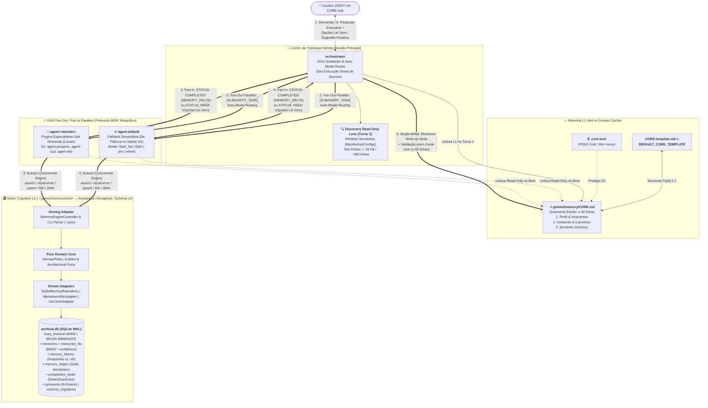
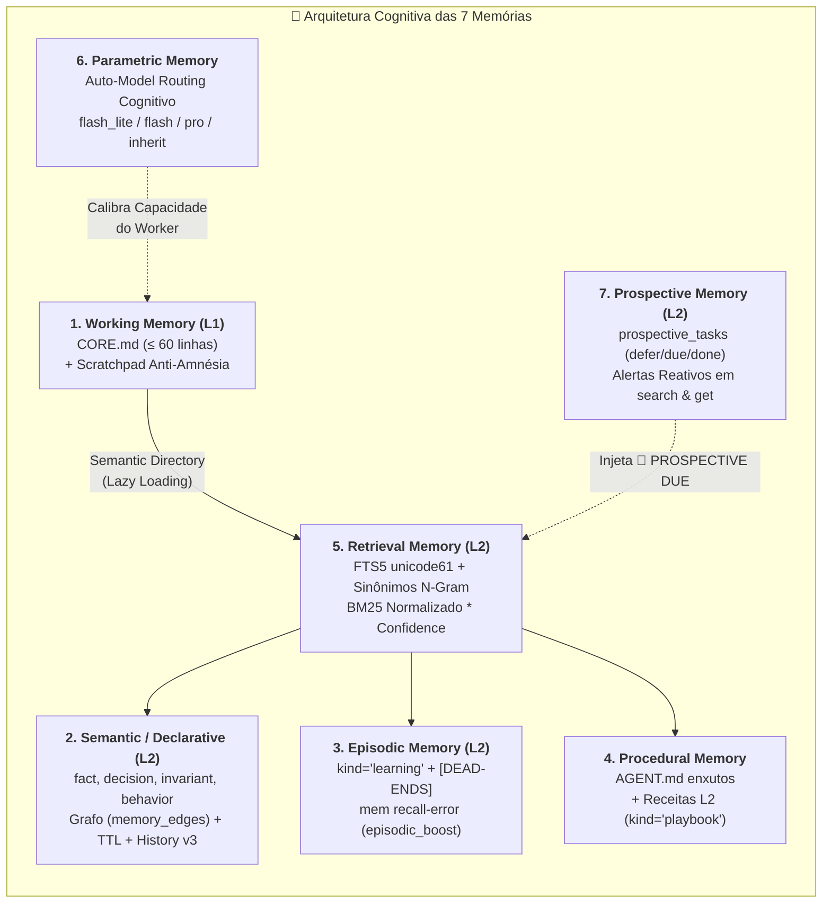
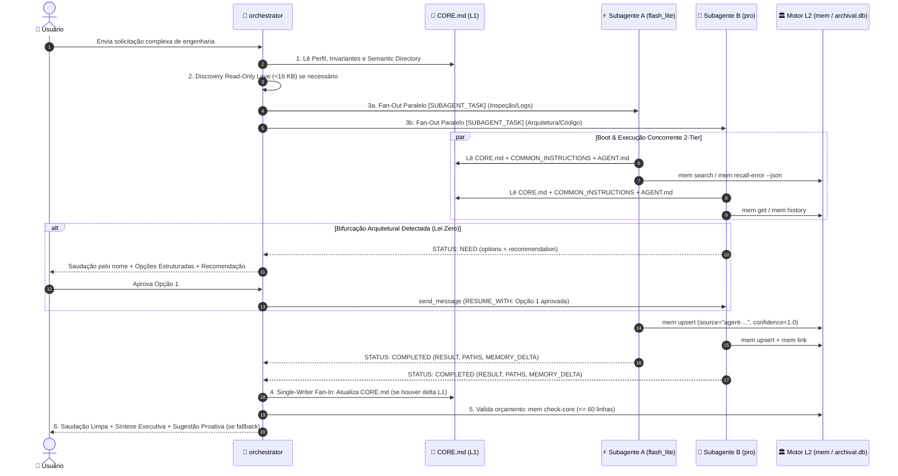

# 🚀 Antigravity: Global Star-Topology Multi-Agent Ecosystem & Hybrid Cognitive Memory Engine

[](#2-pilares-arquiteturais)
[-007ec6?style=flat-square)](#3-arquitetura-cognitiva-híbrida-das-7-memórias)
[](#4-engenharia-interna-do-motor-l2-geminimemorymem)
[-ffd343?style=flat-square)](#4-engenharia-interna-do-motor-l2-geminimemorymem)
[-brightgreen?style=flat-square)](#10-suíte-de-testes-automatizados)

O **Antigravity** é um framework de orquestração multi-agente em **Topologia Estrela Estrita** e um motor de **Memória Cognitiva Híbrida 2-Tier (Schema L2 v3)** projetado para operar nativamente sobre o diretório global `~/.gemini`. Ele transforma sessões isoladas de LLMs em um sistema distribuído determinístico de engenharia de software — combinando escalonamento paralelo em grafos acíclicos direcionados (**DAG Fan-Out / Fan-In**), roteamento cognitivo dinâmico de modelos (**Auto-Model Routing**), governança **Zero Assumptions (Lei Zero)** e persistência transacional concorrente em SQLite WAL + FTS5 sem nenhuma dependência externa.

---

## 📑 Sumário

1. [Proposta de Valor & Filosofia de Engenharia](#1-proposta-de-valor--filosofia-de-engenharia)
2. [Pilares Arquiteturais](#2-pilares-arquiteturais)
3. [Arquitetura Cognitiva Híbrida das 7 Memórias](#3-arquitetura-cognitiva-híbrida-das-7-memórias)
4. [Engenharia Interna do Motor L2 (`~/.gemini/memory/mem`)](#4-engenharia-interna-do-motor-l2-geminimemorymem)
5. [Ciclo de Vida End-to-End (Walkthrough em 4 Fases)](#5-ciclo-de-vida-end-to-end-walkthrough-em-4-fases)
6. [Estrutura do Repositório & Isolamento Git (Starter Kit)](#6-estrutura-do-repositório--isolamento-git-starter-kit)
7. [Instalação, Menor Privilégio & First-Boot Onboarding](#7-instalação-menor-privilégio--first-boot-onboarding)
8. [Ecossistema de Subagentes & Criação de Especialistas (`agent-<domain>`)](#8-ecossistema-de-subagentes--criação-de-especialistas-agent-domain)
9. [Referência Completa da CLI `~/.gemini/memory/mem`](#9-referência-completa-da-cli-geminimemorymem)
10. [Suíte de Testes Automatizados](#10-suíte-de-testes-automatizados)
11. [Governança de Git, Segurança & Invariantes de Código](#11-governança-de-git-segurança--invariantes-de-código)

---

## 1. Proposta de Valor & Filosofia de Engenharia

Assistentes baseados em LLMs convencionais sofrem de quatro falhas estruturais graves quando aplicados a projetos reais de engenharia de software:

| Patologia Clássica de Agentes LLM | Solução de Engenharia do Antigravity |
| :--- | :--- |
| **1. Amnésia Entre Sessões e Repetição de Erros** | **Memória Híbrida 2-Tier + Recall Episódico (`recall-error`):** Cache quente L1 (`CORE.md` $\le 60$ linhas) sempre em contexto pareado com um banco arquival L2 (`archival.db` em SQLite WAL + FTS5) que armazena fatos, decisões, grafos semânticos, versão histórica (`memory_history`) e lições aprendidas (`learning`) contendo obrigatoriamente a seção `[DEAD-ENDS / TENTATIVAS DESCARTADAS]`. |
| **2. Explosão de Contexto e Degradação de Atenção (*Context Rot*)** | **Topologia Estrela + Differential Context Passing (M2M):** O agente principal (`orchestrator`) nunca executa código diretamente nem acumula dumps brutos. Ele decompõe demandas em subtarefas atômicas e injeta nos subagentes exclusivamente os caminhos e invariantes necessários em formato telegráfico livre de ruído. Saídas extensas vão obrigatoriamente para disco (Anti-Amnésia). |
| **3. Race Conditions em Execução Multi-Agente Paralela** | **Single-Writer L1 + Concorrência Transacional L2:** Durante um Fan-Out paralelo, subagentes **jamais** editam `CORE.md`; eles gravam concorrentemente no SQLite L2 (protegido por `WAL`, `busy_timeout=30000` e transações reentrantes `BEGIN IMMEDIATE`) e retornam `MEMORY_DELTA`. Apenas o `orchestrator` atualiza `CORE.md` no Fan-In sob file lock exclusivo (`fcntl`/`msvcrt`). |
| **4. Alucinações Arquiteturais e Decisões Silenciosas** | **Lei Zero Inviolável (Protocolo Zero Assumptions):** Nenhum agente pode assumir requisitos, arquitetura, contratos públicos, adição de bibliotecas ou escopo. Diante de bifurcações técnicas, o subagente interrompe a execução com `STATUS: NEED`, e o `orchestrator` delega a decisão ao usuário com opções estruturadas e recomendação técnica fundamentada. |

---

## 2. Pilares Arquiteturais

### 2.1. Topologia Estrela Estrita (`orchestrator` Central)
O ecossistema proíbe comunicação lateral direta entre subagentes (*mesh* caótico). O **`orchestrator`** ocupa o centro da estrela como único ponto de contato com o usuário e único escalonador de tarefas:
* **Proibição Absoluta de Execução Direta pelo Orquestrador:** O `orchestrator` jamais edita código de projetos, cria queries SQL, executa comandos de terminal de domínio ou manipula containers.
* **Discovery Read-Only Leve no Turno 1 (Whitelist Semântica):** Quando o contexto inicial não informa a estrutura do projeto alvo, o `orchestrator` possui permissão estrita para realizar leitura leve de reconhecimento através de uma *whitelist* semântica — listagem do diretório raiz e leitura de manifestos ou configurações de topo (`package.json`, `pyproject.toml`, `Cargo.toml`, `go.mod`, `docker-compose.yml`, `Makefile`, `README.md`, etc.) respeitando um **teto seguro de `< 16 KB` (~400 linhas)** — exclusivamente para planejar o grafo DAG com precisão. Toda análise profunda e mutação são delegadas aos subagentes.
* **Saudação Obrigatória Limpa (Zero Boot/Status Report):** O `orchestrator` inicia sempre suas respostas saudando o usuário pelo nome registrado em `CORE.md`, sem jamais emitir relatórios robóticos de boot (como *"memória L1 sincronizada"* ou *"diretivas carregadas"*), a menos que explicitamente solicitado.

### 2.2. Decomposição Atômica em DAG & Paralelismo Fan-Out / Fan-In
Toda solicitação complexa é quebrada no maior número possível de **subtarefas atômicas, ortogonais e independentes**:
* **Fan-Out Simultâneo:** Todas as subtarefas com grau de entrada zero (sem dependências pendentes) são disparadas **simultaneamente no mesmo turno** via múltiplas chamadas paralelas a `invoke_subagent`.
* **Reúso Inteligente de Sessão vs. Paralelismo:** Subtarefas concorrentes utilizam instâncias paralelas via `invoke_subagent`; etapas sequenciais no mesmo domínio que se beneficiam do cache de contexto reutilizam o `conversationId` existente via `send_message`.

### 2.3. Auto-Model Routing Cognitivo
Ao invocar subagentes (`invoke_subagent(TypeName="self", Model=...)`), o `orchestrator` seleciona o menor modelo capaz de resolver a subtarefa com excelência, otimizando latência e custo de tokens:

| Parâmetro `Model` | Complexidade Cognitiva | Casos de Uso Ideais |
| :--- | :--- | :--- |
| **`"flash_lite"`** | **Baixa (I/O & Mecânica)** | Leitura de arquivos/configs/logs, listagens de diretórios, `git status`/`diff`, buscas rápidas no banco L2 (`mem search`), checagem de portas e formatação de texto. |
| **`"flash"`** | **Média (Operacional Padrão)** | Implementação de classes/funções delimitadas, testes unitários, scripts de automação, Dockerfiles, queries SQL (DDL/DML) e configurações de build. |
| **`"pro"`** | **Alta (Raciocínio Profundo)** | Arquitetura limpa (Clean Architecture / Ports & Adapters), concorrência crítica e lock-free, otimização severa de performance e debugging arquitetural complexo. |
| **`"inherit"`** | **Fronteira (Gemini 4 Argon)** | Herda o modelo principal da sessão (**Gemini 4 Argon**) para desafios *frontier* extremos ou quando exigido explicitamente pelo usuário. |

### 2.4. Lei Zero Inviolável (Protocolo Zero Assumptions)
Nenhum agente (`orchestrator` ou subagente) pode deduzir ou escolher silenciosamente diante de incertezas em:
1. **Requisitos e Regras de Negócio**
2. **Arquitetura de Software** (camadas, Ports & Adapters, contratos internos)
3. **Contratos Públicos de API e Schemas de Banco de Dados**
4. **Escolha ou Adição de Bibliotecas, Frameworks e Dependências**
5. **Segurança, Permissões e Escopo**

* **Calibragem Operacional:** Detalhes puramente mecânicos ou sintáticos internos que sigam estritamente os princípios SOLID e as convenções já existentes no repositório possuem autonomia técnica e não geram interrupções desnecessárias.
* **Fluxo de Delegação Ativa:** Diante de dúvida ou decisão estrutural, o subagente para imediatamente e emite `STATUS: NEED` (`target_domain: "orchestrator"`) listando `options: ["Opção 1 [Recomendada]", "Opção 2"]` e `recommendation`. O `orchestrator` pausa o fluxo e submete as opções e a recomendação técnica ao usuário, a quem pertence exclusivamente a decisão final.

### 2.5. Regra Single-Writer L1 & Invariante de Sincronia Tripla 1:1
* **Single-Writer de `CORE.md`:** Apenas o `orchestrator` possui permissão de escrita em `~/.gemini/memory/CORE.md` durante o fechamento do turno (*Shutdown Write-on-Delta* no Fan-In), validando obrigatoriamente o orçamento de $\le 60$ linhas via `~/.gemini/memory/mem check-core`.
* **Invariante de Sincronia Tripla 1:1 (`core-template-sync-invariant`):** Sempre que `~/.gemini/memory/CORE.template.md` for atualizado, o `orchestrator` deve atualizar no mesmo turno `~/.gemini/memory/CORE.md` e a constante `DEFAULT_CORE_TEMPLATE` dentro de `~/.gemini/memory/mem` (e vice-versa), garantindo paridade estrita linha a linha (variando unicamente nos placeholders `{{USER_NAME}}`, `{{USER_LANG}}` e `{{DEFAULT_WORKSPACE}}`).
* **SSOT de Identidade:** Dados pessoais do usuário (nome, idioma, caminhos de projetos privados) residem exclusivamente em `CORE.md` e no registro `global:user-profile` do banco L2 (`archival.db`), sendo proibido hardcodá-los em arquivos procedimentais versionados (`GEMINI.md`, `COMMON_INSTRUCTIONS.md`, `AGENT.md`, `README.md`).

### 2.6. Protocolo M2M Telegráfico (Differential Context Passing)
A comunicação Máquina $\leftrightarrow$ Máquina elimina 100% de preâmbulos conversacionais:

````carousel
```markdown
# 1. Disparo de Subtarefa Atômica (orchestrator -> Subagente)
[SUBAGENT_TASK]
AGENT_ID: <agent-<domain> | agent-default>
AGENT_DEF: ~/.gemini/agents/<agent-id>/AGENT.md
ATOMIC_GOAL: <Objetivo único, direto e verificável>
CONTEXT: <Apenas paths, snippets e invariantes estritamente necessários>
```
<!-- slide -->
```yaml
# 2. Escalação de Dúvida / Dependência (Subagente -> orchestrator)
STATUS: NEED
AGENT: <meu-agent-id>
NEEDS:
  - target_domain: "<domain | default | orchestrator>"
    atomic_goal: "<Ação necessária de outro domínio OU dúvida/decisão a delegar ao usuário>"
    context: "<Paths, código, tabelas ou cenário técnico>"
    options: ["<Opção 1 [Recomendada]>", "<Opção 2>"] # Obrigatório para dúvidas/decisões
    recommendation: "<Fundamentação técnica objetiva da opção recomendada>"
RESUME_WITH: "<Dado ou decisão exata necessária para prosseguir>"
```
<!-- slide -->
```yaml
# 3. Conclusão de Subtarefa (Subagente -> orchestrator)
STATUS: COMPLETED
AGENT: <meu-agent-id>
RESULT: "<Síntese técnica densa e direta do que foi executado/validado>"
PATHS: ["<caminhos absolutos criados/modificados/inspecionados>"]
MEMORY_DELTA: "<none | namespace/topic gravado no L2 via mem upsert/link/defer>"
```
````

### 2.7. Dynamic Specialist Plugin Registry & Sugestão Proativa Calibrada
Subagentes especialistas (`~/.gemini/agents/agent-<domain>/AGENT.md`) funcionam como plugins dinâmicos indexados na Seção 3 (`Semantic Directory`) de `CORE.md`.
* **Invariante de Sugestão Proativa Calibrada (`proactive-specialist-suggestion`):** Em **100% das vezes** em que o `orchestrator` recorrer ao fallback `agent-default` para atender a um domínio de engenharia recorrente, stack arquitetural ou workflow especializado ausente no `Semantic Directory` de `CORE.md`, o `orchestrator` é **obrigado** a incluir na mesma resposta final ao usuário uma proposta estruturada de criação do especialista dedicado (`agent-<domain>`), especificando:
  1. **Nome do Agente:** `agent-<domain>`
  2. **Caminho:** `~/.gemini/agents/agent-<domain>/AGENT.md`
  3. **Escopo e Invariantes do Domínio**
  4. **Namespace L2 Primário:** `<domain>`
* *Calibragem Anti-Fadiga:* Essa sugestão é dispensada apenas em operações utilitárias triviais ou efêmeras (como leitura de arquivo avulso ou comando shell pontual).

### 2.8. Diagrama Arquitetural Completo



---

## 3. Arquitetura Cognitiva Híbrida das 7 Memórias

Inspirada na convergência entre arquiteturas cognitivas modernas (*Letta/MemGPT, CoALA, Mem0 e Zep/Graphiti*), a camada de persistência do Antigravity divide o conhecimento em **2 Tiers físicos** e **7 subsistemas cognitivos especializados**:



### 3.1. Working Memory (Memória de Trabalho L1 + Scratchpad Físico Anti-Amnésia)
* **Cache Quente L1 (`~/.gemini/memory/CORE.md`):** Mantido sob orçamento rigoroso de **$\le 60$ linhas** (auditado via `mem check-core`, configurável por `--max-lines` ou pela variável de ambiente `ANTIGRAVITY_CORE_MAX_LINES`). Estruturado em 3 seções fixas:
  1. *Perfil & Invariantes Globais do Usuário (SSOT de Identidade)*
  2. *Ambiente Ativo & Caminhos-Chave*
  3. *Semantic Directory (Ponteiros L2 & Plugins Especialistas)*
* **Persistência Física Anti-Amnésia:** É proibido truncar ou resumir saídas volumosas no chat. Qualquer processamento extenso, log ou diff longo deve ser gravado integralmente em arquivo físico (ex: `output_full.txt` ou `.task_context`) e ter seu caminho absoluto retornado no array `PATHS` do payload M2M.

### 3.2. Semantic & Declarative Memory (Memória Semântica, Grafo, Proveniência & Versionamento L2 v3)
Reside na tabela `memories` do SQLite L2 (`archival.db`) organizada por `namespace` (`<domain>` ou `proj:<repo>`) e `topic`:
* **Tipos Declarativos (`kind`):**
  * `fact`: Fatos objetivos, versões, portas, caminhos e configurações (recebe **TTL padrão de 30 dias** automaticamente se `--ttl` for omitido).
  * `decision`: Decisões arquiteturais e técnicas aprovadas (ADRs enxutos, TTL infinito por padrão).
  * `invariant`: Regras técnicas invioláveis e restrições permanentes do domínio.
  * `behavior`: Heurísticas operacionais e preferências de execução.
* **Semantic Freshness (TTL & Revalidação):** Registros com `ttl_days` definido são monitorados continuamente. Quando $\text{elapsed\_days} > \text{ttl\_days}$, leituras via `search`, `get` ou `recall-error` emitem automaticamente o alerta:
  `⚠️ STALE MEMORY (verificada há Xd, TTL=Yd — revalide no ambiente e rode 'mem verify <ns> "<topic>"')`.
* **Grafo Semântico Direcionado (`memory_edges`):** Tópicos são conectados por arestas tipadas (`DEPENDS_ON`, `RELATES_TO`, `SUPERSEDES`, etc.) via `mem link`, com exclusão em cascata (`ON DELETE CASCADE`) e exibição bidirecional (`out` `--(REL)-->` e `in` `<--(REL)--`) no comando `mem get`.
* **Versionamento Automático, Proveniência & Soft-Delete (Schema v3):**
  * Cada registro possui `version` (iniciado em `1` e auto-incrementado a cada `upsert` ou `import-md`), `source` (identificador do agente ou autor, ex: `--source "agent-default"`) e `confidence` (fator de confiança no intervalo $[0.0, 1.0]$).
  * Antes de qualquer atualização ou soft-delete, o estado anterior completo é arquivado de forma imutável na tabela **`memory_history`**, auditável via `mem history <ns> "<topic>" [--json]`.
  * O comando `mem delete <ns> "<topic>"` executa **soft-delete por padrão** (preenchendo `deleted_at` e removendo a entrada do índice FTS5 ativo sem perder o registro ou seu histórico), permitindo recuperação imediata via `mem restore <ns> "<topic>"`. A remoção física ocorre apenas quando `--hard` é explicitamente informado.
* **Interoperabilidade Wiki Markdown (`export-md` / `import-md`):** Exporta e importa todo o banco L2 (incluindo metadados v3 e arestas do grafo convertidas em WikiLinks `[[ns/topic]]`) para arquivos Markdown compatíveis com Obsidian/Logseq e índice `INDEX.md`. Para evitar colisões de nomes em tópicos que diferem apenas por pontuação ou caixa, o `MarkdownWikiAdapter` aplica um sufixo determinístico de **6 caracteres hexadecimais SHA-256** (`<slug>_<sha256[:6]>.md`).

### 3.3. Episodic Memory (Memória Episódica & Diagnóstico de Erros)
* **Registros `kind='learning'` com Dead-Ends Obrigatórios:** Toda lição aprendida após a resolução de um bug ou problema complexo deve conter a seção **`[DEAD-ENDS / TENTATIVAS DESCARTADAS]`**, documentando o que falhou e por quê, evitando que futuros agentes repitam hipóteses inválidas.
* **Motor `mem recall-error "<snippet_ou_stacktrace>"`:**
  1. Extrai palavras alfanuméricas ($\ge 3$ caracteres) do stacktrace ou mensagem de erro.
  2. Realiza *split* automático de identificadores `CamelCase` (`CAMEL_CASE_SPLIT`) e `snake_case`, preservando tanto o token composto quanto suas partes elementares.
  3. Filtra ruídos contra um conjunto estrito de **46 `ERROR_STOPWORDS`** de linguagens e runtimes (`error`, `exception`, `traceback`, `null`, `java`, `lang`, `runtime`, `function`, `method`, etc.).
  4. Ordena os candidatos por especificidade (comprimento decrescente `(-len(x), x)`), seleciona até **24 termos** e executa a busca FTS5 com **`prioritize_episodic=True`**, ativando a coluna calculada `episodic_boost = 1` para posicionar registros `learning` e `playbook` no topo absoluto dos resultados.

### 3.4. Procedural Memory (Memória Procedural)
Dividida em duas camadas complementares:
1. **Instruções Estáticas Enxutas (`AGENT.md`):** Definições de papéis, fronteiras de domínio e invariantes operacionais em `~/.gemini/agents/<agent-id>/AGENT.md`.
2. **Playbooks Dinâmicos (`kind='playbook'` no L2):** Receitas passo a passo reutilizáveis (procedimentos de build, migrações, deploys, checklists de diagnóstico) gravadas e versionadas no banco `archival.db`.

### 3.5. Retrieval Memory (Motor de Busca Híbrida FTS5, Sinônimos N-Gram & Ranking BM25)
* **Indexação Léxica Diacrítico-Insensível:** Utiliza a tabela virtual `memories_fts` com `fts5(..., content='memories', content_rowid='id', tokenize='unicode61 remove_diacritics 2')`. Termos simples de no mínimo 2 caracteres (`MIN_TOKEN_LENGTH = 2`) recebem busca por prefixo (`"termo"*`), enquanto frases ou termos entre aspas duplas realizam busca exata (`"termo"`).
* **Expansão Dinâmica de Sinônimos (1-Gram, 2-Gram e 3-Gram):** Antes de consultar o FTS5, `DomainPolicy.build_fts_query` analisa a query completa, trigramas, bigramas e unigramas contra a tabela `synonyms` (pré-populada no boot com **12 grupos de sinônimos técnicos** `DEFAULT_SYNONYM_GROUPS`, como `k8s` $\leftrightarrow$ `kubernetes`, `loom` $\leftrightarrow$ `virtual threads`, `hexagonal` $\leftrightarrow$ `ports and adapters` $\leftrightarrow$ `clean architecture`, `postgres` $\leftrightarrow$ `postgresql` $\leftrightarrow$ `psql`, etc., e extensível via `mem syn add`).
* **Fórmula Matemática de Ranking Híbrido (BM25 Normalizado + Hits + Confiança + Decaimento Temporal):**
  Como a função nativa `bm25()` do SQLite FTS5 retorna valores negativos (onde valores mais negativos indicam maior relevância), multiplicá-la diretamente por fatores de boost inverteria a ordenação. O motor `mem` normaliza o score invertendo seu sinal (`-1.0 * bm25(...)`) com piso `0.0001`, aplica pesos diferenciados por coluna (`topic=5.0`, `content=1.0`, `tags=3.0`, `namespace=0.5`), escala logaritmicamente/linearmente pelos acessos (`access_count` com teto em 30 hits), pondera pelo fator `confidence` do Schema v3 e aplica decaimento temporal suave em dias:

$$\text{relevance\_score} = \frac{\max\left(0.0001,\; -1.0 \times \text{bm25}(\text{memories\_fts},\; 5.0,\; 1.0,\; 3.0,\; 0.5)\right) \times \left(1.0 + 0.15 \times \min(\text{access\_count},\; 30)\right) \times \text{confidence}}{1.0 + 0.02 \times \max\left(0.0,\; \text{julianday}(\text{'now'}) - \text{julianday}(\text{updated\_at})\right)}$$

> [!NOTE]
> Toda leitura bem-sucedida via `mem get`, `mem search` ou `mem recall-error` incrementa transacionalmente o contador `access_count` dos registros retornados, retroalimentando a relevância dos conhecimentos mais úteis e habilitando sua promoção para o `CORE.md` via `mem promote`.

### 3.6. Parametric Memory (Memória Paramétrica via Auto-Model Routing)
Trata a capacidade intrínseca dos diferentes pesos de modelos (`flash_lite`, `flash`, `pro`, `inherit` / **Gemini 4 Argon**) como um recurso cognitivo roteável por subtarefa pelo `orchestrator` (conforme detalhado na [Seção 2.3](#23-auto-model-routing-cognitivo)).

### 3.7. Prospective Memory (Memória Prospectiva & Gatilhos Assíncronos)
Gerenciada na tabela `prospective_tasks` através dos comandos `mem defer`, `mem due` e `mem done`:
* Permite que qualquer subagente agende lembretes técnicos ou ações futuras atreladas a uma condição de disparo (`trigger_cond`) dentro de um `namespace`.
* **Injeção Reativa Automática:** Sempre que um agente executa `mem search` ou `mem get` (em modo texto padrão) sobre um namespace que possui tarefas prospectivas com `status = 'pending'`, o controlador injeta automaticamente no topo da saída o alerta:
  `🔔 PROSPECTIVE DUE [<namespace>]: #<id> [<trigger_cond>] -> <action>`
* Tarefas pendentes também são consolidadas e reportadas globalmente na auditoria `mem check-core`.

---

## 4. Engenharia Interna do Motor L2 (`~/.gemini/memory/mem`)

O executável [`~/.gemini/memory/mem`](memory/mem) (~2.600 linhas) foi desenhado como um binário Python 3 autocontido (**zero dependências externas**, utilizando exclusivamente a biblioteca padrão: `argparse`, `contextlib`, `hashlib`, `json`, `os`, `re`, `sqlite3`, `sys`, `dataclasses`, `datetime`, `typing`, `fcntl`/`msvcrt`), estruturado rigorosamente segundo **Clean Architecture (Ports & Adapters)** e os princípios **SOLID**.

### 4.1. Camadas da Arquitetura Hexagonal em Arquivo Único

| Seção Arquitetural no Código | Componentes Principais | Responsabilidade Estrita |
| :--- | :--- | :--- |
| **1. Domain Exceptions & Entities** | `DomainValidationError`, `ResourceNotFoundError`, `MemoryRecord`, `MemoryHistoryRecord`, `SemanticEdge`, `ProspectiveTask`, `NamespaceStat`, `StorageStats`, `WikiDocument` | Objetos de valor imutáveis (`@dataclass(frozen=True, slots=True)`) e exceções semânticas de negócio sem acoplamento de I/O. |
| **2. Architectural Ports** | `ClockPort`, `MemoryRepositoryPort` (`typing.Protocol`) | Contratos abstratos (Interfaces) que invertem a dependência (DIP) entre as regras de negócio/controlador e a infraestrutura física. |
| **3. Pure Domain Policies** | `DomainPolicy` | Validação de namespaces (`^[a-z0-9][a-z0-9_-]*$` ou `^proj:[a-zA-Z0-9._-]+$`), `VALID_KINDS`, `confidence` ($[0.0, 1.0]$), parsing de TTL, cálculo de *staleness*, construção de queries FTS5 com n-grams de sinônimos e tokenização de stacktraces. |
| **4. Driven Adapters (Infra)** | `file_lock`, `immediate_transaction`, `UtcClockAdapter`, `SqliteMemoryRepository`, `MarkdownWikiAdapter` | Persistência SQLite WAL + FTS5, migrações automáticas de schema, bloqueio de arquivo cross-platform e parser resiliente de YAML Frontmatter / WikiLinks. |
| **5. Driving Adapter (App/CLI)** | `MemoryEngineController`, `build_parser`, `main` | Orquestração de casos de uso, formatação de saída dual (Humana ou JSON estruturado via `--json`) e tratamento limpo de erros na borda (`sys.exit(1)` sem expor tracebacks brutos ao agente). |

### 4.2. Controle de Concorrência, Transações Reentrantes & File Locking
Para suportar dezenas de subagentes executando em paralelo durante um Fan-Out do DAG sem erros de `SQLITE_BUSY` ou corrupção de arquivos:
1. **Pragmas de Alta Concorrência:** Na abertura de cada conexão, `SqliteMemoryRepository._get_conn()` aplica:
   * `PRAGMA busy_timeout=30000;` (30 segundos de espera ativa em contenção de escrita)
   * `PRAGMA journal_mode=WAL;` (*Write-Ahead Logging* permitindo leituras paralelas sem bloqueio durante escritas)
   * `PRAGMA synchronous=NORMAL;`, `PRAGMA temp_store=MEMORY;` e `PRAGMA foreign_keys=ON;`
2. **Context Manager Reentrante `immediate_transaction(conn)`:** Utiliza conexões em modo `isolation_level=None` (autocommit nativo do driver) e gerencia transações explicitamente com `BEGIN IMMEDIATE;`. Ao verificar `is_outer = not conn.in_transaction`, permite composição segura de métodos internos com commit/rollback atômico apenas no escopo mais externo.
3. **File Lock Cross-Platform (`file_lock`):** Operações sobre `CORE.md` (`init` e `check-core`) adquirem um lock exclusivo de sistema operacional sobre `~/.gemini/memory/.core.lock`, utilizando `fcntl.flock(fd, fcntl.LOCK_EX)` em sistemas POSIX (Linux/macOS) e `msvcrt.locking(fd, msvcrt.LK_LOCK, 1)` no Windows (`nt`).
4. **Hot Backup Online (`mem backup`):** Utiliza a API nativa `sqlite3.Connection.backup()` para copiar páginas do banco de forma transacionalmente consistente para `~/.gemini/memory/backups/archival_<timestamp>.db` (ou caminho customizado) sem interromper escritas concorrentes.

### 4.3. Máquina de Estados dos Triggers FTS5 External Content (Guarda de 5 Transições)
A tabela virtual `memories_fts` utiliza `content='memories'` (*External Content Table*) para evitar duplicação de texto no disco. No SQLite FTS5, emitir o comando `'delete'` na tabela virtual para um `rowid` que já havia sido removido em um soft-delete anterior **não é idempotente** — isso gera inconsistência na B-Tree invertida e corrompe o banco com `SQLITE_CORRUPT (database disk image is malformed)`.

Para resolver isso matematicamente, os triggers `memories_ai`, `memories_ad` e `memories_au` implementam uma **Máquina de Estados Determinística com Guarda Dupla** (`WHERE old.deleted_at IS NULL` e `WHERE new.deleted_at IS NULL`):

```sql
CREATE TRIGGER IF NOT EXISTS memories_au
AFTER UPDATE OF topic, content, tags, namespace, deleted_at ON memories BEGIN
    -- Só remove do índice FTS5 se o estado ANTERIOR estava ATIVO:
    INSERT INTO memories_fts(memories_fts, rowid, topic, content, tags, namespace)
    SELECT 'delete', old.id, old.topic, old.content, old.tags, old.namespace
    WHERE old.deleted_at IS NULL;

    -- Só insere no índice FTS5 se o estado NOVO permanece/passa a ser ATIVO:
    INSERT INTO memories_fts(rowid, topic, content, tags, namespace)
    SELECT new.id, new.topic, new.content, new.tags, new.namespace
    WHERE new.deleted_at IS NULL;
END;
```

Esta guarda cobre com 100% de segurança todas as **5 transições de estado possíveis**:
1. **Criação (`None` $\rightarrow$ `Ativo`):** `memories_ai` insere no FTS5 (`WHEN new.deleted_at IS NULL`).
2. **Atualização Ativa (`Ativo` $\rightarrow$ `Ativo`):** `memories_au` remove os termos antigos (`old.deleted_at IS NULL`) e indexa os novos (`new.deleted_at IS NULL`).
3. **Soft-Delete (`Ativo` $\rightarrow$ `Soft-Deleted`):** `memories_au` remove os termos antigos do FTS5 (`old.deleted_at IS NULL`) e omite a reinserção (`new.deleted_at IS NOT NULL`).
4. **Mutação de Registro Arquivado (`Soft-Deleted` $\rightarrow$ `Soft-Deleted`):** `memories_au` opera como **NO-OP** puro (nenhum `SELECT` retorna linhas), prevenindo dupla deleção e corrupção da B-Tree.
5. **Reativação via `restore` ou `upsert` (`Soft-Deleted` $\rightarrow$ `Ativo`):** `memories_au` omite a deleção (`old.deleted_at IS NOT NULL`) e indexa apenas o novo estado ativo (`new.deleted_at IS NULL`).

---

## 5. Ciclo de Vida End-to-End (Walkthrough em 4 Fases)



1. **Fase 1 — Boot L1 & Discovery Leve (Turno 1):** O `orchestrator` recebe a mensagem do usuário, lê `~/.gemini/memory/CORE.md` para identificar o nome do usuário, seus invariantes e os especialistas disponíveis no `Semantic Directory`. Se precisar reconhecer a estrutura do repositório alvo, lê apenas manifestos de topo dentro da whitelist semântica (`< 16 KB`).
2. **Fase 2 — Decomposição DAG, Auto-Model Routing & Lei Zero:** O `orchestrator` divide o problema em subtarefas ortogonais, seleciona o `Model` ideal (`flash_lite`, `flash`, `pro` ou `inherit`) e dispara múltiplos subagentes em paralelo com o cabeçalho `[SUBAGENT_TASK]`. Se surgir qualquer dúvida de negócio, contrato ou arquitetura, o fluxo pausa via `STATUS: NEED` e consulta o usuário com opções e recomendação técnica.
3. **Fase 3 — Execução 2-Tier & Persistência L2 Concorrente:** Cada subagente realiza o boot enxuto lendo em paralelo `CORE.md`, `COMMON_INSTRUCTIONS.md` e seu `AGENT.md`. Consulta o L2 sob demanda (`mem search`, `mem get` ou `mem recall-error` diante de falhas), executa sua tarefa estritamente dentro do domínio, grava novos aprendizados no L2 (`mem upsert` com `--source` e `--confidence`) sem tocar no `CORE.md`, e retorna `STATUS: COMPLETED` informando `MEMORY_DELTA` e `PATHS`.
4. **Fase 4 — Fan-In Single-Writer, Auditoria `check-core` & Resposta Final:** O `orchestrator` consolida os resultados, atualiza o `CORE.md` se houver novos ponteiros estruturais (mantendo a sincronia tripla 1:1 caso altere o template), executa `mem check-core` para atestar o limite de $\le 60$ linhas e entrega a resposta iniciando com a saudação limpa pelo nome do usuário (incluindo sugestão proativa de novo `agent-<domain>` caso tenha ocorrido fallback para `agent-default` em domínio especializado).

---

## 6. Estrutura do Repositório & Isolamento Git (Starter Kit)

O arquivo [`.gitignore`](.gitignore) adota uma política **Default-Deny (`*`) com Whitelist Explícita**, separando rigorosamente o **Starter Kit Portável** (versionado no Git — que inclui de fábrica **apenas** os agentes `orchestrator` e `agent-default`) do **Estado Local e Privado do Usuário** (ignorado pelo Git, incluindo o banco de dados, `CORE.md` e quaisquer especialistas `agent-<domain>` criados sob demanda):

```text
~/.gemini/
├── .gitignore                        # ✅ [Versionado - Starter Kit] Regra '*' + Whitelist estrita do Starter Kit
├── GEMINI.md                         # ✅ [Versionado - Starter Kit] Constituição Global (Lei Zero, Estrela, M2M, 7 Memórias)
├── README.md                         # ✅ [Versionado - Starter Kit] Documentação Arquitetural e Operacional Completa
│
├── agents/
│   ├── COMMON_INSTRUCTIONS.md        # ✅ [Versionado - De Fábrica] Protocolo compartilhado 2-Tier, CLI mem e M2M
│   ├── orchestrator/
│   │   └── AGENT.md                  # ✅ [Versionado - De Fábrica] Escalonador DAG, Auto-Model Router e Single-Writer L1
│   ├── agent-default/
│   │   └── AGENT.md                  # ✅ [Versionado - De Fábrica] Subagente Generalista Executor (Fallback & Bootstrap)
│   └── agent-<domain>/               # 🔒 [Ignorado - Local] Plugins especialistas criados sob demanda pelo usuário
│       └── AGENT.md                  #    (Exemplos ilustrativos: agent-postgres, agent-rust, agent-k8s)
│
├── memory/
│   ├── mem                           # ✅ [Versionado - Starter Kit] Motor Cognitivo L2 Hexagonal em Python 3 (Schema v3)
│   ├── CORE.template.md              # ✅ [Versionado - Starter Kit] Template canônico da Memória Quente L1 (<= 60 linhas)
│   ├── tests/
│   │   └── test_mem.py               # ✅ [Versionado - Starter Kit] Suíte com 32 testes automatizados (unittest stdlib)
│   ├── CORE.md                       # 🔒 [Ignorado - Local] Cache L1 renderizado com a identidade real do usuário
│   ├── .core.lock                    # 🔒 [Ignorado - Local] Lockfile cross-platform de exclusão mútua do CORE.md
│   ├── archival.db                   # 🔒 [Ignorado - Local] Banco SQLite WAL + FTS5 local ( + -wal / -shm )
│   ├── backups/                      # 🔒 [Ignorado - Local] Snapshots online gerados por 'mem backup'
│   └── wiki/                         # 🔒 [Ignorado - Local] Exportações Markdown geradas por 'mem export-md'
│
└── antigravity-cli/                  # 🔒 [Ignorado - Local] Configurações locais do cliente CLI (settings.json)
```

---

## 7. Instalação, Menor Privilégio & First-Boot Onboarding

### 7.1. Requisitos de Sistema
* **Sistema Operacional:** Linux, macOS ou Windows.
* **Runtime:** `python3` ($\ge 3.10$) com o módulo padrão `sqlite3` compilado com suporte à extensão **FTS5** (habilitado por padrão nas distribuições modernas de Python 3).
* **Dependências Externas (`pip`):** **Nenhuma** (Zero dependências).

### 7.2. Instalação Rápida
```bash
# 1. Clone o Starter Kit diretamente em ~/.gemini (ou copie os arquivos para lá)
git clone <url-do-repositorio> ~/.gemini

# 2. Garanta permissão de execução para a CLI do motor de memória L2
chmod +x ~/.gemini/memory/mem

# 3. Execute a suíte de testes para validar o ambiente Python + SQLite FTS5
python3 -m unittest discover -s ~/.gemini/memory/tests/ -v
```

### 7.3. Configuração de Menor Privilégio (`~/.gemini/antigravity-cli/settings.json`)
Para que o `orchestrator` e os subagentes leiam/gravem memórias técnicas sem fricção e operem com o modelo de fronteira padrão (**Gemini 4 Argon**), configure as permissões explícitas em `~/.gemini/antigravity-cli/settings.json` (substituindo `<seu_usuario>` pelo seu usuário do sistema):

```json
{
  "allowNonWorkspaceAccess": true,
  "model": "Gemini 4 Argon (Medium)",
  "permissions": {
    "allow": [
      "read_file(/home/<seu_usuario>/.gemini/memory)",
      "write_file(/home/<seu_usuario>/.gemini/memory)",
      "read_file(/home/<seu_usuario>/.gemini/agents)",
      "write_file(/home/<seu_usuario>/.gemini/agents)",
      "read_file(/home/<seu_usuario>/.gemini/GEMINI.md)",
      "write_file(/home/<seu_usuario>/.gemini/GEMINI.md)",
      "command(/home/<seu_usuario>/.gemini/memory/mem)",
      "command(ls)",
      "command(grep)",
      "command(wc)"
    ]
  },
  "trustedWorkspaces": [
    "/home/<seu_usuario>/.gemini",
    "/home/<seu_usuario>/.gemini/memory",
    "/home/<seu_usuario>/.gemini/agents"
  ]
}
```

### 7.4. First-Boot Onboarding (2 Modos)

#### Opção A: Onboarding Interativo Automático via Chat
Ao iniciar a primeira conversa quando `CORE.md` ainda não existe ou contém `Usuário: [UNCONFIGURED]`, o `orchestrator` executa automaticamente o **First-Boot Onboarding Protocol**:
1. Aciona o `agent-default` para inicializar a infraestrutura (`~/.gemini/memory/mem init`).
2. Pergunta ao usuário seu **Nome de exibição**, **Idioma preferido** e **Workspace padrão**.
3. Renderiza `~/.gemini/memory/CORE.md` e grava o registro `global:user-profile` no banco L2.

#### Opção B: Onboarding Direto via Terminal (CLI)
Você pode inicializar o banco `archival.db` (populando os 8 registros fundacionais do namespace `global` e suas arestas semânticas) e gerar o `CORE.md` em um único comando:

```bash
~/.gemini/memory/mem init \
  --user "SeuNome" \
  --lang "pt-BR" \
  --workspace "/home/<seu_usuario>/workspace" \
  --force
```

### 7.5. Variáveis de Ambiente Suportadas pelo Motor `mem`
O motor `~/.gemini/memory/mem` permite sobrescrever seus caminhos e limites via variáveis de ambiente (útil para isolamento de testes ou workspaces customizados):

| Variável de Ambiente | Valor Padrão | Descrição |
| :--- | :--- | :--- |
| `ANTIGRAVITY_DB_PATH` | `~/.gemini/memory/archival.db` | Caminho absoluto do arquivo de banco SQLite L2. |
| `ANTIGRAVITY_CORE_PATH` | `~/.gemini/memory/CORE.md` | Caminho absoluto do arquivo de Memória Quente L1. |
| `ANTIGRAVITY_CORE_TEMPLATE_PATH` | `~/.gemini/memory/CORE.template.md` | Caminho do template base usado pelo comando `mem init`. |
| `ANTIGRAVITY_CORE_LOCK_PATH` | `~/.gemini/memory/.core.lock` | Caminho do arquivo de lock exclusivo cross-platform. |
| `ANTIGRAVITY_CORE_MAX_LINES` | `60` | Orçamento máximo de linhas validado por `mem check-core`. |

---

## 8. Ecossistema de Subagentes & Criação de Especialistas (`agent-<domain>`)

Apenas **dois agentes vêm de fábrica no Starter Kit versionado no Git**: o **`orchestrator`** e o **`agent-default`**. Todos os demais subagentes especialistas (`~/.gemini/agents/agent-<domain>/AGENT.md`) funcionam como **Plugins Especialistas Dinâmicos criados sob demanda pelo usuário** (e permanecem ignorados no Git via `.gitignore` para preservar a customização local de cada ambiente).

### 8.1. Tabela de Agentes do Ecossistema (De Fábrica vs. Plugins Sob Demanda)

| ID do Agente | Caminho da Definição | Status no Starter Kit (`.gitignore`) | Namespace L2 Primário | Papel e Escopo Operacional |
| :--- | :--- | :--- | :--- | :--- |
| **`orchestrator`** | [`~/.gemini/agents/orchestrator/AGENT.md`](agents/orchestrator/AGENT.md) | ✅ **De Fábrica (Versionado)** | `global` | **Agente Default da Sessão Principal:** Escalonador DAG, Auto-Model Router cognitivo, Discovery Read-Only Leve (`< 16 KB`), Single-Writer exclusivo do `CORE.md` e interface executiva com o usuário. |
| **`agent-default`** | [`~/.gemini/agents/agent-default/AGENT.md`](agents/agent-default/AGENT.md) | ✅ **De Fábrica (Versionado)** | `default` *(ou `proj:<repo>`)* | **Subagente Generalista Executor:** Fallback para domínios sem especialista dedicado (Shell, Git, Linux, Python, automação, Web Search), bootstrap de novos especialistas e First-Boot Onboarding. |
| **`agent-<domain>`**<br/>*(Exemplos ilustrativos: `agent-postgres`, `agent-rust`, `agent-k8s`)* | `~/.gemini/agents/agent-<domain>/AGENT.md` | 🔒 **Plugin Criado Sob Demanda pelo Usuário (Ignorado no Git)** | `<domain>` *(ex: `postgres`, `rust`, `k8s`)* | **Plugins Especialistas Dinâmicos:** Criados sob demanda (via sugestão proativa calibrada do `orchestrator` ou manualmente) para isolar invariantes profundas de uma stack, linguagem ou arquitetura recorrente. |

### 8.2. Modo 1: Criação Automática via Sugestão Proativa Calibrada
1. Você solicita uma tarefa de um domínio recorrente ainda não registrado no `CORE.md` (exemplos ilustrativos: otimizar queries em PostgreSQL, criar um serviço em Rust ou configurar manifests Kubernetes).
2. O `orchestrator` delega a execução imediata para o fallback de fábrica `agent-default` (para não bloquear sua entrega) e, ao final da resposta, apresenta a **Sugestão Proativa de Especialista** propondo a criação do plugin local (ex: `agent-postgres`, `agent-rust`, `agent-k8s`).
3. Ao receber seu *"Sim / Pode criar"*, o `orchestrator` delega ao `agent-default` a criação de `~/.gemini/agents/agent-<domain>/AGENT.md`, inicializa o namespace `<domain>` no L2 e registra o novo ponteiro no `Semantic Directory` de `CORE.md` (validando `mem check-core`).

### 8.3. Modo 2: Criação Manual Passo a Passo (Padrão Schema L2 v3)
Para criar manualmente um plugin especialista local (ex: `agent-postgres`):

**Passo 1:** Crie o arquivo `~/.gemini/agents/agent-<domain>/AGENT.md` seguindo o padrão enxuto compatível com o **Schema L2 v3** (herdando a Lei Zero e as instruções compartilhadas por referência DRY, idêntico ao padrão de [`agents/agent-default/AGENT.md`](agents/agent-default/AGENT.md)):

```markdown
# 🧩 Subagente Especialista em <Domínio> (`agent-<domain>`)

> **ID:** `agent-<domain>` | **Namespace L2 Primário:** `<domain>` (ou `proj:<repo>` para projetos locais)
> **Escopo:** <Descrição concisa das responsabilidades exclusivas do especialista e o que deve ser delegado a outros agentes>.
> **Constituição:** Herda integralmente a Lei Zero e normas de [`~/.gemini/GEMINI.md`](~/.gemini/GEMINI.md) e [`~/.gemini/agents/COMMON_INSTRUCTIONS.md`](~/.gemini/agents/COMMON_INSTRUCTIONS.md).

---

## 🛠️ Diretrizes Operacionais de Execução

1. **Herança da Lei Zero (Zero Assumptions):**
   * **NUNCA SUPOR NADA.** Diante de qualquer incerteza, ambiguidade de requisitos, decisões de arquitetura/negócio ou múltiplos caminhos viáveis, pare imediatamente.
   * Emita `STATUS: NEED` com `target_domain: "orchestrator"` expondo as opções identificadas (`Opção 1 [Recomendada]`, `Opção 2`) e recomendação técnica fundamentada para deliberação do usuário.
2. **Proibição Absoluta de Git Commit/Push Autônomo:**
   * Jamais execute `git commit` ou `git push` sem autorização prévia e expressa do usuário no turno atual.
3. **Invariantes Técnicas Específicas do Domínio (`<domain>`):**
   * <Invariante 1 específica do domínio>
   * <Invariante 2 específica do domínio>
4. **Engenharia de Software Rigorosa (SOLID & Clean Architecture):**
   * Todo código escrito ou refatorado deve obedecer estritamente a **SOLID**, **Clean Architecture / Ports & Adapters**, tipagem estrita e tratamento explícito de erros.
5. **Regra Single-Writer de `CORE.md` & Curadoria L2 (Schema v3):**
   * O `agent-<domain>` **NUNCA** edita `CORE.md` diretamente.
   * Conhecimentos adquiridos (configurações, playbooks, dead-ends) devem ser gravados em L2 via `~/.gemini/memory/mem upsert` informando proveniência (`--source "agent-<domain>"` e `--confidence 1.0`), ou via `link`/`defer`, e reportados no campo `MEMORY_DELTA` do payload `STATUS: COMPLETED`.
   * **Governança & Resiliência L2 v3:** Utilize `mem history <domain> "<topic>" [--json]` para auditar versões anteriores antes de sobrescrever, `mem delete` (soft-delete seguro) e `mem restore` para recuperação se necessário, `mem backup` para snapshots preventivos e a flag `--json` para integração determinística sem parsing manual.
6. **Anti-Amnésia & M2M Telegráfico:**
   * Proibido resumir saídas extensas no chat (faça dump físico e aponte em `PATHS`). Comunicação com o `orchestrator` 100% telegráfica e sem saudações.
```

**Passo 2:** Adicione o ponteiro na Seção 3 (`Semantic Directory`) de `~/.gemini/memory/CORE.md` e valide o orçamento de linhas:
```bash
~/.gemini/memory/mem check-core
```

---

## 9. Referência Completa da CLI `~/.gemini/memory/mem`

Todos os comandos abaixo refletem exatamente a especificação implementada em `build_parser()` de [`~/.gemini/memory/mem`](memory/mem).
> [!TIP]
> **Flag Global/Subcomando `--json`:** Pode ser passada tanto antes do subcomando (`mem --json get ...`) quanto após os subcomandos compatíveis (`search`, `get`, `list`, `history`, `backup`, `stats`/`status`, `due`, `recall-error`, `check-core`). Quando `--json` está presente e ocorre um erro de domínio, SQLite ou I/O, o motor escreve `{"status": "error", "error": "<mensagem>"}` em `stderr` e encerra com código `1`.

### 9.1. Tabela Resumo de Comandos e Flags Exatas

| Subcomando | Sintaxe Exata & Flags Suportadas | Descrição Funcional |
| :--- | :--- | :--- |
| **`init`** | `mem init [--user <nome>] [--lang <idioma>] [--workspace <path>] [--force]` | Inicializa `archival.db` no Schema v3, popula os 8 registros fundacionais em `global` (e suas arestas) e gera `CORE.md` a partir de `CORE.template.md` (`--force` sobrescreve `CORE.md` existente). |
| **`search`** | `mem search "<query>" [--ns <ns>] [--limit <N>] [--json]` | Busca híbrida FTS5 BM25 normalizada ponderada por `confidence`, `access_count` e recência, com expansão automática de sinônimos n-gram (padrão `--limit 5`). |
| **`get`** | `mem get <namespace> "<topic>" [--json]` | Recupera um registro ativo exato, incrementa `access_count`, verifica alertas `STALE` / `PROSPECTIVE DUE` e exibe arestas de entrada/saída do grafo (`memory_edges`). |
| **`upsert`** | `mem upsert <namespace> <kind> "<topic>" "<content>" ["<tags>"] [--ttl <dias\|0\|none>] [--source "<origem>"] [--confidence <0.0..1.0>]` | Insere ou atualiza atomicamente um registro (`kind` $\in$ `{fact, learning, behavior, decision, invariant, playbook}`). Se já existir, arquiva a versão anterior em `memory_history` e incrementa `version`. |
| **`verify`** | `mem verify <namespace> "<topic>" [--ttl <dias\|0\|none>]` | Revalida o frescor semântico de um registro ativo atualizando `updated_at` para o timestamp UTC atual e opcionalmente redefinindo seu `ttl_days`. |
| **`list`** | `mem list [--ns <ns>] [--json]` | Lista todos os registros ativos (`deleted_at IS NULL`), opcionalmente filtrados por namespace, ordenados por `namespace, topic`. |
| **`delete`** | `mem delete <namespace> "<topic>" [--hard]` | Realiza **soft-delete por padrão** (arquiva snapshot em `memory_history`, define `deleted_at` e remove do índice FTS5). Com `--hard`, executa `DELETE` físico permanente. |
| **`restore`** | `mem restore <namespace> "<topic>"` | Restaura um registro soft-deleted (`deleted_at = NULL`), reindexando-o automaticamente no FTS5 via trigger `memories_au`. |
| **`history`** | `mem history <namespace> "<topic>" [--json]` | Exibe o estado atual (ativo, soft-deleted ou removido) e todas as versões anteriores arquivadas em `memory_history` em ordem cronológica de versão (`version ASC`). |
| **`backup`** | `mem backup [dest_path] [--json]` | Cria um hot backup online consistente usando `sqlite3.Connection.backup()`. Se `dest_path` for omitido, salva em `~/.gemini/memory/backups/archival_<timestamp>.db`. |
| **`promote`** | `mem promote [--ns <ns>] [--limit <N>] [--by {hits,recent}] [--min-hits <N>]` | Identifica candidatos de alto tráfego ou recência no L2 e gera um snippet Markdown pronto para colar no `Semantic Directory` do `CORE.md`. |
| **`stats`** *(ou `status`)* | `mem stats [--json]` / `mem status [--json]` | Exibe métricas consolidadas por namespace, contagem de registros *stale*, tarefas prospectivas, arestas semânticas, sinônimos, soft-deletes, versões no histórico e Top 5 registros mais acessados. |
| **`link`** | `mem link <src_ns>:<src_topic> <RELATION> <dst_ns>:<dst_topic>` | Cria uma aresta direcionada na tabela `memory_edges` entre dois tópicos ativos (ex: `RELATES_TO`, `DEPENDS_ON`, `SUPERSEDES`). |
| **`defer`** | `mem defer <namespace> "<trigger_cond>" "<action>"` | Agenda uma tarefa na Memória Prospectiva (`prospective_tasks`) com `status='pending'`. |
| **`due`** | `mem due [--ns <ns>] [--json]` | Lista todas as tarefas prospectivas pendentes (globalmente ou filtradas por `--ns`). |
| **`done`** | `mem done <task_id>` | Marca a tarefa prospectiva `<task_id>` como concluída (`status='done'`, preenchendo `completed_at`). |
| **`syn`** *(ou `syn-list`)* | `mem syn [list \| add <term> "<syn1,syn2,...>"]` | Lista os sinônimos dinâmicos configurados no FTS5 (`mem syn` / `mem syn list` / `mem syn-list`) ou adiciona/atualiza expansões (`mem syn add <termo> "s1,s2"`). |
| **`recall-error`** | `mem recall-error "<error_snippet>" [--ns <ns>] [--limit <N>] [--json]` | Tokeniza mensagens de erro ou stacktraces (split `CamelCase`/`snake_case` + filtro de 46 stopwords) e busca soluções no L2 priorizando `learning` e `playbook` (`episodic_boost`). |
| **`check-core`** | `mem check-core [--max-lines <N>] [--json]` | Audita o orçamento de linhas de `CORE.md` (padrão `60` ou `$ANTIGRAVITY_CORE_MAX_LINES`), calcula densidade de palavras/bytes/tokens estimados e lista tarefas prospectivas pendentes. Retorna **exit code `1`** se exceder o limite. |
| **`export-md`** | `mem export-md [dir] [--ns <ns>]` | Exporta memórias ativas para arquivos Markdown com YAML Frontmatter e WikiLinks `[[ns/topic]]` + `INDEX.md` (padrão `~/.gemini/memory/wiki`). Em exportação completa (sem `--ns`), remove arquivos `.md` órfãos. |
| **`import-md`** | `mem import-md [dir]` | Importa arquivos Markdown da Wiki (padrão `~/.gemini/memory/wiki`) preservando histórico em `memory_history`, incrementando `version` e reconstruindo arestas em `memory_edges`. |

### 9.2. Exemplos Práticos de Uso da CLI

```bash
# 1. Gravar um aprendizado episódico (learning) com proveniência e Dead-Ends obrigatórios
~/.gemini/memory/mem upsert postgres learning "pgbouncer-prepared-statements-error" \
  "Transaction pooling no PgBouncer exige protocol-level prepared statements ou desativação no driver.
[DEAD-ENDS / TENTATIVAS DESCARTADAS]:
- Aumentar max_prepared_transactions no postgresql.conf não resolve porque o erro ocorre no multiplexador de sessão do PgBouncer." \
  "postgres,pgbouncer,pooling" --source "agent-default" --confidence 0.95

# 2. Consultar soluções para uma exceção/stacktrace via Recall Episódico em JSON
~/.gemini/memory/mem recall-error "PSQLException: prepared statement S_1 already exists in PgBouncer" --ns postgres --json

# 3. Conectar dois tópicos no Grafo Semântico e inspecionar os links
~/.gemini/memory/mem link postgres:pgbouncer-prepared-statements-error RELATES_TO global:agent-memory-architecture
~/.gemini/memory/mem get postgres "pgbouncer-prepared-statements-error"

# 4. Auditar o histórico de versões (Schema v3) e realizar um Hot Backup preventivo
~/.gemini/memory/mem history postgres "pgbouncer-prepared-statements-error" --json
~/.gemini/memory/mem backup --json

# 5. Agendar, listar e concluir uma pendência na Memória Prospectiva
~/.gemini/memory/mem defer proj:api-pagamentos "Ao migrar para PostgreSQL 17" "Revalidar parâmetros de vacuum e rodar mem verify"
~/.gemini/memory/mem due --ns proj:api-pagamentos
~/.gemini/memory/mem done 1

# 6. Validar o orçamento da Memória Quente L1 (<= 60 linhas)
~/.gemini/memory/mem check-core --json
```

---

## 10. Suíte de Testes Automatizados

O motor L2 conta com uma suíte rigorosa de **32 testes automatizados** em [`~/.gemini/memory/tests/test_mem.py`](memory/tests/test_mem.py) construída sobre o módulo padrão `unittest` (carregando o executável `mem` dinamicamente via `importlib.machinery.SourceFileLoader`).

### 10.1. Como Executar os Testes
```bash
python3 -m unittest discover -s ~/.gemini/memory/tests/ -v
```

### 10.2. Cobertura Detalhada das 5 Suítes (`test_mem.py`)

| Classe de Teste (`unittest.TestCase`) | Qtd. | Escopo & Invariantes Verificados |
| :--- | :---: | :--- |
| **`TestDomainPolicy`** | **11** | Validação de regex para namespaces (`<domain>` e `proj:<name>`), validação de `VALID_KINDS` (`fact`, `learning`, `behavior`, `decision`, `invariant`, `playbook`), limites de `confidence` ($[0.0, 1.0]$), regras de `parse_ttl` (incluindo TTL default de 30d para `fact` e preservação em `verify`), leitura de `ANTIGRAVITY_CORE_MAX_LINES`, expansão de sinônimos FTS5, filtro `MIN_TOKEN_LENGTH = 2` (ignorando tokens de 1 caractere sem aspas e preservando `"a"` entre aspas) e tokenização `build_error_fts_query` (CamelCase + stopwords). |
| **`TestMarkdownWikiAdapter`** | **3** | Parsing resiliente de arrays inline (`["REL -> a:b"]`), blocos multilinhas YAML (`\|` e `>`) e frontmatter completo contendo dois-pontos (`:`) dentro de valores, tags, `version`, `source`, `confidence` e `links`. |
| **`TestSqliteRepositorySchemaV3`** | **10** | Inicialização limpa do Schema v3 (`PRAGMA user_version = 3` e `schema_migrations` com versões 1, 2 e 3); migração in-place **v2 $\rightarrow$ v3** e **v1 $\rightarrow$ v3** sem perda de dados (habilitando `kind='playbook'` e reconstruindo o FTS5); validação completa das **5 transições da máquina de estados dos triggers FTS5** com soft-delete e reativação sem `SQLITE_CORRUPT`; preservação de histórico em `bulk_import` (`import-md`); versionamento automático e snapshots em `memory_history`; ciclo `soft-delete` $\rightarrow$ `restore` e `hard-delete` (`--hard`); ponderação do ranking BM25 por `confidence` (`score(conf=1.0) > 2 * score(conf=0.2)`); e integridade de `hot_backup`. |
| **`TestControllerAndCliJson`** | **6** | Saída JSON e métricas de densidade (`line_count`, `word_count`, `byte_count`, `estimated_tokens`) em `check-core --json`; serialização de metadados v3 em `list --json` e `stats --json`; tratamento limpo de erros em subprocesso CLI sem expor `Traceback` (texto e `--json`); garantia de `exit code 1` quando `CORE.md` ultrapassa o limite de 60 linhas; e **teste de contrato da invariante `test_core_template_sync_invariant`** garantindo paridade 1:1 entre `CORE.template.md` e `DEFAULT_CORE_TEMPLATE` em `memory/mem`. |
| **`TestConcurrencyAndStress`** | **2** | **Stress Test Multiprocesso SQLite WAL:** 8 processos workers simultâneos executando 5 iterações cada (40 escritas concorrentes em tópicos distintos + 40 atualizações disputando o mesmo tópico compartilhado `shared-contended-topic`), validando exit code `0` em todos os workers, `PRAGMA integrity_check == 'ok'`, `version == 40`, `39` snapshots em `memory_history` e consistência exata do índice `memories_fts`.<br/>**Exclusão Mútua de `file_lock`:** 8 processos concorrentes incrementando um arquivo contador físico com atraso induzido sob `file_lock`, comprovando ausência total de *lost updates* (`final_count == 40`). |
| **Total Geral** | **32** | **100% de aprovação em execução isolada via `tempfile`** |

---

## 11. Governança de Git, Segurança & Invariantes de Código

### 11.1. Proibição Absoluta de Commit e Push Autônomos
Conforme determinado pela **Lei Zero (Cláusula 3 de `GEMINI.md`)**, nenhum agente (`orchestrator`, `agent-default` ou qualquer subagente especialista `agent-<domain>`) possui permissão para executar `git commit` ou `git push` por iniciativa própria. Toda operação que altere o histórico ou envie código ao repositório remoto exige autorização prévia e expressa do usuário no turno atual.

### 11.2. Padrão Obrigatório de Mensagens de Commit (3 Blocos)
Toda mensagem de commit gerada no ecossistema deve conter **obrigatoriamente 3 blocos estruturados nesta ordem exata** (sendo terminantemente proibido saltar da linha de título diretamente para a lista de bullets):

```text
<type>(<scope>): <título imperativo conciso em até 72 caracteres>

<Bloco 2 — Descrição em Prosa: Parágrafo denso contextualizando o PORQUÊ da alteração, o problema ou limitação do estado anterior e a decisão arquitetural/técnica adotada.>

- <Bloco 3 — Lista de Alterações: Ação concreta realizada, arquivos/classes afetados e justificativa>
- <Item adicional detalhando mudanças de schema, flags ou testes>
```
* **Types válidos:** `feat`, `fix`, `refactor`, `perf`, `docs`, `test`, `chore`, `style`, `ci`, `build`.

### 11.3. Padrão Obrigatório de Pull Requests (4 Blocos)
Toda descrição de Pull Request (PR) deve estruturar obrigatoriamente **4 blocos**:
1. **Título do PR:** No formato Conventional Commits `<type>(<scope>): <título imperativo>`.
2. **Contexto & Motivação:** Parágrafo em prosa detalhando o problema de engenharia/negócio e o impacto da solução.
3. **Alterações Realizadas:** Lista organizada por módulo/componente detalhando as modificações técnicas.
4. **Como Foi Validado / Testes:** Comandos exatos executados, suítes de testes unitários/integração e evidências de verificação.

### 11.4. Diretrizes de Engenharia de Software & Segurança
* **Clean Architecture & SOLID:** Todo código produzido ou refatorado pelos agentes deve respeitar separação estrita de responsabilidades (SRP), inversão de dependências via portas/protocolos (DIP), tipagem estrita e tratamento explícito de erros.
* **Preservação de Integridade Documental:** Comentários arquiteturais relevantes (como a explicação da máquina de estados dos triggers FTS5 em `memory/mem`) e docstrings existentes jamais devem ser removidos silenciosamente.
* **Proteção contra Vazamento de Identidade (SSOT):** Antes de qualquer preparação de commit no Starter Kit (`~/.gemini`), verifique via `git status` e `git diff` que nenhum dado pessoal de `CORE.md` ou `archival.db` foi introduzido nos arquivos versionados.
