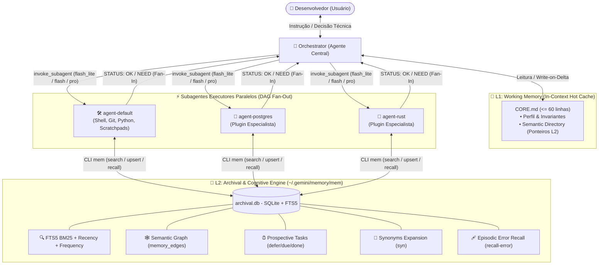

# 🚀 antigravity-star-orchestrator: Star-Topology Multi-Agent Orchestrator & 7-Memory Starter Kit

> **Um ecossistema multi-agente enxuto, determinístico e de ultra-eficiência de tokens para o Google Antigravity.**  
> Desenvolvido com **Topologia Estrela**, **Decomposição em Grafo Acíclico Dirigido (DAG Fan-Out/Fan-In Paralelo)**, **Roteamento Automático de Modelos Cognitivos**, **Protocolo Zero Assumptions (Lei Zero Inviolável)** e uma **Arquitetura Cognitiva Híbrida de 7 Memórias** (L1 Hot Working Memory + L2 SQLite FTS5 com Zero Dependências, Semantic Freshness/TTL, Wiki Markdown e Rastreamento de Dead-Ends).

---

## 📑 Sumário

- [Visão Geral & Proposta de Valor](#-visão-geral--proposta-de-valor)
- [Arquitetura do Sistema](#-arquitetura-do-sistema)
- [Os 7 Tipos de Memória Implementados](#-os-7-tipos-de-memória-implementados)
- [Estrutura de Arquivos do Starter Kit](#-estrutura-de-arquivos-do-starter-kit)
- [Instalação Rápida & First-Boot Onboarding](#-instalação-rápida--first-boot-onboarding)
- [Como Criar Subagentes Especialistas (Plugins Dinâmicos)](#-como-criar-subagentes-especialistas-plugins-dinâmicos)
- [Referência Completa da CLI `~/.gemini/memory/mem`](#-referência-completa-da-cli-geminimemorymem)
- [Diretrizes de Segurança & Privacidade](#-diretrizes-de-segurança--privacidade)

---

## 🎯 Visão Geral & Proposta de Valor

Assistentes de IA convencionais sofrem frequentemente de três problemas críticos: **amnésia de contexto em sessões longas**, **custo excessivo de tokens devido a prompts monolíticos e redundantes** e **alucinações perigosas originadas de suposições arbitrárias**.

O **Antigravity Starter Kit** foi projetado para resolver esses problemas de ponta a ponta através de princípios sólidos de engenharia de software e inteligência artificial distribuída:

1. **Topologia Estrela & Separação de Papéis:** O usuário interage exclusivamente com um agente orquestrador central (`orchestrator`), focado em planejamento, decomposição de tarefas e síntese final. Tarefas operacionais são delegadas para subagentes executores.
2. **Decomposição Atômica em DAG & Paralelismo Máximo (Fan-Out / Fan-In):** Requisições complexas não são enviadas como monólitos. O orquestrador decompõe o pedido em subtarefas atômicas independentes e dispara múltiplos subagentes simultaneamente no mesmo turno, reduzindo o tempo total de resposta de forma drástica.
3. **Auto-Model Routing (Roteamento Cognitivo por Complexidade):** Economia extrema de tokens e baixa latência através da seleção dinâmica do modelo ideal para cada subtarefa atômica, integrando suporte a Google's latest frontier model **Gemini 4 Argon**:
   - `flash_lite` $\rightarrow$ Tarefas mecânicas de I/O, listagens, extrações e leituras de arquivos.
   - `flash` $\rightarrow$ Operações padrão de desenvolvimento, scripts, queries SQL e implementações delimitadas.
   - `pro` $\rightarrow$ Design de arquitetura avançado, concorrência crítica, otimização de performance e debugging profundo.
   - `inherit` $\rightarrow$ Herda o contexto da sessão principal, permitindo que subtarefas de extrema complexidade e raciocínio de fronteira sejam roteadas diretamente para o **Gemini 4 Argon**.
4. **Protocolo Zero Assumptions (Lei Zero Inviolável):** Sob nenhuma hipótese os agentes assumem, adivinham ou escolhem silenciosamente decisões de negócio, arquitetura ou bifurcações técnicas ambíguas. Diante de qualquer incerteza, o fluxo é pausado e submetido ao usuário acompanhado de recomendações técnicas estruturadas.
5. **Arquitetura Híbrida de 7 Memórias (Zero Dependências Externas):** Implementação completa em Python puro e SQLite com extensão nativa FTS5, sem necessidade de servidores externos de vetores ou dependências pesadas de terceiros.

---

## 🏗️ Arquitetura do Sistema

O fluxo de trabalho opera em topologia estrela estrita, com comunicação Máquina $\leftrightarrow$ Máquina (M2M) telegráfica e isolamento de domínios:



---

## 🧠 Os 7 Tipos de Memória Implementados

Inspirado nas arquiteturas de memória cognitiva mais avançadas (como CoALA, Letta/MemGPT, Mem0 e Zep), o ecossistema implementa 7 camadas de memória complementares:

| # | Tipo de Memória | Implementação Técnica | Finalidade & Benefício |
|---|---|---|---|
| **1** | **Working Memory (L1)** | `~/.gemini/memory/CORE.md` | Cache quente no prompt dos agentes (estritamente $\le$ 60 linhas verificado via `mem check-core`). Mantém identidade, invariantes e índice semântico. Acompanhado de Scratchpad Anti-Amnésia em arquivo físico para tarefas massivas. |
| **2** | **Semantic Memory (L2)** | Tabela `memories` + Tabela `memory_edges` + Semantic Freshness | Grafo de conhecimento persistente organizado por namespaces (`<dominio>` ou `proj:<nome>`). Permite vincular nós via `mem link` e gerenciar frescor temporal de dados voláteis via `--ttl <dias>` e `mem verify`. Exportável e importável em Wiki Markdown via `mem export-md` e `mem import-md`. |
| **3** | **Episodic Memory** | Tabela `memories` (`kind = learning`) + `recall-error` | Padrão Reflexion com rastreamento explícito de `[DEAD-ENDS / TENTATIVAS DESCARTADAS]`. Guarda históricos de erros, hipóteses refutadas e diagnósticos comprovados. Permite consulta cirúrgica imediata via `mem recall-error` para impedir repetição de falhas passadas. |
| **4** | **Procedural Memory** | `AGENT.md` modulares + `kind = playbook` | Protocolos procedurais de conduta estáticos nos arquivos dos agentes somados a receitas executáveis passo a passo salvas dinamicamente no L2 (`kind = playbook`). |
| **5** | **Retrieval Memory** | Virtual Table `memories_fts` (FTS5 BM25 Ponderado) | Busca híbrida com tokenizador `unicode61 remove_diacritics 2`, cálculo ponderado de relevância (tópico peso 5.0, tags 3.0, conteúdo 1.0), boost de popularidade (`access_count`), decaimento temporal e expansão por sinônimos técnicos (`mem syn`). |
| **6** | **Parametric Memory** | Auto-Model Routing (`flash_lite`, `flash`, `pro`, `inherit` running on **Gemini 4 Argon**) | Uso otimizado da inteligência interna dos modelos LLM, evitando instruções redundantes e roteando subtarefas de acordo com o esforço cognitivo necessário. Quando a sessão principal roda em **Gemini 4 Argon**, passar `Model: "inherit"` direciona subtarefas de fronteira e extrema complexidade diretamente para o **Gemini 4 Argon**! Prompts M2M telegráficos e sem preâmbulos. |
| **7** | **Prospective Memory** | Tabela `prospective_tasks` (`defer`, `due`, `done`) | Fila persistente de intenções futuras, pendências e gatilhos contextuais (com documentação de tentativas prévias e dead-ends). Dispara alertas reativos automáticos sempre que um agente consulta um namespace com tarefas pendentes. |

---

## 📁 Estrutura de Arquivos do Starter Kit

O ecossistema é projetado com isolamento estrito entre o código base portátil do kit (versionado) e os dados locais da máquina do usuário (ignorados pelo Git para segurança e privacidade total):

```text
~/.gemini/
├── .gitignore                      # Regras restritas: versiona apenas o Starter Kit
├── GEMINI.md                       # Constituição Global (injetada em todos os agentes)
├── README.md                       # Documentação completa e guia do Starter Kit
│
├── agents/                         # Definições de papéis dos agentes
│   ├── COMMON_INSTRUCTIONS.md      # Instruções operacionais comuns compartilhadas
│   ├── orchestrator/
│   │   └── AGENT.md                # Agente Orquestrador Central (Star Topology)
│   ├── agent-default/
│   │   └── AGENT.md                # Subagente Executor Generalista (Fallback/Shell/Git)
│   └── agent-<domain>/             # 🔒 [LOCAL] Seus plugins especialistas (ex: agent-rust)
│       └── AGENT.md
│
└── memory/                         # Motor Cognitivo de 7 Memórias
    ├── mem                         # CLI executável em Python puro (Zero Dependências)
    ├── CORE.template.md            # Template de inicialização do L1 Working Memory
    ├── CORE.md                     # 🔒 [LOCAL] L1 Working Memory gerado no Onboarding
    └── archival.db                 # 🔒 [LOCAL] L2 SQLite Database (FTS5 + Grafo)
```

> [!NOTE]
> **Arquivos Versionados no Git:** `GEMINI.md`, `README.md`, `.gitignore`, `agents/COMMON_INSTRUCTIONS.md`, `agents/orchestrator/AGENT.md`, `agents/agent-default/AGENT.md`, `memory/mem`, `memory/CORE.template.md`.  
> **Arquivos Locais (Nunca vão para o Git):** `memory/CORE.md`, `memory/archival.db` e subagentes especialistas criados localmente `agents/agent-<domain>/`.

---

## 🚀 Instalação Rápida & First-Boot Onboarding

Siga os 3 passos simples abaixo para ativar o ecossistema na sua máquina:

### Passo 1: Clonar ou Copiar os Arquivos
Clone este repositório no diretório de configuração do Antigravity (`~/.gemini`) e garanta permissão de execução na CLI `mem`:

```bash
git clone https://github.com/passella/antigravity-star-orchestrator.git ~/.gemini
chmod +x ~/.gemini/memory/mem
```

### Passo 2: Configurar Permissões Autônomas no Antigravity
Para que o orquestrador e os subagentes consigam ler a memória e invocar a CLI `mem` de forma totalmente autônoma (sem exibir popups de confirmação a cada query), adicione as regras abaixo no seu arquivo `~/.gemini/antigravity-cli/settings.json`:

```json
{
  "permissions": {
    "allow": [
      "read_file(~/.gemini/memory)",
      "write_file(~/.gemini/memory)",
      "read_file(~/.gemini/agents)",
      "write_file(~/.gemini/agents)",
      "read_file(~/.gemini/GEMINI.md)",
      "write_file(~/.gemini/GEMINI.md)",
      "command(~/.gemini/memory/mem)"
    ]
  },
  "trustedWorkspaces": [
    "~/.gemini"
  ]
}
```

### Passo 3: Inicialização & Onboarding (Escolha uma das opções)

#### Opção A — Onboarding Interativo via Chat (Recomendado)
Apenas abra o chat do Antigravity e envie uma saudação inicial (ex: `"Olá!"` ou `"Oi"`).  
O `orchestrator` detecta automaticamente que o ambiente está em estado `[UNCONFIGURED]`, executa a inicialização do banco L2 e conduz um diálogo amigável para registrar:
1. Seu nome de preferência;
2. Idioma preferencial (ex: `pt-BR`);
3. Caminho do seu diretório de projetos (workspace padrão).

#### Opção B — Inicialização Direta via Terminal
Se preferir inicializar manualmente via linha de comando antes de abrir o chat:

```bash
~/.gemini/memory/mem init --user "SeuNome" --lang "pt-BR" --workspace "~/dev"
```

O comando cria o banco `~/.gemini/memory/archival.db` com todas as tabelas FTS5, semeia o dicionário técnico de sinônimos e gera o `~/.gemini/memory/CORE.md` personalizado a partir do template.

---

## 🧩 Como Criar Subagentes Especialistas (Plugins Dinâmicos)

O Starter Kit é intencionalmente enxuto e vem de fábrica apenas com o `orchestrator` e o subagente generalista `agent-default`. Você pode expandir o ecossistema com especialistas sob demanda (ex: `agent-postgres`, `agent-react`, `agent-k8s`, `agent-rust`).

### 1. Modo Automático Proativo (Recomendado)
Durante o uso diário, quando você solicitar tarefas envolvendo um domínio técnico relevante que ainda não possui um especialista dedicado, o `orchestrator` acionará o `agent-default` como fallback e **sugerirá proativamente criar um agente especialista**:

> *"Notei que estamos realizando implementações avançadas em PostgreSQL. Deseja que eu crie o especialista `agent-postgres` para persistir schemas, playbooks de migração e melhores práticas desse domínio?"*

Ao confirmar, o próprio `orchestrator` cria a pasta `~/.gemini/agents/agent-postgres/AGENT.md` estruturada e registra o ponteiro no `Semantic Directory` do `CORE.md` automaticamente!

### 2. Modo Manual (Criação Direta)

Se você desejar criar um especialista manualmente, siga duas etapas simples:

#### Etapa 1: Criar o arquivo `~/.gemini/agents/agent-<dominio>/AGENT.md`
Crie o arquivo herdando obrigatoriamente a **Lei Zero Inviolável** no topo:

```markdown
# 🛠️ AGENT: <dominio> Specialist

> **Namespace L2 Primário:** `<dominio>`  
> **Papel:** Especialista técnico em <Tecnologia/Domínio>.

---

## 🛑 0. Protocolo Zero Assumptions (Lei Zero Inviolável)
1. **NUNCA SUPOR NADA:** Jamais deduza ou tome decisões arbitrárias diante de incertezas ou bifurcações técnicas.
2. **ESCALAÇÃO IMEDIATA:** Diante de qualquer dúvida de requisitos ou escolha de trade-off, emita `STATUS: NEED` com `target_domain: "orchestrator"`, expondo as opções identificadas e sua recomendação técnica para validação com o usuário.

---

## 🎯 1. Escopo & Especialidade
- Invariantes técnicas e diretrizes de engenharia do domínio <dominio>.
- Padrões de código, bibliotecas recomendadas e regras de segurança.

## 💾 2. Protocolo de Memória L2
- Antes de iniciar, consulte o histórico relevante via `~/.gemini/memory/mem search "<termo>" --ns <dominio>`.
- Persista aprendizados e playbooks novos via `~/.gemini/memory/mem upsert <dominio> <kind> "<topic>" "<content>"`.
```

#### Etapa 2: Registrar no `Semantic Directory` do `CORE.md`
Abra `~/.gemini/memory/CORE.md` e adicione uma linha na seção **3. Índice de Ponteiros L2**:

```markdown
- **<dominio>** (`~/.gemini/agents/agent-<dominio>/AGENT.md`): Invariantes e boas práticas de <Tecnologia>.
```

> [!TIP]
> O motor `~/.gemini/memory/mem` valida e aceita qualquer novo namespace automaticamente (padrão regex `^[a-z0-9][a-z0-9_-]*$`) ou namespaces de projetos locais (`^proj:[a-zA-Z0-9._-]+$`). **Nenhuma alteração de código ou schema no motor é necessária!**

---

## 📖 Referência Completa da CLI `~/.gemini/memory/mem`

A CLI `mem` foi escrita em Python puro e fornece a interface completa de gestão das 7 memórias.

| Comando | Sintaxe | Descrição & Exemplo de Uso |
|---|---|---|
| **`init`** | `mem init [--user <nome>] [--lang <idioma>] [--workspace <path>] [--force]` | Inicializa o banco SQLite L2, cria as tabelas FTS5 e gera o `CORE.md`.<br/>`mem init --user "Dev" --lang "pt-BR" --workspace "~/dev"` |
| **`search`** | `mem search "<query>" [--ns <namespace>] [--limit <N>]` | Busca híbrida FTS5 com BM25 + Popularidade + Recency + Sinônimos.<br/>`mem search "connection pool postgres" --ns postgres` |
| **`get`** | `mem get <namespace> "<topic>"` | Recupera o conteúdo integral de um tópico e incrementa seu contador de acessos.<br/>`mem get global "user-profile"` |
| **`upsert`** | `mem upsert <namespace> <kind> "<topic>" "<content>" ["<tags>"] [--ttl <dias>]` | Insere ou atualiza um tópico com TTL opcional em dias. Tipos válidos: `fact`, `learning` (com `[DEAD-ENDS]`), `behavior`, `decision`, `invariant`, `playbook`.<br/>`mem upsert postgres invariant "max-connections" "Limite máximo de conexões: 100" "db,pool" --ttl 90` |
| **`verify`** | `mem verify <namespace> "<topic>"` | Revalida e confirma a atualidade de um registro sujeito a TTL, estendendo seu ciclo de validade sem alterar o conteúdo.<br/>`mem verify postgres "max-connections"` |
| **`recall-error`** | `mem recall-error "<erro>" [--ns <ns>] [--limit <N>]` | Busca episódica de soluções de bugs passados e lições aprendidas (incluindo tentativas e dead-ends descartados).<br/>`mem recall-error "PSQLException: Connection refused"` |
| **`link`** | `mem link <src_ns>:<src_topic> <relation> <dst_ns>:<dst_topic>` | Cria aresta no grafo semântico (`depends_on`, `implements`, `optimizes`, etc.).<br/>`mem link auth:jwt-config depends_on security:rsa-keys` |
| **`defer`** | `mem defer <namespace> "<trigger_cond>" "<action>"` | Registra pendência na memória prospectiva para execução futura (inclui dead-ends/tentativas falhas se houver).<br/>`mem defer devops "Ao atualizar para Node 22" "Revisar flags do V8 [DEAD-ENDS: flag --no-opt falhou]"` |
| **`due`** | `mem due [--ns <namespace>]` | Lista todas as tarefas prospectivas pendentes para um domínio ou projeto.<br/>`mem due --ns devops` |
| **`done`** | `mem done <task_id>` | Marca uma tarefa da memória prospectiva como concluída.<br/>`mem done 3` |
| **`export-md`** | `mem export-md [dir]` | Exporta todos os tópicos do banco L2 para uma árvore de arquivos Markdown com frontmatter YAML (padrão: `~/.gemini/memory/wiki`). Compatível com Obsidian e Logseq.<br/>`mem export-md ~/docs/wiki` |
| **`import-md`** | `mem import-md [dir]` | Importa arquivos Markdown de uma pasta de volta para o SQLite FTS5 L2 com parsing de frontmatter e upsert automático.<br/>`mem import-md ~/docs/wiki` |
| **`syn`** | `mem syn [list \| add <termo> "<sin1,sin2,...>"]` | Gerencia a expansão de sinônimos técnicos no ranking de busca FTS5.<br/>`mem syn add orm "drizzle,prisma,typeorm"` |
| **`promote`** | `mem promote [--ns <ns>] [--limit <N>] [--by hits\|recent] [--min-hits <N>]` | Sugere tópicos mais acessados do L2 para promoção ao `CORE.md`.<br/>`mem promote --by hits --min-hits 5` |
| **`check-core`** | `mem check-core` | Valida se `CORE.md` respeita o limite estrito de 60 linhas do orçamento L1.<br/>`mem check-core` |
| **`list`** | `mem list [--ns <namespace>]` | Lista todos os tópicos e metadados cadastrados em um namespace.<br/>`mem list --ns postgres` |
| **`stats`** | `mem stats` | Exibe estatísticas consolidadas de memórias, arestas do grafo e tarefas pendentes.<br/>`mem stats` |
| **`delete`** | `mem delete <namespace> "<topic>"` | Remove um tópico e limpa índices associados e arestas no grafo.<br/>`mem delete postgres "old-config"` |

---

## 🔒 Diretrizes de Segurança & Privacidade

1. **Single Source of Truth para Identidade:** Nenhum dado pessoal (nome, email, chaves ou caminhos privados) deve ser hardcoded em arquivos versionados (`GEMINI.md`, `AGENT.md`, `COMMON_INSTRUCTIONS.md`). Toda identidade reside no `CORE.md` e em `archival.db`, que permanecem exclusivamente na máquina local do desenvolvedor.
2. **Proibição Absoluta de Commits/Pushes Autônomos:** Nenhum agente tem permissão para executar comandos `git commit` ou `git push` de forma autônoma sem a aprovação explícita e direta do usuário no chat.
3. **Isolamento de Estado:** O arquivo `.gitignore` protege ativamente sua privacidade, garantindo que suas notas, memórias aprendidas e dados operacionais nunca sejam enviados para repositórios públicos acidentalmente.
4. **Execução Local & Zero Dependências:** O motor de memória opera 100% offline via SQLite local, garantindo latência próxima de zero, resiliência total e soberania sobre seus dados técnicos.

---

<p align="center">
  <b>antigravity-star-orchestrator</b> • Desenvolvido para máxima performance de engenharia.
</p>
