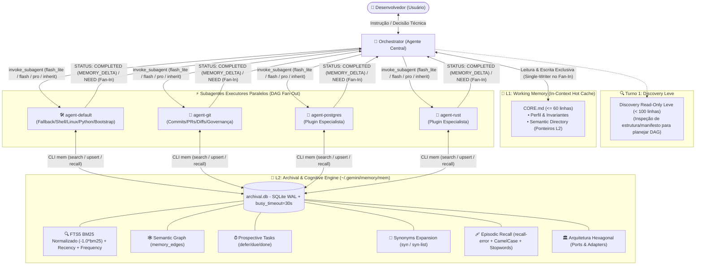

# 🚀 antigravity-star-orchestrator: Star-Topology Multi-Agent Orchestrator & 7-Memory Starter Kit

> **Um ecossistema multi-agente enxuto, determinístico e de ultra-eficiência de tokens para o Google Antigravity.**  
> Desenvolvido com **Topologia Estrela**, **Decomposição em Grafo Acíclico Dirigido (DAG Fan-Out/Fan-In Paralelo)**, **Roteamento Automático de Modelos Cognitivos**, **Protocolo Zero Assumptions (Lei Zero Inviolável)** e uma **Arquitetura Cognitiva Híbrida de 7 Memórias** (L1 Hot Working Memory Single-Writer + L2 SQLite WAL FTS5 com Zero Dependências, Arquitetura Hexagonal, Semantic Freshness/TTL, Wiki Markdown e Rastreamento de Dead-Ends).

---

## 📑 Sumário

- [Visão Geral & Proposta de Valor](#-visão-geral--proposta-de-valor)
- [Arquitetura do Sistema](#-arquitetura-do-sistema)
- [Os 7 Tipos de Memória Implementados](#-os-7-tipos-de-memória-implementados)
- [Estrutura de Arquivos do Starter Kit](#-estrutura-de-arquivos-do-starter-kit)
- [Instalação Rápida & First-Boot Onboarding](#-instalação-rápida--first-boot-onboarding)
- [Como Criar Subagentes Especialistas (Plugins Dinâmicos)](#-como-criar-subagentes-especialistas-plugins-dinâmicos)
- [Referência Completa da CLI `~/.gemini/memory/mem`](#-referência-completa-da-cli-geminimemorymem)
- [Diretrizes de Segurança & Governança](#-diretrizes-de-segurança--governança)

---

## 🎯 Visão Geral & Proposta de Valor

Assistentes de IA convencionais sofrem frequentemente de três problemas críticos: **amnésia de contexto em sessões longas**, **custo excessivo de tokens devido a prompts monolíticos e redundantes** e **alucinações perigosas originadas de suposições arbitrárias**.

O **Antigravity Starter Kit** foi projetado para resolver esses problemas de ponta a ponta através de princípios sólidos de engenharia de software e inteligência artificial distribuída:

1. **Topologia Estrela & Separação Estrita de Papéis:** O usuário interage exclusivamente com um agente orquestrador central (`orchestrator`), focado em planejamento arquitetural, decomposição de tarefas e síntese final. Tarefas técnicas e operacionais são delegadas para subagentes executores especialistas.
2. **Decomposição Atômica em DAG & Paralelismo Máximo (Fan-Out / Fan-In):** Requisições complexas não são tratadas como blocos monolíticos. O orquestrador decompõe o pedido em subtarefas atômicas ortogonais e dispara múltiplos subagentes simultaneamente no mesmo turno, reduzindo o tempo total de resposta de forma drástica.
3. **Regra Arquitetural Single-Writer para L1 (`CORE.md`):** Para evitar condições de corrida (*race conditions*) durante execuções paralelas em Fan-Out, os subagentes gravam conhecimento concorrentemente apenas no banco L2 (`archival.db`) e reportam deltas no retorno (`MEMORY_DELTA`). Apenas o `orchestrator` possui permissão de escrita no `CORE.md` durante o Fan-In de fechamento.
4. **Discovery Read-Only Leve no Turno 1:** Elimina o problema da "cegueira de descoberta" ao planejar o grafo DAG. Caso o contexto inicial não informe a estrutura do projeto, o `orchestrator` tem permissão estrita para leitura leve (listar raiz ou ler manifestos `< 100` linhas), mantendo proibição absoluta para qualquer mutação, script ou comando operacional direto.
5. **Auto-Model Routing (Roteamento Cognitivo por Complexidade):** Economia extrema de tokens e baixa latência através da seleção dinâmica do modelo ideal para cada nó atômico do DAG, integrando suporte nativo ao modelo frontier **Gemini 4 Argon**:
   - `flash_lite` $\rightarrow$ Tarefas mecânicas de I/O, listagens, extrações e leituras de arquivos/configs/logs.
   - `flash` $\rightarrow$ Operações padrão de desenvolvimento, scripts, queries SQL, Dockerfiles e testes unitários.
   - `pro` $\rightarrow$ Design de arquitetura avançado (Clean Architecture / Ports & Adapters), concorrência crítica, otimização de performance e debugging profundo.
   - `inherit` $\rightarrow$ Herda o contexto da sessão principal, permitindo que subtarefas de extrema complexidade sejam roteadas diretamente para o **Gemini 4 Argon**.
6. **Protocolo Zero Assumptions (Lei Zero Inviolável):** Sob nenhuma hipótese os agentes assumem, adivinham ou escolhem silenciosamente decisões de negócio, arquitetura, contratos de API, schemas ou dependências. Diante de incertezas, o fluxo é pausado imediatamente e submetido ao usuário com opções mapeadas e recomendações técnicas estruturadas.
7. **Arquitetura Hexagonal & Concorrência Segura (Zero Dependências Externas):** O motor de memória `~/.gemini/memory/mem` foi construído seguindo **Clean Architecture (Ports & Adapters)** e **SOLID**:
   - Camada de Domínio e Políticas desacoplada de I/O.
   - Concorrência de alta resiliência com SQLite WAL (`PRAGMA journal_mode=WAL;`), `isolation_level=None` com transações reentrantes `BEGIN IMMEDIATE`, `PRAGMA busy_timeout=30000;` e file locking POSIX (`.core.lock`).
   - Zero-overhead de boot através de controle de migração via `PRAGMA user_version = 2` (DDL executado estritamente na inicialização).

---

## 🏗️ Arquitetura do Sistema

O fluxo de trabalho opera em topologia estrela estrita, com comunicação Máquina $\leftrightarrow$ Máquina (M2M) telegráfica, isolamento de domínios e persistência híbrida de duas camadas:



---

## 🧠 Os 7 Tipos de Memória Implementados

Inspirado nas arquiteturas de memória cognitiva mais avançadas (como CoALA, Letta/MemGPT, Mem0 e Zep/Graphiti), o ecossistema implementa 7 camadas de memória complementares:

| # | Tipo de Memória | Implementação Técnica | Finalidade & Benefício |
|---|---|---|---|
| **1** | **Working Memory (L1)** | `~/.gemini/memory/CORE.md` | Cache quente no prompt dos agentes (estritamente $\le$ 60 linhas auditado via `mem check-core` com **exit code 1 bloqueante** em caso de estouro e listagem de pendências ativas). Regra arquitetural **Single-Writer**: apenas o `orchestrator` edita no Fan-In. Acompanhado de Scratchpad Anti-Amnésia em arquivo físico para tarefas massivas. |
| **2** | **Semantic Memory (L2)** | Tabela `memories` + Tabela `memory_edges` + Semantic Freshness | Grafo de conhecimento persistente organizado por namespaces (`<dominio>` ou `proj:<nome>`). Permite vincular nós via `mem link` e gerenciar frescor temporal de dados voláteis via `--ttl <dias>` e `mem verify`. Exportável via `mem export-md` com prevenção de colisão de arquivos por hash SHA-256 (`_safe_filename`) e importável via `mem import-md` com parsing de frontmatter YAML. |
| **3** | **Episodic Memory** | Tabela `memories` (`kind = learning`) + `recall-error` | Padrão Reflexion com rastreamento explícito de `[DEAD-ENDS / TENTATIVAS DESCARTADAS]`. Guarda históricos de erros, hipóteses refutadas e diagnósticos comprovados. A busca `mem recall-error` utiliza **split avançado de identificadores** (`CamelCase`, `snake_case`, `kebab-case`), filtragem determinística por `ERROR_STOPWORDS` e seleção dos 24 tokens mais específicos, impedindo explosão combinatória e falsos positivos. |
| **4** | **Procedural Memory** | `AGENT.md` modulares enxutos (DRY) + `kind = playbook` | Protocolos procedurais de conduta estáticos nos arquivos dos agentes (sem repetições desnecessárias da Constituição) somados a receitas executáveis passo a passo salvas dinamicamente no L2 (`kind = playbook`). |
| **5** | **Retrieval Memory** | Virtual Table `memories_fts` (FTS5 BM25 Normalizado) | Busca híbrida com tokenizador `unicode61 remove_diacritics 2` e pontuação **matematicamente normalizada** (`MAX(0.0001, -1.0 * bm25(memories_fts, 5.0, 1.0, 3.0, 0.5))`), corrigindo a inversão de sinal nativa do SQLite. Aplica pesos calibrados (tópico 5.0, tags 3.0, conteúdo 1.0, namespace 0.5), boost de popularidade (`access_count`), decaimento temporal e expansão de sinônimos (`mem syn` / `syn-list`). |
| **6** | **Parametric Memory** | Auto-Model Routing (`flash_lite`, `flash`, `pro`, `inherit` no **Gemini 4 Argon**) | Uso otimizado da inteligência interna dos modelos LLM, evitando instruções redundantes e roteando subtarefas de acordo com o esforço cognitivo necessário. Quando a sessão principal roda em **Gemini 4 Argon**, passar `Model: "inherit"` direciona subtarefas de fronteira e extrema complexidade diretamente para o **Gemini 4 Argon**. Prompts M2M telegráficos. |
| **7** | **Prospective Memory** | Tabela `prospective_tasks` (`defer`, `due`, `done`) | Fila persistente de intenções futuras, pendências e gatilhos contextuais (com documentação de tentativas prévias e dead-ends). Dispara alertas reativos automáticos sempre que um agente consulta um namespace com tarefas pendentes em `mem search` ou `mem get`. |

---

## 📁 Estrutura de Arquivos do Starter Kit

O ecossistema é projetado com isolamento estrito entre o código base portátil do kit (versionado) e os dados locais da máquina do usuário (ignorados pelo Git para segurança e privacidade total), além de uma consolidação DRY rigorosa (Lei Zero centralizada no `GEMINI.md`):

```text
~/.gemini/
├── .gitignore                      # Regras restritas: versiona apenas o Starter Kit
├── GEMINI.md                       # Constituição Global (SSOT da Lei Zero, Topologia e M2M)
├── README.md                       # Documentação completa e guia do Starter Kit
│
├── agents/                         # Definições de papéis dos agentes (Enxutas & DRY)
│   ├── COMMON_INSTRUCTIONS.md      # Instruções operacionais comuns (Protocolo de Memória & M2M)
│   ├── orchestrator/
│   │   └── AGENT.md                # Agente Orquestrador Central (Scheduler DAG & Single-Writer)
│   ├── agent-default/
│   │   └── AGENT.md                # Subagente Executor Generalista (Fallback/Shell/Linux/Python)
│   ├── agent-git/
│   │   └── AGENT.md                # Subagente Especialista em Git (Commits 3-blocos, PRs e Governança)
│   └── agent-<domain>/             # 🔒 [LOCAL] Seus plugins especialistas sob demanda (ex: agent-rust)
│       └── AGENT.md
│
└── memory/                         # Motor Cognitivo de 7 Memórias (Hexagonal & Concurrency-Safe)
    ├── mem                         # CLI executável em Python puro (Zero Dependências)
    ├── CORE.template.md            # Template de inicialização do L1 Working Memory (< 40 linhas)
    ├── CORE.md                     # 🔒 [LOCAL] L1 Working Memory gerado no Onboarding
    └── archival.db                 # 🔒 [LOCAL] L2 SQLite Database (WAL, FTS5 + Grafo)
```

> [!NOTE]
> **Arquivos Versionados no Git:** `GEMINI.md`, `README.md`, `.gitignore`, `agents/COMMON_INSTRUCTIONS.md`, `agents/orchestrator/AGENT.md`, `agents/agent-default/AGENT.md`, `agents/agent-git/AGENT.md`, `memory/mem`, `memory/CORE.template.md`.  
> **Arquivos Locais (Nunca vão para o Git):** `memory/CORE.md`, `memory/archival.db` e subagentes especialistas criados localmente `agents/agent-<domain>/`.
> **Consolidação DRY:** A "Lei Zero (Zero Assumptions)" e o protocolo M2M residem exclusivamente em `GEMINI.md`, eliminando redundâncias e inflação de tokens L1 nos demais arquivos secundários.

---

## 🚀 Instalação Rápida & First-Boot Onboarding

Siga os 3 passos simples abaixo para ativar o ecossistema na sua máquina:

### Passo 1: Clonar ou Copiar os Arquivos
Clone este repositório no diretório de configuração do Antigravity (`~/.gemini`) e garanta permissão de execução na CLI `mem`:

```bash
git clone https://github.com/passella/antigravity-star-orchestrator.git ~/.gemini
chmod +x ~/.gemini/memory/mem
```

### Passo 2: Configurar Permissões Autônomas no Antigravity
Para que o orquestrador e os subagentes consigam ler a memória e invocar a CLI `mem` de forma totalmente autônoma (sem exibir popups de confirmação a cada query), adicione as regras abaixo no seu arquivo `~/.gemini/antigravity-cli/settings.json`:

```json
{
  "permissions": {
    "allow": [
      "read_file(~/.gemini/memory)",
      "write_file(~/.gemini/memory)",
      "read_file(~/.gemini/agents)",
      "write_file(~/.gemini/agents)",
      "read_file(~/.gemini/GEMINI.md)",
      "write_file(~/.gemini/GEMINI.md)",
      "command(~/.gemini/memory/mem)"
    ]
  },
  "trustedWorkspaces": [
    "~/.gemini"
  ]
}
```

### Passo 3: Inicialização & Onboarding (Escolha uma das opções)

#### Opção A — Onboarding Interativo via Chat (Recomendado)
Apenas abra o chat do Antigravity e envie uma saudação inicial (ex: `"Olá!"` ou `"Oi"`).  
O `orchestrator` detecta automaticamente que o ambiente está em estado `[UNCONFIGURED]`, executa a inicialização do banco L2 e conduz um diálogo amigável para registrar:
1. Seu nome de preferência;
2. Idioma preferencial (ex: `pt-BR`);
3. Caminho do seu diretório de projetos (workspace padrão).

#### Opção B — Inicialização Direta via Terminal
Se preferir inicializar manualmente via linha de comando antes de abrir o chat:

```bash
~/.gemini/memory/mem init --user "SeuNome" --lang "pt-BR" --workspace "~/dev"
```

O comando cria o banco `~/.gemini/memory/archival.db` com o schema v2 em modo WAL, semeia os sinônimos técnicos e gera o `~/.gemini/memory/CORE.md` a partir do `CORE.template.md` (ou do `DEFAULT_CORE_TEMPLATE` embutido no script caso o template seja omitido).

---

## 🧩 Como Criar Subagentes Especialistas (Plugins Dinâmicos)

O Starter Kit vem de fábrica com o `orchestrator`, o subagente generalista `agent-default` e o especialista em governança e versionamento `agent-git`. Você pode expandir o ecossistema com especialistas sob demanda (ex: `agent-postgres`, `agent-react`, `agent-k8s`, `agent-rust`).

### 1. Modo Automático Proativo (Recomendado)
Durante o uso diário, quando você solicitar tarefas envolvendo um domínio técnico relevante que ainda não possui um especialista dedicado, o `orchestrator` acionará o `agent-default` como fallback e **sugerirá proativamente criar um agente especialista**:

> *"Notei que estamos realizando implementações avançadas em PostgreSQL. Deseja que eu crie o especialista `agent-postgres` para persistir schemas, playbooks de migração e melhores práticas desse domínio?"*

Ao confirmar, o próprio `orchestrator` cria a pasta `~/.gemini/agents/agent-postgres/AGENT.md` estruturada e registra o ponteiro no `Semantic Directory` do `CORE.md` automaticamente!

### 2. Modo Manual (Criação Direta)

Se você desejar criar um especialista manualmente, siga duas etapas simples:

#### Etapa 1: Criar o arquivo `~/.gemini/agents/agent-<dominio>/AGENT.md`
Crie o arquivo seguindo o padrão enxuto e DRY do ecossistema:

```markdown
# 🛠️ AGENT: <dominio> Specialist

> **Namespace L2 Primário:** `<dominio>`  
> **Papel:** Especialista técnico em <Tecnologia/Domínio>.
> **Constituição:** Herda integralmente a Lei Zero e normas de [`~/.gemini/GEMINI.md`](~/.gemini/GEMINI.md) e [`~/.gemini/agents/COMMON_INSTRUCTIONS.md`](~/.gemini/agents/COMMON_INSTRUCTIONS.md).

---

## 🛠️ Diretrizes Operacionais de Execução

1. **Herança da Lei Zero (Zero Assumptions):**
   * NUNCA SUPOR NADA. Em qualquer incerteza de requisitos, arquitetura ou bifurcações técnicas, pare imediatamente.
   * Emita `STATUS: NEED` com `target_domain: "orchestrator"` expondo opções estruturadas e recomendação técnica fundamentada para deliberação do usuário.
2. **Proibição Absoluta de Commit/Push Autônomo:**
   * Jamais execute `git commit` ou `git push` sem autorização prévia e expressa do usuário no turno.
3. **Engenharia de Software Rigorosa (SOLID & Clean Architecture):**
   * Código desenvolvido ou refatorado deve seguir tipagem estrita, Ports & Adapters e tratamento explícito de erros.
4. **Regra Single-Writer de `CORE.md` & Curadoria L2:**
   * O subagente **NUNCA** edita `CORE.md` diretamente.
   * Conhecimentos adquiridos devem ser gravados em L2 via `~/.gemini/memory/mem upsert/link/defer` e reportados no campo `MEMORY_DELTA` do payload `STATUS: COMPLETED`.
5. **Anti-Amnésia & M2M Telegráfico:**
   * Proibido resumir saídas extensas no chat (faça dump físico e informe em `PATHS`). Comunicação com o `orchestrator` 100% telegráfica e sem saudações.
```

#### Etapa 2: Registrar no `Semantic Directory` do `CORE.md`
Abra `~/.gemini/memory/CORE.md` e adicione uma linha na seção **3. Semantic Directory**:

```markdown
- **`<dominio>`** (`~/.gemini/agents/agent-<dominio>/AGENT.md`): Invariantes e boas práticas de <Tecnologia>.
```

*(Exemplo existente de especialista registrado: `- **git** (~/.gemini/agents/agent-git/AGENT.md): Mensagens de commit (Título+Descrição+Lista), PRs, semântica de diffs e governança read-only`)*.

> [!TIP]
> O motor `~/.gemini/memory/mem` valida e aceita qualquer novo namespace automaticamente (padrão regex `^[a-z0-9][a-z0-9_-]*$`) ou namespaces de projetos locais (`^proj:[a-zA-Z0-9._-]+$`). **Nenhuma alteração de código ou schema no motor é necessária!**

---

## 📖 Referência Completa da CLI `~/.gemini/memory/mem`

A CLI `mem` foi construída em Python puro (sem dependências externas) sob Arquitetura Hexagonal, fornecendo a interface completa de gestão das 7 memórias:

| Comando | Sintaxe | Descrição & Exemplo de Uso |
|---|---|---|
| **`init`** | `mem init [--user <nome>] [--lang <idioma>] [--workspace <path>] [--force]` | Inicializa o banco SQLite L2 em modo WAL (`user_version = 2`), semeia os sinônimos técnicos e gera o `CORE.md` a partir do template (ou do fallback embutido `DEFAULT_CORE_TEMPLATE`).<br/>`mem init --user "Dev" --lang "pt-BR" --workspace "~/dev"` |
| **`search`** | `mem search "<query>" [--ns <namespace>] [--limit <N>]` | Busca híbrida FTS5 com **BM25 normalizado** (`-1.0 * bm25`) + boost de Popularidade + Recency + expansão automática de Sinônimos.<br/>`mem search "connection pool postgres" --ns postgres` |
| **`get`** | `mem get <namespace> "<topic>"` | Recupera o conteúdo integral de um tópico, exibe conexões do grafo semântico e incrementa o contador de acessos.<br/>`mem get global "user-profile"` |
| **`upsert`** | `mem upsert <namespace> <kind> "<topic>" "<content>" ["<tags>"] [--ttl <dias>]` | Insere ou atualiza um tópico de forma atômica com suporte a TTL. Tipos válidos: `fact`, `learning` (com `[DEAD-ENDS]`), `behavior`, `decision`, `invariant`, `playbook`.<br/>`mem upsert postgres invariant "max-connections" "Limite máximo: 100" "db,pool" --ttl 90` |
| **`verify`** | `mem verify <namespace> "<topic>" [--ttl <dias>]` | Revalida e confirma a atualidade de um registro sujeito a TTL, estendendo seu ciclo de validade temporal sem alterar o conteúdo.<br/>`mem verify postgres "max-connections"` |
| **`recall-error`** | `mem recall-error "<erro>" [--ns <ns>] [--limit <N>]` | Busca episódica de soluções de bugs passados com **split de identificadores** (`CamelCase`, `snake_case`), filtro de `ERROR_STOPWORDS` e seleção dos 24 termos mais específicos.<br/>`mem recall-error "PSQLException: Connection refused"` |
| **`link`** | `mem link <src_ns>:<src_topic> <relation> <dst_ns>:<dst_topic>` | Cria aresta direcionada no grafo semântico (`DEPENDS_ON`, `RELATES_TO`, `SUPERSEDES`).<br/>`mem link auth:jwt-config DEPENDS_ON security:rsa-keys` |
| **`defer`** | `mem defer <namespace> "<trigger_cond>" "<action>"` | Registra pendência na memória prospectiva para execução futura (com registro de dead-ends se houver).<br/>`mem defer devops "Ao atualizar para Node 22" "Revisar flags do V8 [DEAD-ENDS: flag --no-opt falhou]"` |
| **`due`** | `mem due [--ns <namespace>]` | Lista todas as tarefas prospectivas pendentes para um domínio ou projeto.<br/>`mem due --ns devops` |
| **`done`** | `mem done <task_id>` | Marca uma tarefa da memória prospectiva como concluída.<br/>`mem done 3` |
| **`export-md`** | `mem export-md [dir] [--ns <ns>]` | Exporta todos os tópicos do banco L2 para uma árvore de arquivos Markdown com frontmatter YAML e **prevenção de colisão de arquivos por hash SHA-256** (`_safe_filename`). Compatível com Obsidian e Logseq.<br/>`mem export-md ~/docs/wiki` |
| **`import-md`** | `mem import-md [dir]` | Importa arquivos Markdown de volta para o SQLite FTS5 L2 com parsing de frontmatter e restauração de arestas semânticas.<br/>`mem import-md ~/docs/wiki` |
| **`syn`** *(alias: `syn-list`)* | `mem syn [list \| add <termo> "<sin1,sin2,...>"]` | Gerencia a expansão de sinônimos técnicos dinâmicos no ranking de busca FTS5.<br/>`mem syn add orm "drizzle,prisma,typeorm"` ou `mem syn-list` |
| **`promote`** | `mem promote [--ns <ns>] [--limit <N>] [--by hits\|recent] [--min-hits <N>]` | Sugere tópicos mais acessados do L2 para promoção ao `Semantic Directory` do `CORE.md`.<br/>`mem promote --by hits --min-hits 5` |
| **`check-core`** | `mem check-core` | Valida o orçamento do `CORE.md` ($\le 60$ linhas) retornando **exit code 1 bloqueante** se excedido e lista tarefas prospectivas pendentes.<br/>`mem check-core` |
| **`list`** | `mem list [--ns <namespace>]` | Lista todos os tópicos e metadados cadastrados em um namespace.<br/>`mem list --ns postgres` |
| **`stats`** *(alias: `status`)* | `mem stats` *(ou `mem status`)* | Exibe estatísticas consolidadas de armazenamento, hit ratios, registros obsoletos (stale TTL) e conexões do grafo.<br/>`mem stats` |
| **`delete`** | `mem delete <namespace> "<topic>"` | Remove um tópico e limpa índices FTS5 associados e arestas no grafo.<br/>`mem delete postgres "old-config"` |

---

## 🔒 Diretrizes de Segurança & Governança

1. **Regra Arquitetural Single-Writer para o L1 (`CORE.md`):** Nenhum subagente tem permissão para escrever em `~/.gemini/memory/CORE.md`. Toda alteração no cache quente de contexto é consolidada exclusivamente pelo `orchestrator` no fechamento do Fan-In, eliminando qualquer risco de race condition.
2. **Governança Estrita de Git (`agent-git`):**
   * **Proibição Absoluta de Commits/Pushes Autônomos:** Nenhum agente executa `git commit` ou `git push` por iniciativa própria. Toda alteração versionada requer autorização prévia e expressa do usuário no turno.
   * **Invariante Obrigatório de Formato de Commit (3 Blocos):**
     1. **Título (Conventional Commits):** `<type>(<scope>): <resumo imperativo conciso>`.
     2. **Descrição da Alteração em Prosa:** Parágrafo denso e explicativo contextualizando o *porquê* da alteração, o problema resolvido e a decisão técnica (**proibido saltar direto do título para bullets!**).
     3. **Lista de Alterações Estruturada:** Bullets detalhando o quê e como foi alterado em cada componente afetado.
   * **Padronização de Pull Requests (PRs):** Estruturação obrigatória em 4 blocos (Título, Contexto & Motivação, Lista de Alterações Realizadas, Como Foi Validado/Testes).
3. **Single Source of Truth para Identidade:** Dados pessoais e de perfil (nome, email, chaves ou caminhos privados) nunca são hardcoded em arquivos versionados (`GEMINI.md`, `AGENT.md`, `COMMON_INSTRUCTIONS.md`). Toda identidade reside dinamicamente no `CORE.md` e em `archival.db`.
4. **Isolamento de Estado:** O arquivo `.gitignore` protege ativamente sua privacidade, garantindo que notas, dados de projetos e bancos locais nunca vazem para repositórios públicos.
5. **Execução Local & Zero Dependências:** O motor de memória opera 100% offline via SQLite local com suporte a WAL e file locks POSIX, assegurando latência zero, integridade transacional e soberania total sobre seus dados técnicos.

---

<p align="center">
  <b>antigravity-star-orchestrator</b> • Desenvolvido para máxima performance de engenharia.
</p>
