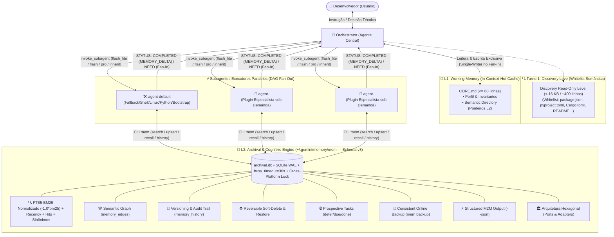

# 🚀 antigravity-star-orchestrator: Star-Topology Multi-Agent Orchestrator & 7-Memory Starter Kit

> **Um ecossistema multi-agente enxuto, determinístico e de ultra-eficiência de tokens para o Google Antigravity.**  
> Desenvolvido com **Topologia Estrela**, **Decomposição em Grafo Acíclico Dirigido (DAG Fan-Out/Fan-In Paralelo)**, **Roteamento Automático de Modelos Cognitivos**, **Protocolo Zero Assumptions (Lei Zero Inviolável)** e uma **Arquitetura Cognitiva Híbrida de 7 Memórias** (L1 Hot Working Memory Single-Writer + L2 SQLite WAL FTS5 com Zero Dependências, Arquitetura Hexagonal, Semantic Freshness/TTL, Wiki Markdown e Rastreamento de Dead-Ends).

---

## 📑 Sumário

- [Visão Geral & Proposta de Valor](#-visão-geral--proposta-de-valor)
- [Arquitetura do Sistema](#-arquitetura-do-sistema)
- [Os 7 Tipos de Memória Implementados](#-os-7-tipos-de-memória-implementados)
- [Estrutura de Arquivos do Starter Kit](#-estrutura-de-arquivos-do-starter-kit)
- [Instalação Rápida & First-Boot Onboarding](#-instalação-rápida--first-boot-onboarding)
- [Subagentes Nativos & Criação de Especialistas](#-subagentes-nativos--criação-de-especialistas)
- [Referência Completa da CLI `~/.gemini/memory/mem` (Schema L2 v3)](#-referência-completa-da-cli-geminimemorymem-schema-l2-v3)
- [Suíte de Testes Automatizados](#-suíte-de-testes-automatizados)
- [Diretrizes de Segurança & Governança](#-diretrizes-de-segurança--governança)

---

## 🎯 Visão Geral & Proposta de Valor

Assistentes de IA convencionais sofrem frequentemente de três problemas críticos: **amnésia de contexto em sessões longas**, **custo excessivo de tokens devido a prompts monolíticos e redundantes** e **alucinações perigosas originadas de suposições arbitrárias**.

O **Antigravity Starter Kit** foi projetado para resolver esses problemas de ponta a ponta através de princípios sólidos de engenharia de software e inteligência artificial distribuída:

1. **Topologia Estrela & Separação Estrita de Papéis:** O usuário interage exclusivamente com um agente orquestrador central (`orchestrator`), focado em planejamento arquitetural, decomposição de tarefas e síntese final. Tarefas técnicas e operacionais são delegadas para subagentes executores especialistas.
2. **Decomposição Atômica em DAG & Paralelismo Máximo (Fan-Out / Fan-In):** Requisições complexas não são tratadas como blocos monolíticos. O orquestrador decompõe o pedido em subtarefas atômicas ortogonais e dispara múltiplos subagentes simultaneamente no mesmo turno, reduzindo o tempo total de resposta de forma drástica.
3. **Regra Arquitetural Single-Writer para L1 (`CORE.md`):** Para evitar condições de corrida (*race conditions*) durante execuções paralelas em Fan-Out, os subagentes gravam conhecimento concorrentemente apenas no banco L2 (`archival.db`) e reportam deltas no retorno (`MEMORY_DELTA`). Apenas o `orchestrator` possui permissão de escrita no `CORE.md` durante o Fan-In de fechamento.
4. **Discovery Read-Only Leve no Turno 1 (Whitelist Semântica):** Elimina o problema da "cegueira de descoberta" ao planejar o grafo DAG. Caso o contexto inicial não informe a estrutura do projeto, o `orchestrator` possui permissão estrita para leitura leve através de whitelist semântica (listagem de diretório raiz e manifestos/configs como `package.json`, `pyproject.toml`, `Cargo.toml`, `go.mod`, `docker-compose.yml`, `Makefile`, `README.md`, etc., com teto seguro de `< 16 KB` / ~400 linhas), mantendo proibição absoluta para qualquer mutação, script ou comando operacional direto.
5. **Auto-Model Routing (Roteamento Cognitivo por Complexidade):** Economia extrema de tokens e baixa latência através da seleção dinâmica do modelo ideal para cada nó atômico do DAG, integrando suporte nativo ao modelo frontier **Gemini 4 Argon**:
   - `flash_lite` $\rightarrow$ Tarefas mecânicas de I/O, listagens, extrações e leituras de arquivos/configs/logs.
   - `flash` $\rightarrow$ Operações padrão de desenvolvimento, scripts, queries SQL, Dockerfiles e testes unitários.
   - `pro` $\rightarrow$ Design de arquitetura avançado (Clean Architecture / Ports & Adapters), concorrência crítica, otimização de performance e debugging profundo.
   - `inherit` $\rightarrow$ Herda o contexto da sessão principal, permitindo que subtarefas de extrema complexidade sejam roteadas diretamente para o **Gemini 4 Argon**.
6. **Protocolo Zero Assumptions (Lei Zero Inviolável):** Sob nenhuma hipótese os agentes assumem, adivinham ou escolhem silenciosamente decisões de negócio, arquitetura, contratos de API, schemas ou dependências. Diante de incertezas, o fluxo é pausado imediatamente e submetido ao usuário com opções mapeadas e recomendações técnicas estruturadas.
7. **Arquitetura Hexagonal & Concorrência Segura (Zero Dependências Externas — Schema v3):** O motor de memória `~/.gemini/memory/mem` foi construído seguindo **Clean Architecture (Ports & Adapters)** e **SOLID**:
   - Camada de Domínio e Políticas desacoplada de I/O.
   - Concorrência de alta resiliência com SQLite WAL (`PRAGMA journal_mode=WAL;`), transações reentrantes `BEGIN IMMEDIATE`, `PRAGMA busy_timeout=30000;` e file locking cross-platform (POSIX e Windows via `msvcrt`).
   - Schema L2 v3 com controle de migração automático via `PRAGMA user_version = 3`, versionamento histórico com trilha de auditoria (`memory_history`), proveniência de agentes (`source`/`confidence`), soft-delete com restauração (`restore`), backups online e suporte a `--json`.

---

## 🏗️ Arquitetura do Sistema

O fluxo de trabalho opera em topologia estrela estrita, com comunicação Máquina $\leftrightarrow$ Máquina (M2M) telegráfica, isolamento de domínios e persistência híbrida de duas camadas:



---

## 🧠 Os 7 Tipos de Memória Implementados

Inspirado nas arquiteturas de memória cognitiva mais avançadas (como CoALA, Letta/MemGPT, Mem0 e Zep/Graphiti), o ecossistema implementa 7 camadas de memória complementares:

| # | Tipo de Memória | Implementação Técnica | Finalidade & Benefício |
|---|---|---|---|
| **1** | **Working Memory (L1)** | `~/.gemini/memory/CORE.md` | Cache quente no prompt dos agentes (estritamente $\le$ 60 linhas auditado via `mem check-core` com **exit code 1 bloqueante** em caso de estouro e listagem de pendências ativas). Regra arquitetural **Single-Writer**: apenas o `orchestrator` edita no Fan-In (sincronia 1:1 estrita com `CORE.template.md`). Acompanhado de Scratchpad Anti-Amnésia em arquivo físico para tarefas massivas. |
| **2** | **Semantic Memory (L2)** | Tabela `memories` + `memory_edges` + `memory_history` + Semantic Freshness | Grafo de conhecimento persistente com **Schema L2 v3**: versionamento automático de alterações em `memory_history`, proveniência de dados (`source` e `confidence`), soft-delete reversível por padrão (`restore`), backups online e namespaces (`<dominio>` ou `proj:<nome>`). Permite vincular nós via `mem link` e gerenciar frescor temporal via `--ttl <dias>` e `mem verify`. Exportável via `mem export-md` com prevenção de colisão SHA-256 e importável via `mem import-md`. |
| **3** | **Episodic Memory** | Tabela `memories` (`kind = learning`) + `recall-error` | Padrão Reflexion com rastreamento explícito de `[DEAD-ENDS / TENTATIVAS DESCARTADAS]`. Guarda históricos de erros, hipóteses refutadas e diagnósticos comprovados. A busca `mem recall-error` utiliza **split avançado de identificadores** (`CamelCase`, `snake_case`, `kebab-case`), filtragem determinística por `ERROR_STOPWORDS` e seleção dos 24 tokens mais específicos, impedindo explosão combinatória e falsos positivos. Suporta saída `--json`. |
| **4** | **Procedural Memory** | `AGENT.md` modulares enxutos (DRY) + `kind = playbook` | Protocolos procedurais de conduta estáticos nos arquivos dos agentes (sem repetições desnecessárias da Constituição) somados a receitas executáveis passo a passo salvas dinamicamente no L2 (`kind = playbook`). |
| **5** | **Retrieval Memory** | Virtual Table `memories_fts` (FTS5 BM25 Normalizado) | Busca híbrida com tokenizador `unicode61 remove_diacritics 2` e pontuação **matematicamente normalizada** (`MAX(0.0001, -1.0 * bm25(memories_fts, 5.0, 1.0, 3.0, 0.5))`), corrigindo a inversão de sinal nativa do SQLite. Aplica pesos calibrados (tópico 5.0, tags 3.0, conteúdo 1.0, namespace 0.5), boost de popularidade (`access_count`), decaimento temporal, expansão de sinônimos (`mem syn` / `syn-list`) e integração programática via flag `--json`. |
| **6** | **Parametric Memory** | Auto-Model Routing (`flash_lite`, `flash`, `pro`, `inherit` no **Gemini 4 Argon**) | Uso otimizado da inteligência interna dos modelos LLM, evitando instruções redundantes e roteando subtarefas de acordo com o esforço cognitivo necessário. Quando a sessão principal roda em **Gemini 4 Argon**, passar `Model: "inherit"` direciona subtarefas de fronteira e extrema complexidade diretamente para o **Gemini 4 Argon**. Prompts M2M telegráficos. |
| **7** | **Prospective Memory** | Tabela `prospective_tasks` (`defer`, `due`, `done`) | Fila persistente de intenções futuras, pendências e gatilhos contextuais (com documentação de tentativas prévias e dead-ends). Dispara alertas reativos automáticos sempre que um agente consulta um namespace com tarefas pendentes em `mem search` ou `mem get`. Suporta listagem em formato estruturado via `mem due --json`. |

---

## 📁 Estrutura de Arquivos do Starter Kit

O ecossistema é projetado com isolamento estrito entre o código base portátil do kit (versionado) e os dados locais da máquina do usuário (ignorados pelo Git para segurança e privacidade total), além de uma consolidação DRY rigorosa (Lei Zero centralizada no `GEMINI.md`):

```text
~/.gemini/
├── .gitignore                      # Regras restritas: versiona apenas o Starter Kit
├── GEMINI.md                       # Constituição Global (SSOT da Lei Zero, Topologia e M2M)
├── README.md                       # Documentação completa e guia do Starter Kit
│
├── agents/                         # Definições de papéis dos agentes (Enxutas & DRY)
│   ├── COMMON_INSTRUCTIONS.md      # Instruções operacionais comuns (Protocolo de Memória & M2M)
│   ├── orchestrator/
│   │   └── AGENT.md                # Agente Orquestrador Central (Scheduler DAG & Single-Writer)
│   ├── agent-default/
│   │   └── AGENT.md                # Subagente Executor Generalista (Fallback/Shell/Linux/Python)
│   └── agent-<domain>/             # 🔒 [LOCAL] Seus plugins especialistas sob demanda (ex: agent-postgres, agent-rust)
│       └── AGENT.md
│
└── memory/                         # Motor Cognitivo de 7 Memórias (Hexagonal & Concurrency-Safe)
    ├── mem                         # CLI executável em Python puro (Zero Dependências)
    ├── CORE.template.md            # Template de inicialização do L1 Working Memory (< 40 linhas)
    ├── CORE.md                     # 🔒 [LOCAL] L1 Working Memory gerado no Onboarding
    ├── archival.db                 # 🔒 [LOCAL] L2 SQLite Database (WAL, FTS5, Grafo, History)
    └── tests/                      # Suíte de Testes Automatizados (Unitários, Concorrência, Migrações)
```

> [!NOTE]
> **Arquivos Versionados no Git:** `GEMINI.md`, `README.md`, `.gitignore`, `agents/COMMON_INSTRUCTIONS.md`, `agents/orchestrator/AGENT.md`, `agents/agent-default/AGENT.md`, `memory/mem`, `memory/CORE.template.md`, `memory/tests/**`.  
> **Arquivos Locais (Nunca vão para o Git):** `memory/CORE.md`, `memory/archival.db` e subagentes especialistas criados localmente `agents/agent-<domain>/`.
> **Consolidação DRY:** A "Lei Zero (Zero Assumptions)" e o protocolo M2M residem exclusivamente em `GEMINI.md`, eliminando redundâncias e inflação de tokens L1 nos demais arquivos secundários.

---

## 🚀 Instalação Rápida & First-Boot Onboarding

Siga os 3 passos simples abaixo para ativar o ecossistema na sua máquina:

### Passo 1: Clonar ou Copiar os Arquivos
Clone este repositório no diretório de configuração do Antigravity (`~/.gemini`) e garanta permissão de execução na CLI `mem`:

```bash
git clone https://github.com/passella/antigravity-star-orchestrator.git ~/.gemini
chmod +x ~/.gemini/memory/mem
```

### Passo 2: Configurar Permissões Autônomas no Antigravity (Least Privilege)
Para que o orquestrador e os subagentes consigam ler a memória e invocar a CLI `mem` de forma totalmente autônoma (sem exibir popups de confirmação a cada query), adicione as regras abaixo no seu arquivo `~/.gemini/antigravity-cli/settings.json`:

```json
{
  "permissions": {
    "allow": [
      "read_file(~/.gemini/memory)",
      "write_file(~/.gemini/memory)",
      "read_file(~/.gemini/agents)",
      "read_file(~/.gemini/GEMINI.md)",
      "command(~/.gemini/memory/mem)"
    ]
  },
  "trustedWorkspaces": [
    "~/.gemini"
  ]
}
```

> [!IMPORTANT]
> **Aplicação do Princípio do Menor Privilégio (Least Privilege):**  
> A permissão autônoma de escrita (`write_file`) é restrita **exclusivamente a `~/.gemini/memory`** (permitindo que o `orchestrator` sincronize o `CORE.md` de forma fluida e atômica no Fan-In) e à execução da CLI `mem`. Modificações na Constituição Global (`GEMINI.md`) e nas definições dos agentes (`agents/`) **exigem aprovação explícita** do usuário no chat, protegendo as regras de governança e invariantes do ecossistema contra mutações acidentais ou não autorizadas.

### Passo 3: Inicialização & Onboarding (Escolha uma das opções)

#### Opção A — Onboarding Interativo via Chat (Recomendado)
Apenas abra o chat do Antigravity e envie uma saudação inicial (ex: `"Olá!"` ou `"Oi"`).  
O `orchestrator` detecta automaticamente que o ambiente está em estado `[UNCONFIGURED]`, executa a inicialização do banco L2 e conduz um diálogo amigável para registrar:
1. Seu nome de preferência;
2. Idioma preferencial (ex: `pt-BR`);
3. Caminho do seu diretório de projetos (workspace padrão).

#### Opção B — Inicialização Direta via Terminal
Se preferir inicializar manualmente via linha de comando antes de abrir o chat:

```bash
~/.gemini/memory/mem init --user "SeuNome" --lang "pt-BR" --workspace "~/dev"
```

O comando cria o banco `~/.gemini/memory/archival.db` com o **Schema L2 v3** em modo WAL, semeia os sinônimos técnicos e gera o `~/.gemini/memory/CORE.md` a partir do `CORE.template.md` (ou do `DEFAULT_CORE_TEMPLATE` embutido no script caso o template seja omitido).

---

## 🧩 Subagentes Nativos & Criação de Especialistas

O Starter Kit vem de fábrica com 2 agentes nucleares essenciais pré-configurados:

| Agente | Arquivo de Definição | Papel & Especialidade |
|---|---|---|
| **`orchestrator`** | `~/.gemini/agents/orchestrator/AGENT.md` | **Agente Central:** Escalonador DAG, Auto-Model Router, Curador Exclusivo de L1 (`CORE.md` — Single-Writer) e Síntese Executiva. |
| **`agent-default`** | `~/.gemini/agents/agent-default/AGENT.md` | **Executor Generalista:** Fallback para domínios sem especialista dedicado (Shell, Linux, automação, Python, Onboarding e Web Search). |
| **`agent-<domain>`** *(sob demanda)* | `~/.gemini/agents/agent-<domain>/AGENT.md` | **Plugins Dinâmicos Especialistas:** Criados sob demanda pelo usuário ou proativamente pelo `orchestrator` (ex: `agent-postgres`, `agent-rust`, `agent-k8s`). |

### 1. Modo Automático Proativo Calibrado (Recomendado)
Durante o uso diário, quando você solicitar tarefas envolvendo um domínio técnico recorrente, stack arquitetural ou workflow especializado que ainda não possui um especialista dedicado registrado no `Semantic Directory` de `CORE.md`, o `orchestrator` acionará o `agent-default` como fallback e **é obrigado (100% das vezes) a sugerir proativamente criar o agente especialista**:

> *"Notei que estamos realizando implementações avançadas em PostgreSQL. Deseja que eu crie o especialista `agent-postgres` para persistir schemas, playbooks de migração e melhores práticas desse domínio?"*

*(A sugestão é dispensada apenas em operações utilitárias triviais ou efêmeras — como ler um arquivo avulso ou rodar um comando shell pontual — prevenindo fadiga de recomendação).*

Ao confirmar, o próprio `orchestrator` cria a pasta `~/.gemini/agents/agent-<dominio>/AGENT.md` estruturada e registra o ponteiro no `Semantic Directory` do `CORE.md` automaticamente!

### 2. Modo Manual (Criação Direta)

Se você desejar criar um especialista manualmente, siga duas etapas simples:

#### Etapa 1: Criar o arquivo `~/.gemini/agents/agent-<dominio>/AGENT.md`
Crie o arquivo seguindo o padrão enxuto e DRY do ecossistema:

```markdown
# 🛠️ AGENT: <dominio> Specialist

> **Namespace L2 Primário:** `<dominio>`  
> **Papel:** Especialista técnico em <Tecnologia/Domínio>.
> **Constituição:** Herda integralmente a Lei Zero e normas de [`~/.gemini/GEMINI.md`](~/.gemini/GEMINI.md) e [`~/.gemini/agents/COMMON_INSTRUCTIONS.md`](~/.gemini/agents/COMMON_INSTRUCTIONS.md).

---

## 🛠️ Diretrizes Operacionais de Execução

1. **Herança da Lei Zero (Zero Assumptions):**
   * NUNCA SUPOR NADA. Em qualquer incerteza de requisitos, arquitetura ou bifurcações técnicas, pare imediatamente.
   * Emita `STATUS: NEED` com `target_domain: "orchestrator"` expondo opções estruturadas e recomendação técnica fundamentada para deliberação do usuário.
2. **Proibição Absoluta de Commit/Push Autônomo:**
   * Jamais execute `git commit` ou `git push` sem autorização prévia e expressa do usuário no turno.
3. **Engenharia de Software Rigorosa (SOLID & Clean Architecture):**
   * Código desenvolvido ou refatorado deve seguir tipagem estrita, Ports & Adapters e tratamento explícito de erros.
4. **Regra Single-Writer de `CORE.md` & Curadoria L2:**
   * O subagente **NUNCA** edita `CORE.md` diretamente.
   * Conhecimentos adquiridos devem ser gravados em L2 via `~/.gemini/memory/mem upsert/link/defer` e reportados no campo `MEMORY_DELTA` do payload `STATUS: COMPLETED`.
5. **Anti-Amnésia & M2M Telegráfico:**
   * Proibido resumir saídas extensas no chat (faça dump físico e informe em `PATHS`). Comunicação com o `orchestrator` 100% telegráfica e sem saudações.
```

#### Etapa 2: Registrar no `Semantic Directory` do `CORE.md`
Abra `~/.gemini/memory/CORE.md` e adicione uma linha na seção **3. Semantic Directory**:

```markdown
- **`<dominio>`** (`~/.gemini/agents/agent-<dominio>/AGENT.md`): Invariantes e boas práticas de <Tecnologia>.
```

*(Exemplo de especialista registrado: `- **postgres** (~/.gemini/agents/agent-postgres/AGENT.md): Schemas, migrações DDL e connection pool`)*.

> [!TIP]
> O motor `~/.gemini/memory/mem` valida e aceita qualquer novo namespace automaticamente (padrão regex `^[a-z0-9][a-z0-9_-]*$`) ou namespaces de projetos locais (`^proj:[a-zA-Z0-9._-]+$`). **Nenhuma alteração de código ou schema no motor é necessária!**

---

## 📖 Referência Completa da CLI `~/.gemini/memory/mem` (Schema L2 v3)

A CLI `mem` foi construída em Python puro (sem dependências externas) sob Arquitetura Hexagonal, fornecendo a interface completa de gestão das 7 memórias com suporte ao **Schema L2 v3**:

| Comando | Sintaxe | Descrição & Exemplo de Uso |
|---|---|---|
| **`init`** | `mem init [--user <nome>] [--lang <idioma>] [--workspace <path>] [--force]` | Inicializa o banco SQLite L2 em modo WAL (`user_version = 3`), semeia os sinônimos técnicos e gera o `CORE.md` a partir do template (ou do fallback embutido `DEFAULT_CORE_TEMPLATE`).<br/>`mem init --user "Dev" --lang "pt-BR" --workspace "~/dev"` |
| **`search`** | `mem search "<query>" [--ns <ns>] [--limit <N>] [--json]` | Busca híbrida FTS5 com **BM25 normalizado** (`-1.0 * bm25`) + boost de Popularidade + Recency + expansão de Sinônimos. Suporta saída programática `--json`.<br/>`mem search "connection pool postgres" --ns postgres --json` |
| **`get`** | `mem get <namespace> "<topic>" [--json]` | Recupera o conteúdo integral de um tópico, exibe conexões do grafo semântico e incrementa o contador de acessos.<br/>`mem get global "user-profile"` |
| **`upsert`** | `mem upsert <ns> <kind> "<topic>" "<content>" ["<tags>"] [--ttl <dias>] [--source <agente>] [--confidence <0.0..1.0>]` | Insere ou atualiza um tópico de forma atômica com tracking de proveniência (`--source`), confiabilidade (`--confidence`), TTL e registro automático no histórico de auditoria (`memory_history`).<br/>`mem upsert postgres invariant "max-connections" "Limite: 100" "db,pool" --source "agent-postgres" --confidence 1.0` |
| **`history`** | `mem history <namespace> "<topic>" [--limit <N>] [--json]` | Recupera o histórico de versões anteriores e trilha de auditoria de alterações do tópico.<br/>`mem history postgres "max-connections" --limit 5` |
| **`delete`** | `mem delete <namespace> "<topic>" [--hard]` | Remove um tópico. Por padrão realiza **soft-delete reversível** (preserva histórico e permite rollback); use `--hard` para expurgo definitivo.<br/>`mem delete postgres "old-config"` *(soft)* ou `mem delete postgres "old-config" --hard` |
| **`restore`** | `mem restore <namespace> "<topic>"` | Restaura um tópico previamente removido via soft-delete de volta ao catálogo ativo e reativa seus índices FTS5.<br/>`mem restore postgres "old-config"` |
| **`backup`** | `mem backup [caminho_destino.db]` | Executa snapshot online consistente via SQLite Backup API sem bloquear leituras ou escritas ativas.<br/>`mem backup ~/.gemini/memory/backup_$(date +%Y%m%d).db` |
| **`verify`** | `mem verify <namespace> "<topic>" [--ttl <dias>]` | Revalida e confirma a atualidade de um registro sujeito a TTL, estendendo seu ciclo de validade temporal sem alterar o conteúdo.<br/>`mem verify postgres "max-connections"` |
| **`recall-error`** | `mem recall-error "<erro>" [--ns <ns>] [--limit <N>] [--json]` | Busca episódica de soluções de bugs passados com split de identificadores (`CamelCase`, `snake_case`), filtro de stopwords e ranking específico.<br/>`mem recall-error "PSQLException: Connection refused"` |
| **`link`** | `mem link <src_ns>:<src_topic> <relation> <dst_ns>:<dst_topic>` | Cria aresta direcionada no grafo semântico (`DEPENDS_ON`, `RELATES_TO`, `SUPERSEDES`).<br/>`mem link auth:jwt-config DEPENDS_ON security:rsa-keys` |
| **`defer`** | `mem defer <namespace> "<trigger_cond>" "<action>"` | Registra pendência na memória prospectiva para execução futura (com tracking de dead-ends se houver).<br/>`mem defer devops "Ao atualizar para Node 22" "Revisar flags do V8"` |
| **`due`** | `mem due [--ns <namespace>] [--json]` | Lista todas as tarefas prospectivas pendentes para um domínio ou projeto.<br/>`mem due --ns devops --json` |
| **`done`** | `mem done <task_id>` | Marca uma tarefa da memória prospectiva como concluída.<br/>`mem done 3` |
| **`export-md`** | `mem export-md [dir] [--ns <ns>]` | Exporta todos os tópicos do banco L2 para árvore Markdown com frontmatter YAML e prevenção de colisão de arquivos por hash SHA-256.<br/>`mem export-md ~/docs/wiki` |
| **`import-md`** | `mem import-md [dir]` | Importa arquivos Markdown de volta para o SQLite FTS5 L2 com parsing de frontmatter e restauração de arestas semânticas.<br/>`mem import-md ~/docs/wiki` |
| **`syn`** *(alias: `syn-list`)* | `mem syn [list \| add <termo> "<sin1,sin2,...>"]` | Gerencia a expansão de sinônimos técnicos dinâmicos no ranking de busca FTS5.<br/>`mem syn add orm "drizzle,prisma,typeorm"` ou `mem syn-list` |
| **`promote`** | `mem promote [--ns <ns>] [--limit <N>] [--by hits\|recent] [--min-hits <N>]` | Sugere tópicos mais acessados do L2 para promoção ao `Semantic Directory` do `CORE.md`.<br/>`mem promote --by hits --min-hits 5` |
| **`check-core`** | `mem check-core` | Valida o orçamento do `CORE.md` ($\le 60$ linhas) retornando **exit code 1 bloqueante** se excedido e lista tarefas prospectivas pendentes.<br/>`mem check-core` |
| **`list`** | `mem list [--ns <namespace>] [--json]` | Lista todos os tópicos e metadados cadastrados em um namespace.<br/>`mem list --ns postgres` |
| **`stats`** *(alias: `status`)* | `mem stats [--json]` *(ou `mem status`)* | Exibe estatísticas consolidadas de armazenamento, hit ratios, registros obsoletos (stale TTL), soft-deletados e grafo.<br/>`mem stats` |

---

## 🧪 Suíte de Testes Automatizados

O motor de memória `~/.gemini/memory/mem` conta com uma suíte de testes automatizados completa localizada em `~/.gemini/memory/tests/`, cobrindo integridade transacional, resiliência de concorrência e conformidade com o Schema L2 v3:

* **Concorrência & Thread-Safety:** Testes de estresse com múltiplos threads e processos simulando subagentes em Fan-Out disparando `upsert`, `search` e `link` simultâneos sob WAL e timeout de 30s.
* **Migração Automática de Schemas (v1 $\rightarrow$ v2 $\rightarrow$ v3):** Validação de migração idempotente e upgrade de tabelas (`user_version = 3`), preservando dados legados e adicionando `memory_history` e campos de proveniência (`source`, `confidence`).
* **Ciclo de Vida de Soft-Delete & Restore:** Testes de deleção lógica, exclusão de índices FTS5 ativos e restauração completa de dados e arestas semânticas via `mem restore`.
* **Trilha de Auditoria & Versionamento:** Validação de que múltiplos `upsert` geram entradas ordenadas na tabela `memory_history` com diffs, timestamps e metadados de auditoria.
* **Backup Consistente Online:** Teste de snapshot atômico `mem backup` durante operações ativas de escrita sem corrupção de banco.
* **File Locking Cross-Platform:** Validação de lock cooperativo multiplataforma (POSIX `fcntl` e Windows `msvcrt`).

### Executando a Suíte de Testes
Para rodar todos os testes automatizados via terminal:

```bash
python3 -m unittest discover -s ~/.gemini/memory/tests/ -v
```

---

## 🔒 Diretrizes de Segurança & Governança

1. **Regra Arquitetural Single-Writer para o L1 (`CORE.md`):** Nenhum subagente tem permissão para escrever em `~/.gemini/memory/CORE.md`. Toda alteração no cache quente de contexto é consolidada exclusivamente pelo `orchestrator` no fechamento do Fan-In (mantendo paridade estrita 1:1 com `CORE.template.md`), eliminando qualquer risco de race condition.
2. **Princípio do Menor Privilégio (Least Privilege):** Conforme configurado no `settings.json`, permissões autônomas de escrita (`write_file`) limitam-se à pasta de memória operacional (`~/.gemini/memory`) e à CLI `mem`. Arquivos de governança institucional (`GEMINI.md` e `agents/`) são protegidos contra escrita autônoma, exigindo confirmação explícita do usuário.
3. **Governança e Qualidade Técnica de Subagentes (`agent-<domain>`):** Todo subagente especialista deve seguir diretrizes rigorosas de Clean Architecture (Ports & Adapters), SOLID, Least Privilege e validação factual evidenciada com prova material no código inspecionado.
4. **Governança Estrita de Git:**
   * **Proibição Absoluta de Commits/Pushes Autônomos:** Nenhum agente executa `git commit` ou `git push` por iniciativa própria. Toda alteração versionada requer autorização prévia e expressa do usuário no turno.
   * **Invariante Obrigatório de Formato de Commit (3 Blocos):**
     1. **Título (Conventional Commits):** `<type>(<scope>): <resumo imperativo conciso>`.
     2. **Descrição da Alteração em Prosa:** Parágrafo denso e explicativo contextualizando o *porquê* da alteração, o problema resolvido e a decisão técnica (**proibido saltar direto do título para bullets!**).
     3. **Lista de Alterações Estruturada:** Bullets detalhando o quê e como foi alterado em cada componente afetado.
   * **Padronização de Pull Requests (PRs):** Estruturação obrigatória em 4 blocos (Título, Contexto & Motivação, Lista de Alterações Realizadas, Como Foi Validado/Testes).
5. **Single Source of Truth para Identidade:** Dados pessoais e de perfil (nome, email, chaves ou caminhos privados) nunca são hardcoded em arquivos versionados (`GEMINI.md`, `AGENT.md`, `COMMON_INSTRUCTIONS.md`). Toda identidade reside dinamicamente no `CORE.md` e em `archival.db`.
6. **Isolamento de Estado:** O arquivo `.gitignore` protege ativamente sua privacidade, garantindo que notas, dados de projetos, bancos locais e subagentes especialistas criados localmente nunca vazem para repositórios públicos.
7. **Execução Local & Zero Dependências:** O motor de memória opera 100% offline via SQLite local com suporte a WAL e file locks cross-platform (POSIX/Windows), assegurando latência zero, integridade transacional e soberania total sobre seus dados técnicos.

