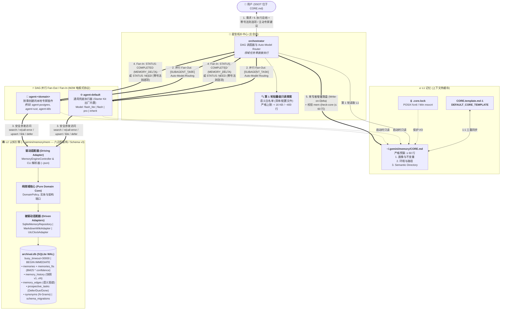
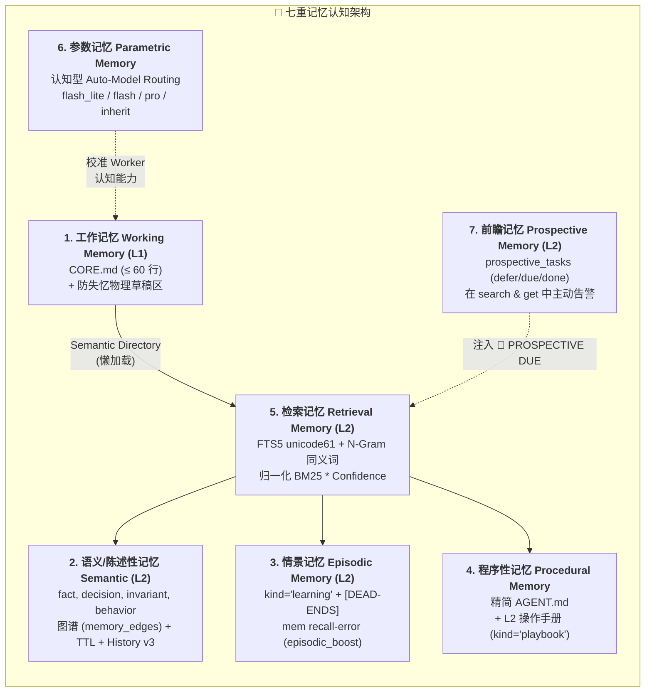
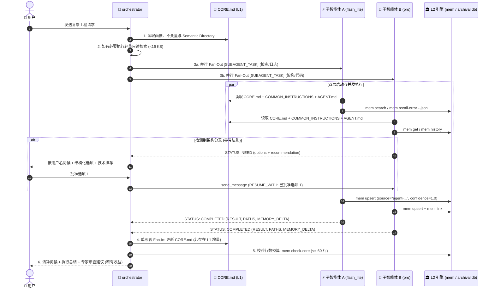

# 🚀 Antigravity: 全局星型拓扑多智能体生态与混合认知记忆引擎

🌐 **语言 / Languages:** [Português (BR)](README.md) | [English](README.en.md) | [Español](README.es.md) | **简体中文**

[](#2-架构支柱)
[-007ec6?style=flat-square)](#3-七重记忆混合认知架构)
[](#4-l2-引擎内部工程实现-geminimemorymem)
[-ffd343?style=flat-square)](#4-l2-引擎内部工程实现-geminimemorymem)
[-brightgreen?style=flat-square)](#10-自动化测试套件)

**Antigravity** 是一个基于**严格星型拓扑（Strict Star-Topology）**的多智能体编排框架，同时配备**双层混合认知记忆引擎（2-Tier Hybrid Cognitive Memory Engine，Schema L2 v3）**，专为在全局目录 `~/.gemini` 上原生运行而设计。它将孤立的 LLM 会话转化为确定性的分布式软件工程系统——结合有向无环图并行调度（**DAG Fan-Out / Fan-In**）、动态认知模型路由（**Auto-Model Routing**）、**零假设治理（Zero Assumptions / 零号法则）**以及零外部依赖的 SQLite WAL + FTS5 并发事务持久化。

---

## 📑 目录

1. [价值主张与工程哲学](#1-价值主张与工程哲学)
2. [架构支柱](#2-架构支柱)
3. [七重记忆混合认知架构](#3-七重记忆混合认知架构)
4. [L2 引擎内部工程实现 (`~/.gemini/memory/mem`)](#4-l2-引擎内部工程实现-geminimemorymem)
5. [端到端生命周期 (四阶段演练)](#5-端到端生命周期-四阶段演练)
6. [仓库结构与 Git 隔离 (Starter Kit)](#6-仓库结构与-git-隔离-starter-kit)
7. [安装、最小权限与首次启动引导 (First-Boot Onboarding)](#7-安装最小权限与首次启动引导-first-boot-onboarding)
8. [子智能体生态与专家创建 (`agent-<domain>`)](#8-子智能体生态与专家创建-agent-domain)
9. [`~/.gemini/memory/mem` CLI 完整参考](#9-geminimemorymem-cli-完整参考)
10. [自动化测试套件](#10-自动化测试套件)
11. [Git 治理、安全与代码不变量](#11-git-治理安全与代码不变量)

---

## 1. 价值主张与工程哲学

常规基于 LLM 的编程助手在应用于真实软件工程项目时，通常存在四个严重的结构性缺陷：

| 传统 LLM 智能体的典型痛点 | Antigravity 的工程解决方案 |
| :--- | :--- |
| **1. 跨会话失忆与重复犯错** | **双层混合记忆 + 情景错误召回（`recall-error`）：** L1 热缓存（`CORE.md` $\le 60$ 行）始终驻留上下文，并与 L2 归档库（基于 SQLite WAL + FTS5 的 `archival.db`）配对；L2 存储事实、决策、语义图谱、版本历史（`memory_history`）以及强制包含 `[DEAD-ENDS / TENTATIVAS DESCARTADAS]` 章节的经验教训（`learning`）。 |
| **2. 上下文爆炸与注意力退化（*Context Rot*）** | **星型拓扑 + 差分上下文传递（M2M）：** 主智能体（`orchestrator`）绝不直接执行项目代码，也不堆积原始输出转储。它将需求拆解为原子级子任务，并以无噪声的电报式格式仅向子智能体注入必需的路径与不变量。超长输出强制落盘保存（防失忆原则）。 |
| **3. 并行多智能体执行中的竞态条件** | **L1 单写者（Single-Writer）+ L2 事务并发：** 在并行 Fan-Out 期间，子智能体**绝不**直接编辑 `CORE.md`；它们并发写入 SQLite L2（受 `WAL`、`busy_timeout=30000` 与可重入事务 `BEGIN IMMEDIATE` 保护）并返回 `MEMORY_DELTA`。仅 `orchestrator` 在 Fan-In 阶段通过排他文件锁（`fcntl`/`msvcrt`）更新 `CORE.md`。 |
| **4. 架构幻觉与静默决策** | **不可违背的零号法则（Zero Assumptions 协议）：** 任何智能体均不得擅自假设需求、架构、公开契约、新增依赖库或作用域。遇到技术分叉时，子智能体立即通过 `STATUS: NEED` 中断执行，由 `orchestrator` 向用户呈报结构化选项与经充分论证的技术推荐方案。 |

---

## 2. 架构支柱

### 2.1. 严格星型拓扑（核心 `orchestrator`）
本生态严禁子智能体之间直接横向通信（避免混乱的 *mesh* 网状结构）。**`orchestrator`** 位于星型拓扑中心，是用户的唯一接触点与唯一的任务调度器：
* **绝对禁止编排器直接执行：** `orchestrator` 绝不编辑项目代码、编写 SQL 查询、执行特定领域的终端命令或操作容器。
* **第 1 轮轻量级只读探索（语义白名单）：** 当初始上下文未提供目标项目结构时，`orchestrator` 严格获准通过语义白名单执行轻量级只读侦察——仅列出根目录及读取顶层清单或配置文件（`package.json`、`pyproject.toml`、`Cargo.toml`、`go.mod`、`docker-compose.yml`、`Makefile`、`README.md` 等），并严格遵守 **`< 16 KB`（约 400 行）的安全上限**——且仅用于精准规划 DAG 图谱。所有深度分析与变更操作均委派给子智能体。
* **强制性洁净问候（零启动/状态报告）：** `orchestrator` 每次回复必须以 `CORE.md` 中记录的用户名向用户问候开篇，除非用户明确要求，否则绝不输出机械式的启动状态报告（例如 *"L1 记忆已同步"* 或 *"指令已加载"*）。

### 2.2. DAG 原子化拆解与 Fan-Out / Fan-In 并行调度
所有复杂请求均会被拆解为尽可能多的**原子化、正交且彼此独立的子任务**：
* **同步 Fan-Out：** 所有入度为零（无未决依赖）的子任务均在**同一轮次内**通过多次并行调用 `invoke_subagent` 同时触发。
* **智能会话复用 vs. 并行：** 并发子任务使用 `invoke_subagent` 启动并行实例；同一领域内受益于上下文缓存的顺序步骤，则通过 `send_message` 复用现有的 `conversationId`。

### 2.3. 认知型 Auto-Model Routing
在调用子智能体（`invoke_subagent(TypeName="self", Model=...)`）或 worker（`swarm`）时，`orchestrator` 基于 `agy` 实际的 **23 个模型**目录，选择能高质量完成子任务的最小模型与推理强度级别（`low`、`medium`、`high`、`xhigh`、`max`），以优化延迟与 Token 成本：

| `Model` 参数 | 认知复杂度与推理强度 | 理想适用场景、完整目录（23 个模型）与配额周期 |
| :--- | :--- | :--- |
| **`"flash_lite"`** | **Tier 1: 低（推理强度 `low` — I/O 与机械操作）** | 读取文件/配置/日志、目录列表、`git status`/`diff`、L2 快速检索（`mem search`）、端口检查及文本格式化。**每日重置：** `gemini-3.8-flash-low`、`gemini-4-hydrogen-low`、`gemini-4-neon-low`、`claude-sonnet-5-5-low`、`claude-opus-5-5-low` \| **每周重置 (7d)：** `gemini-4-argon-low`。 |
| **`"flash"`** | **Tier 2: 中（推理强度 `medium` — 标准工程操作）** | 实现边界清晰的类/函数、单元测试、自动化脚本、Dockerfile、SQL 查询（DDL/DML）与构建配置。**每日重置：** `gemini-3.8-flash-medium`、`gemini-3.8-flash-high`、`gpt-oss-120b-medium`、`gemini-4-hydrogen-medium`、`gemini-4-neon-medium`、`claude-sonnet-5-5-medium`。 |
| **`"pro"`** | **Tier 3: 高（推理强度 `high` / `xhigh` — 深度架构设计）** | Clean Architecture / Ports & Adapters、关键并发控制、大型结构重构、边界值分析（BVA）及复杂调试，同时保留 Argon 的每周配额。**每日重置：** `gemini-4-neon-high`、`gemini-4-hydrogen-high`、`claude-sonnet-5-5-high`、`claude-opus-5-5-medium`、`gemini-4-neon-xhigh`、`gemini-4-hydrogen-xhigh`。 |
| **`"inherit"`** | **Tier 4: 前沿（推理强度 `xhigh` / `max` / `high` Frontier）** | 全新架构决策、极端前沿难题与对抗性审计。**每日重置：** `claude-opus-5-5-high`、`gemini-4-neon-xhigh`、`gemini-4-hydrogen-xhigh`、`gemini-pro-orchestrator-neon` \| **每周重置 (7d)：** `gemini-4-argon-medium`、`gemini-4-argon-high`、`gemini-pro-orchestrator-g1-pro`。 |

* **智能配额自动故障转移（429 / Quota Exhaustion）：** 由于模型目录包含分布在独立配额池中的 23 个模型与 5 个推理强度级别（`low`、`medium`、`high`、`xhigh`、`max`），若某个 worker 在任务开始前或执行中途遇到配额耗尽（`RESOURCE_EXHAUSTED` / HTTP 429），`orchestrator` 会自动将执行重路由至具备可用配额且能力与推理强度相当的模型/层级（`flash_lite` $\leftrightarrow$ `flash` $\leftrightarrow$ `pro` $\leftrightarrow$ `inherit`，或在保留部分进度的同时在 Gemini 3.8 Flash、Gemini 4 Neon/Hydrogen/Argon、GPT-OSS、Claude Sonnet/Opus 5.5 与 Orchestrator 系列之间进行 *in-place* 原地切换），从而在不中断工作流的情况下透明地完成任务。

### 2.4. 不可违背的零号法则（Zero Assumptions 协议）
任何智能体（`orchestrator` 或子智能体）在以下方面遇到不确定性时，严禁静默推断或擅自选择：
1. **业务需求与业务规则**
2. **软件架构**（分层、Ports & Adapters、内部契约）
3. **公开 API 契约与数据库 Schema**
4. **库、框架与依赖项的选择或新增**
5. **安全、权限与作用域**

* **操作权衡校准：** 严格遵循 SOLID 原则及仓库现有约定的纯内部机械性或语法性细节，智能体拥有技术自治权，无需不必要地中断流程。
* **主动委派流程：** 遇到疑问或结构性决策时，子智能体立即停止执行并发出 `STATUS: NEED`（`target_domain: "orchestrator"`），列出 `options: ["选项 1 [推荐]", "选项 2"]` 及 `recommendation`。`orchestrator` 暂停流程并将选项与技术推荐提交给用户，最终决定权完全归属于用户。

### 2.5. L1 单写者规则与 1:1 三重同步不变量
* **`CORE.md` 单写者（Single-Writer）：** 仅 `orchestrator` 在轮次结束阶段（Fan-In 时的 *Shutdown Write-on-Delta*）拥有对 `~/.gemini/memory/CORE.md` 的写入权限，且必须通过 `~/.gemini/memory/mem check-core` 验证 $\le 60$ 行的预算限制。
* **1:1 三重同步不变量（`core-template-sync-invariant`）：** 每当 `~/.gemini/memory/CORE.template.md` 更新时，`orchestrator` 必须在同一轮次同步更新 `~/.gemini/memory/CORE.md` 以及 `~/.gemini/memory/mem` 中的常量 `DEFAULT_CORE_TEMPLATE`（反之亦然），确保严格逐行一致（仅允许占位符 `{{USER_NAME}}`、`{{USER_LANG}}` 和 `{{DEFAULT_WORKSPACE}}` 存在差异）。
* **身份单一事实来源（SSOT）：** 用户的个人数据（姓名、语言、私有项目路径）仅存储于 `CORE.md` 和 L2 数据库（`archival.db`）的 `global:user-profile` 记录中，严禁硬编码到受版本控制的过程性文件（`GEMINI.md`、`COMMON_INSTRUCTIONS.md`、`AGENT.md`、`README.md`）中。

### 2.6. M2M 电报式协议（差分上下文传递）
机器与机器（Machine $\leftrightarrow$ Machine）通信 100% 消除寒暄废话：

````carousel
```markdown
# 1. 原子子任务派发 (orchestrator -> 子智能体)
[SUBAGENT_TASK]
AGENT_ID: <agent-<domain> | agent-default>
AGENT_DEF: ~/.gemini/agents/<agent-id>/AGENT.md
ATOMIC_GOAL: <单一、直接且可验证的目标>
CONTEXT: <仅包含严格必需的路径、代码片段与不变量>
```
<!-- slide -->
```yaml
# 2. 疑问 / 依赖 / QA+AppSec 交接上报 (子智能体 -> orchestrator)
STATUS: NEED
AGENT: <meu-agent-id>
NEEDS:
  - target_domain: "<domain | default | orchestrator>" # 单个字符串或列表 (如: ["qa", "appsec"])
    atomic_goal: "<需要其他领域/门禁执行的动作，或需要委派给用户的疑问/决策>"
    context: "<变更摘要、执行的构建/测试命令、风险或技术场景>"
    options: ["<选项 1 [推荐]>", "<选项 2>"] # 存在疑问/决策时必填
    recommendation: "<推荐选项的客观技术依据>"
PATHS: ["<创建/修改/检查的绝对路径>"]
MEMORY_DELTA: "<none | 通过 mem upsert/link/defer 写入 L2 的 namespace/topic>"
RESUME_WITH: "<继续执行所需的确切数据/决策，或 QA+AppSec 批准确认>"
```
<!-- slide -->
```yaml
# 3. 子任务完成回报 (子智能体 -> orchestrator)
STATUS: COMPLETED
AGENT: <meu-agent-id>
RESULT: "<对已执行/已验证内容的精炼直接技术总结>"
PATHS: ["<创建/修改/检查的绝对路径>"]
MEMORY_DELTA: "<none | 通过 mem upsert/link/defer 写入 L2 的 namespace/topic>"
```
````

> [!NOTE]
> `STATUS: NEED` 中的 `target_domain` 字段既支持单个字符串（如 `"rust"`、`"orchestrator"`），也支持领域列表（如 `["qa", "appsec"]`）。所有开发类智能体（`EXTENDS: agent-dev-base`，审计状态下的 `agent-qa` 与 `agent-appsec` 除外）在完成代码/配置/基础设施/脚本变更后，必须强制发出 `target_domain: ["qa", "appsec"]` 的 `STATUS: NEED`；相应地，只要发现任何故障或漏洞，`agent-qa` 和 `agent-appsec` 就会发出 `target_domain: "<dev-stack>"` 的 `STATUS: NEED` 退回代码修复，如此循环直至双方均以 `STATUS: COMPLETED` 批准通过。

### 2.7. 动态专家插件注册表与对话结束审查
专家子智能体（`~/.gemini/agents/agent-<domain>/AGENT.md`）作为动态插件运行，索引于 `CORE.md` 的第 3 节（`Semantic Directory`）。
* **强制性对话结束审查与主动专家建议（`end-of-conversation-specialist-review` / `proactive-specialist-suggestion`）：** 在**每次**与用户对话或交付结束时——无论是否发生过回退到 `agent-default`——`orchestrator` 都会整体评估对话上下文，判断是否值得创建新的专家智能体（例如：新兴/高频的领域/技术栈/工作流、专用工具，或现有专家负载过重）。若确认有益，`orchestrator` **必须**在最终回复中包含结构化的推荐专家方案，明确列出：
  1. **智能体名称：** `agent-<domain>`
  2. **路径：** `~/.gemini/agents/agent-<domain>/AGENT.md`
  3. **继承（`EXTENDS`）：** 若适用于该领域则指明
  4. **领域作用域与不变量**
  5. **主要 L2 命名空间：** `<domain>`
  6. **收益理由**
* *抗噪校准：* 当不值得创建时（现有专家已充分覆盖，或仅是一次性/琐碎需求），`orchestrator` 不得生硬凑数建议。

### 2.8. 通用质量流水线（`dev <-> qa / appsec`）
生态中的所有软件开发需求（无论使用何种编程语言或技术栈）在最终交付用户前，都必须在 DAG 中执行强制性的双向闭环：
1. **`dev`（语言/技术栈专家）：** 严格遵循 SOLID、Clean Architecture / Ports & Adapters 及领域不变量进行实现或重构。在结束代码变更（功能、修复、契约、CLI/参数、API、依赖或配置）前，必须在同一轮次检查并同步更新受影响的文档（`README.md`、`docs/`、`CHANGELOG.md`、指南/Schema，即 **Doc-Sync Gate**），并执行 **Local CI Gate**（对 `.github/workflows/*.yml` 进行 1:1 本地仿真：运行严格模式 `zizmor`、`actionlint`、不可变 Git Tag SHA/Node.js 检查，以及实际运行 CI 中的 linter/测试/SCA/`run:` 步骤）。完成任何代码、配置、基础设施或脚本变更后（即使已通过本地测试），所有继承 `agent-dev-base` 的智能体**必须**以发出 `target_domain: ["qa", "appsec"]` 的 `STATUS: NEED` 结束（绝不单独发 `STATUS: COMPLETED`），附上变更客观摘要、`PATHS`、已执行的构建/测试命令、Doc-Sync Gate 状态、Local CI Gate 证据及风险/注意事项。
2. **`qa`（`agent-qa`）：** 独立对抗性质量门禁，执行边界测试（BVA）、*fuzzing*/*chaos* 混沌测试、linter 检查、严格不变量审计、在声明 `COMPLETED` 前强制执行与 `.github/workflows/*.yml` 1:1 对齐的 **Local CI Gate**，以及文档一致性核查（检测代码与文档/Schema 间的 *drift* 漂移）。
3. **`appsec`（`agent-appsec`）：** 持续安全审查，涵盖 OWASP/CWE、SAST 静态扫描、输入净化与供应链安全加固（*supply-chain hardening*）。
* **强制退回与阻塞循环（`qa/appsec -> "<dev-stack>"`）：** 每当 `agent-qa` 或 `agent-appsec` 发现**任何**故障、回归、不变量违规、Bug、漏洞或安全隐患时，**必须**发出指向对应技术栈开发专家 `target_domain: "<dev-stack>"` 的 `STATUS: NEED`，附带可执行取证报告（文件、行号、根因、严重度、复现/证据及预期修复方案）交由 dev 修复代码——存在未关闭问题时严禁返回 `STATUS: COMPLETED`。dev 修复后重新向 `["qa", "appsec"]` 发出 `STATUS: NEED`，循环迭代直至两者全部返回 `STATUS: COMPLETED`。
* **防死循环保障：** `agent-qa` 与 `agent-appsec`（同样继承自 `agent-dev-base`）在完成自身验证/审计时豁免向 `["qa", "appsec"]` 交接——仅当 100% 通过（零未决发现）时返回 `STATUS: COMPLETED`，或存在发现时向 `"<dev-stack>"` 发出 `STATUS: NEED`。
* **严格作用域豁免：** 仅纯只读任务（无文件编辑）、生成 commit/PR 消息或无代码/配置/基础设施/脚本修改的琐碎文本微调，方可豁免完整流水线交接。

### 2.9. 完整架构图



---

## 3. 七重记忆混合认知架构

受现代认知架构（*Letta/MemGPT、CoALA、Mem0 与 Zep/Graphiti*）融合思想启发，Antigravity 的持久化层将知识划分为 **2 个物理层级（Tiers）** 与 **7 个专业认知子系统**：



### 3.1. 工作记忆（Working Memory L1 + 防失忆物理草稿区）
* **L1 热缓存（`~/.gemini/memory/CORE.md`）：** 严格控制在 **$\le 60$ 行**预算内（通过 `mem check-core` 审计，可通过 `--max-lines` 或环境变量 `ANTIGRAVITY_CORE_MAX_LINES` 配置）。结构固定为 3 个章节：
  1. *用户画像与全局不变量（身份 SSOT）*
  2. *活跃环境与关键路径*
  3. *Semantic Directory（L2 指针与专家插件）*
* **防失忆物理持久化：** 严禁在聊天中截断或概括超长输出。任何长处理结果、日志或长 diff 必须完整写入物理文件（如 `output_full.txt` 或 `.task_context`），并在 M2M 载荷的 `PATHS` 数组中返回其绝对路径。

### 3.2. 语义与陈述性记忆（Semantic & Declarative Memory：图谱、溯源与 L2 v3 版本控制）
存储在 SQLite L2（`archival.db`）的 `memories` 表中，按 `namespace`（`<domain>` 或 `proj:<repo>`）和 `topic` 组织：
* **陈述性类型（`kind`）：**
  * `fact`：客观事实、版本号、端口、路径和配置（若省略 `--ttl`，默认自动赋予 **30 天 TTL**）。
  * `decision`：经批准的架构与技术决策（精简 ADR，默认永久有效）。
  * `invariant`：领域内不可违背的技术规则与永久性约束。
  * `behavior`：操作启发式规则与执行偏好。
* **语义新鲜度（TTL 与重新校验）：** 定义了 `ttl_days` 的记录会被持续监控。当 $\text{elapsed\_days} > \text{ttl\_days}$ 时，通过 `search`、`get` 或 `recall-error` 读取将自动发出警告：
  `⚠️ STALE MEMORY (verificada há Xd, TTL=Yd — revalide no ambiente e rode 'mem verify <ns> "<topic>"')`。
* **有向语义图谱（`memory_edges`）：** 主题之间可通过 `mem link` 建立带类型的边（`DEPENDS_ON`、`RELATES_TO`、`SUPERSEDES` 等），支持级联删除（`ON DELETE CASCADE`），并在 `mem get` 命令中双向展示（出边 `--(REL)-->` 与入边 `<--(REL)--`）。
* **自动版本控制、溯源与软删除（Schema v3）：**
  * 每条记录均拥有 `version`（初始为 `1`，每次 `upsert` 或 `import-md` 自动递增）、`source`（智能体或作者标识，如 `--source "agent-default"`）和 `confidence`（置信度因子，范围 $[0.0, 1.0]$）。
  * 在任何更新或软删除之前，完整旧状态会被不可变地归档至 **`memory_history`** 表，可通过 `mem history <ns> "<topic>" [--json]` 审计。
  * `mem delete <ns> "<topic>"` 默认执行**软删除**（填充 `deleted_at` 并从活跃 FTS5 索引移除，同时保留记录与历史），支持通过 `mem restore <ns> "<topic>"` 立即恢复。仅当显式传入 `--hard` 时才执行物理删除。
* **Wiki Markdown 互操作（`export-md` / `import-md`）：** 将整个 L2 数据库（含 v3 元数据以及转换为 `[[ns/topic]]` WikiLinks 的图谱边）导出/导入为兼容 Obsidian/Logseq 的 Markdown 文件及 `INDEX.md` 索引。为避免仅因标点或大小写不同的主题发生文件名冲突，`MarkdownWikiAdapter` 会附加一个确定性的 **6 位十六进制 SHA-256 后缀**（`<slug>_<sha256[:6]>.md`）。

### 3.3. 情景记忆（Episodic Memory 与错误诊断）
* **强制包含 Dead-Ends 的 `kind='learning'` 记录：** 解决 Bug 或复杂问题后记录的每条经验教训，必须包含 **`[DEAD-ENDS / TENTATIVAS DESCARTADAS]`** 章节，记录失败方案及其原因，防止后续智能体重复无效假设。
* **`mem recall-error "<snippet_ou_stacktrace>"` 引擎：**
  1. 从堆栈跟踪或错误信息中提取字母数字词元（$\ge 3$ 个字符）。
  2. 自动拆分 `CamelCase`（`CAMEL_CASE_SPLIT`）与 `snake_case` 标识符，同时保留复合词元及其基础拆分词。
  3. 对照由 **46 个语言与运行时 `ERROR_STOPWORDS`** 组成的严格停用词集（`error`、`exception`、`traceback`、`null`、`java`、`lang`、`runtime`、`function`、`method` 等）过滤噪声。
  4. 按特异度（长度降序 `(-len(x), x)`）排序候选词，最多选取 **24 个词元**，并以 **`prioritize_episodic=True`** 执行 FTS5 搜索，激活计算列 `episodic_boost = 1`，将 `learning` 和 `playbook` 记录置顶返回。

### 3.4. 程序性记忆（Procedural Memory）
分为两个互补层级：
1. **精简静态指令（`AGENT.md`）：** 位于 `~/.gemini/agents/<agent-id>/AGENT.md` 的角色定义、领域边界与操作不变量。
2. **动态操作手册（L2 中的 `kind='playbook'`）：** 存储并在 `archival.db` 中进行版本管理的可复用分步操作指南（构建流程、迁移、部署、诊断检查表）。

### 3.5. 检索记忆（Retrieval Memory：FTS5 混合搜索引擎、N-Gram 同义词与 BM25 排序）
* **变音符号不敏感词法索引：** 使用虚拟表 `memories_fts`，配置 `fts5(..., content='memories', content_rowid='id', tokenize='unicode61 remove_diacritics 2')`。长度不少于 2 个字符（`MIN_TOKEN_LENGTH = 2`）的单词触发前缀搜索（`"termo"*`），而短语或双引号包裹的词元执行精确匹配（`"termo"`）。
* **动态同义词扩展（1-Gram、2-Gram 与 3-Gram）：** 在查询 FTS5 前，`DomainPolicy.build_fts_query` 会对照 `synonyms` 表分析完整查询以及三元组、二元组和单元组（启动时预置 **12 组技术同义词** `DEFAULT_SYNONYM_GROUPS`，如 `k8s` $\leftrightarrow$ `kubernetes`、`loom` $\leftrightarrow$ `virtual threads`、`hexagonal` $\leftrightarrow$ `ports and adapters` $\leftrightarrow$ `clean architecture`、`postgres` $\leftrightarrow$ `postgresql` $\leftrightarrow$ `psql` 等，并可通过 `mem syn add` 扩展）。
* **混合排序数学公式（归一化 BM25 + 命中次数 + 置信度 + 时间衰减）：**
  由于 SQLite FTS5 原生 `bm25()` 函数返回负值（越负代表相关性越高），直接乘以提升因子会颠倒排序。`mem` 引擎通过取反（`-1.0 * bm25(...)`）并设置下限 `0.0001` 来归一化得分，为各列施加不同权重（`topic=5.0`、`content=1.0`、`tags=3.0`、`namespace=0.5`），按访问量（`access_count`，上限 30 次命中）缩放，乘以 Schema v3 的 `confidence` 因子，并按天数施加平滑时间衰减：

$$\text{relevance\_score} = \frac{\max\left(0.0001,\; -1.0 \times \text{bm25}(\text{memories\_fts},\; 5.0,\; 1.0,\; 3.0,\; 0.5)\right) \times \left(1.0 + 0.15 \times \min(\text{access\_count},\; 30)\right) \times \text{confidence}}{1.0 + 0.02 \times \max\left(0.0,\; \text{julianday}(\text{'now'}) - \text{julianday}(\text{updated\_at})\right)}$$

> [!NOTE]
> 每次通过 `mem get`、`mem search` 或 `mem recall-error` 成功读取记录时，都会以事务方式递增返回记录的 `access_count` 计数器，从而正反馈提升最有价值知识的相关性，并使其有资格通过 `mem promote` 晋升至 `CORE.md`。

### 3.6. 参数记忆（Parametric Memory：通过 Auto-Model Routing 实现）
将不同模型权重（`flash_lite`、`flash`、`pro`、`inherit` / **Gemini 4 Argon**）的内在能力视为由 `orchestrator` 按子任务动态路由的认知资源（详见[第 2.3 节](#23-认知型-auto-model-routing)）。

### 3.7. 前瞻记忆（Prospective Memory 与异步触发器）
通过 `mem defer`、`mem due` 和 `mem done` 命令在 `prospective_tasks` 表中进行管理：
* 允许任何子智能体在特定 `namespace` 内安排与触发条件（`trigger_cond`）绑定的技术提醒或未来待办事项。
* **自动响应式注入：** 每当智能体在包含 `status = 'pending'` 前瞻任务的命名空间上执行 `mem search` 或 `mem get`（默认文本模式）时，控制器会自动在输出顶部注入告警：
  `🔔 PROSPECTIVE DUE [<namespace>]: #<id> [<trigger_cond>] -> <action>`
* 所有待办任务也会在 `mem check-core` 审计中被汇总并全局报告。

---

## 4. L2 引擎内部工程实现 (`~/.gemini/memory/mem`)

可执行文件 [`~/.gemini/memory/mem`](memory/mem)（约 2,600 行）被设计为一个自包含的 Python 3 单文件二进制脚本（**零外部依赖**，仅使用标准库：`argparse`、`contextlib`、`hashlib`、`json`、`os`、`re`、`sqlite3`、`sys`、`dataclasses`、`datetime`、`typing`、`fcntl`/`msvcrt`），严格遵循 **Clean Architecture（Ports & Adapters）** 与 **SOLID** 原则构建。

### 4.1. 单文件内的六边形架构分层

| 代码架构层 | 核心组件 | 严格职责 |
| :--- | :--- | :--- |
| **1. 领域异常与实体 (Domain Exceptions & Entities)** | `DomainValidationError`、`ResourceNotFoundError`、`MemoryRecord`、`MemoryHistoryRecord`、`SemanticEdge`、`ProspectiveTask`、`NamespaceStat`、`StorageStats`、`WikiDocument` | 不可变值对象（`@dataclass(frozen=True, slots=True)`）与业务语义异常，零 I/O 耦合。 |
| **2. 架构端口 (Architectural Ports)** | `ClockPort`、`MemoryRepositoryPort` (`typing.Protocol`) | 抽象契约（接口），实现业务规则/控制器与物理基础设施之间的依赖倒置（DIP）。 |
| **3. 纯领域策略 (Pure Domain Policies)** | `DomainPolicy` | 命名空间校验（`^[a-z0-9][a-z0-9_-]*$` 或 `^proj:[a-zA-Z0-9._-]+$`）、`VALID_KINDS`、`confidence`（$[0.0, 1.0]$）、TTL 解析、过期（*staleness*）计算、带同义词 n-gram 的 FTS5 查询构建及堆栈跟踪分词。 |
| **4. 被驱动适配器 (Driven Adapters / 基础设施)** | `file_lock`、`immediate_transaction`、`UtcClockAdapter`、`SqliteMemoryRepository`、`MarkdownWikiAdapter` | SQLite WAL + FTS5 持久化、自动 Schema 迁移、跨平台文件锁以及高容错 YAML Frontmatter / WikiLinks 解析器。 |
| **5. 驱动适配器 (Driving Adapter / 应用与 CLI)** | `MemoryEngineController`、`build_parser`、`main` | 用例编排、双模式输出格式化（人类可读文本或通过 `--json` 输出结构化 JSON），以及边界处的优雅错误处理（`sys.exit(1)`，不向智能体暴露原始堆栈）。 |

### 4.2. 并发控制、可重入事务与文件锁
为支持数十个子智能体在 DAG Fan-Out 期间并发运行而不触发 `SQLITE_BUSY` 错误或文件损坏：
1. **高并发 Pragma：** 每次打开连接时，`SqliteMemoryRepository._get_conn()` 自动应用：
   * `PRAGMA busy_timeout=30000;`（写竞争时最多主动等待 30 秒）
   * `PRAGMA journal_mode=WAL;`（*Write-Ahead Logging*，允许在写入期间无阻塞地并行读取）
   * `PRAGMA synchronous=NORMAL;`、`PRAGMA temp_store=MEMORY;` 与 `PRAGMA foreign_keys=ON;`
2. **可重入上下文管理器 `immediate_transaction(conn)`：** 使用 `isolation_level=None`（驱动原生 autocommit 模式）连接，并通过 `BEGIN IMMEDIATE;` 显式管理事务。通过检查 `is_outer = not conn.in_transaction`，允许内部方法安全嵌套组合，并仅在最外层作用域执行原子提交或回滚。
3. **跨平台文件锁（`file_lock`）：** 对 `CORE.md` 的操作（`init` 与 `check-core`）会对 `~/.gemini/memory/.core.lock` 获取操作系统级排他锁：在 POSIX 系统（Linux/macOS）使用 `fcntl.flock(fd, fcntl.LOCK_EX)`，在 Windows（`nt`）使用 `msvcrt.locking(fd, msvcrt.LK_LOCK, 1)`。
4. **在线热备份（`mem backup`）：** 调用原生 `sqlite3.Connection.backup()` API，在不中断并发写入的情况下，将数据库页以事务一致的方式复制至 `~/.gemini/memory/backups/archival_<timestamp>.db`（或指定自定义路径）。

### 4.3. FTS5 外部内容触发器状态机（五重状态转移守卫）
虚拟表 `memories_fts` 采用 `content='memories'`（*External Content Table*）以避免磁盘文本重复存储。在 SQLite FTS5 中，对一个已在先前软删除中移除过的 `rowid` 再次发出 `'delete'` 命令**不具备幂等性**——这会导致倒排 B-Tree 不一致并引发 `SQLITE_CORRUPT (database disk image is malformed)` 数据库损坏。

为在数学上彻底解决该问题，触发器 `memories_ai`、`memories_ad` 和 `memories_au` 实现了一个**带双重守卫的确定性状态机**（`WHERE old.deleted_at IS NULL` 与 `WHERE new.deleted_at IS NULL`）：

```sql
CREATE TRIGGER IF NOT EXISTS memories_au
AFTER UPDATE OF topic, content, tags, namespace, deleted_at ON memories BEGIN
    -- 仅当“先前状态”为活跃 (ACTIVE) 时，才从 FTS5 索引中移除：
    INSERT INTO memories_fts(memories_fts, rowid, topic, content, tags, namespace)
    SELECT 'delete', old.id, old.topic, old.content, old.tags, old.namespace
    WHERE old.deleted_at IS NULL;

    -- 仅当“新状态”保持或变为活跃 (ACTIVE) 时，才写入 FTS5 索引：
    INSERT INTO memories_fts(rowid, topic, content, tags, namespace)
    SELECT new.id, new.topic, new.content, new.tags, new.namespace
    WHERE new.deleted_at IS NULL;
END;
```

该守卫 100% 安全覆盖所有 **5 种可能的状态转移**：
1. **创建（`None` $\rightarrow$ `活跃`）：** `memories_ai` 写入 FTS5（`WHEN new.deleted_at IS NULL`）。
2. **活跃记录更新（`活跃` $\rightarrow$ `活跃`）：** `memories_au` 移除旧词条（`old.deleted_at IS NULL`）并索引新词条（`new.deleted_at IS NULL`）。
3. **软删除（`活跃` $\rightarrow$ `已软删除`）：** `memories_au` 从 FTS5 移除旧词条（`old.deleted_at IS NULL`）并跳过重新插入（`new.deleted_at IS NOT NULL`）。
4. **已归档记录变更（`已软删除` $\rightarrow$ `已软删除`）：** `memories_au` 执行纯 **NO-OP**（两条 `SELECT` 均不返回行），防止双重删除与 B-Tree 损坏。
5. **通过 `restore` 或 `upsert` 重新激活（`已软删除` $\rightarrow$ `活跃`）：** `memories_au` 跳过删除（`old.deleted_at IS NOT NULL`），仅索引新的活跃状态（`new.deleted_at IS NULL`）。

---

## 5. 端到端生命周期 (四阶段演练)



1. **阶段 1 — L1 启动与轻量探索（第 1 轮）：** `orchestrator` 接收用户消息，读取 `~/.gemini/memory/CORE.md` 以获取用户姓名、不变量及 `Semantic Directory` 中的可用专家。如需了解目标仓库结构，仅读取语义白名单内的顶层清单文件（`< 16 KB`）。
2. **阶段 2 — DAG 拆解、Auto-Model Routing 与零号法则：** `orchestrator` 将问题拆分为正交子任务，选择最优 `Model`（`flash_lite`、`flash`、`pro` 或 `inherit`），并携带 `[SUBAGENT_TASK]` 请求头并行派发多个子智能体。若出现业务、契约或架构疑问，流程通过 `STATUS: NEED` 暂停并向用户呈报选项与技术推荐。
3. **阶段 3 — 双层执行与 L2 并发持久化：** 每个子智能体执行精简启动，并行读取 `CORE.md`、`COMMON_INSTRUCTIONS.md` 与自身的 `AGENT.md`。按需查询 L2（`mem search`、`mem get`，或在出错时调用 `mem recall-error`），严格在领域边界内完成任务，将新获得的认知写入 L2（`mem upsert` 附带 `--source` 与 `--confidence`）而不触碰 `CORE.md`，最终返回包含 `MEMORY_DELTA` 与 `PATHS` 的 `STATUS: COMPLETED`。
4. **阶段 4 — 单写者 Fan-In、`check-core` 审计与最终回复：** `orchestrator` 汇总结果，若出现新的结构性指针则更新 `CORE.md`（如修改模板则同步保持 1:1 三重同步），执行 `mem check-core` 验证 $\le 60$ 行上限，并以用户姓名洁净问候开篇交付回复——同时在上下文体现出实际收益时附上结构化的新 `agent-<domain>` 专家创建建议（对于琐碎或已被充分覆盖的需求则不强行建议）。

---

## 6. 仓库结构与 Git 隔离 (Starter Kit)

[`.gitignore`](.gitignore) 文件采用**默认拒绝（Default-Deny，`*`）加显式白名单**策略，严格隔离**可移植 Starter Kit**（受 Git 版本控制——出厂仅包含 `orchestrator` 与 `agent-default` 两个智能体）与**用户本地私有状态**（被 Git 忽略，包括数据库、`CORE.md` 及所有按需创建的 `agent-<domain>` 专家）：

```text
~/.gemini/
├── .gitignore                        # ✅ [已纳入版本控制 - Starter Kit] '*' 规则 + Starter Kit 严格白名单
├── GEMINI.md                         # ✅ [已纳入版本控制 - Starter Kit] 全局宪法 (零号法则、星型拓扑、M2M、七重记忆)
├── README.md                         # ✅ [已纳入版本控制 - Starter Kit] 完整架构与操作文档 (Português BR)
├── README.en.md                      # ✅ [已纳入版本控制 - Starter Kit] 完整架构与操作文档 (English)
├── README.es.md                      # ✅ [已纳入版本控制 - Starter Kit] 完整架构与操作文档 (Español)
├── README.zh-CN.md                   # ✅ [已纳入版本控制 - Starter Kit] 完整架构与操作文档 (简体中文)
│
├── agents/
│   ├── COMMON_INSTRUCTIONS.md        # ✅ [已纳入版本控制 - 出厂内置] 双层共享协议、mem CLI 与 M2M 规范
│   ├── orchestrator/
│   │   └── AGENT.md                  # ✅ [已纳入版本控制 - 出厂内置] DAG 调度器、Auto-Model Router 与 L1 单写者
│   ├── agent-default/
│   │   └── AGENT.md                  # ✅ [已纳入版本控制 - 出厂内置] 通用执行子智能体 (兜底与引导)
│   ├── agent-dev-base/               # 🔒 [已忽略 - 本地] 含 9 条工程不变量的 SSOT 抽象基类 (EXTENDS)
│   │   └── AGENT.md
│   └── agent-<domain>/               # 🔒 [已忽略 - 本地] 用户按需创建的专家插件
│       └── AGENT.md                  #    (当前活跃 19 个本地插件: 15 个继承 agent-dev-base + 4 个独立 — 见第 8.1 节)
│
├── memory/
│   ├── mem                           # ✅ [已纳入版本控制 - Starter Kit] Python 3 六边形 L2 认知引擎 (Schema v3)
│   ├── CORE.template.md              # ✅ [已纳入版本控制 - Starter Kit] L1 热记忆规范模板 (<= 60 行)
│   ├── tests/
│   │   ├── test_mem.py               # ✅ [已纳入版本控制 - Starter Kit] 21 个 L2 引擎自动化测试套件 (unittest stdlib)
│   │   └── test_catalog_parity.py    # ✅ [已纳入版本控制 - Starter Kit] 目录一致性测试套件 (agents/CORE/dev-base/README)
│   ├── CORE.md                       # 🔒 [已忽略 - 本地] 渲染有真实用户身份的 L1 缓存
│   ├── .core.lock                    # 🔒 [已忽略 - 本地] CORE.md 跨平台互斥锁文件
│   ├── archival.db                   # 🔒 [已忽略 - 本地] 本地 SQLite WAL + FTS5 数据库 (含 -wal / -shm)
│   ├── backups/                      # 🔒 [已忽略 - 本地] 由 'mem backup' 生成的在线快照
│   └── wiki/                         # 🔒 [已忽略 - 本地] 由 'mem export-md' 生成的 Markdown 导出文件
│
└── antigravity-cli/                  # 🔒 [已忽略 - 本地] CLI 客户端本地配置 (settings.json)
```

---

## 7. 安装、最小权限与首次启动引导 (First-Boot Onboarding)

### 7.1. 系统要求
* **操作系统：** Linux、macOS 或 Windows。
* **运行时：** `python3`（$\ge 3.10$），且标准库 `sqlite3` 编译启用了 **FTS5** 扩展支持（现代 Python 3 发行版默认启用）。
* **外部依赖（`pip`）：** **无**（零依赖）。

### 7.2. 快速安装
```bash
# 1. 直接将 Starter Kit 克隆到 ~/.gemini (或将文件复制到该目录)
git clone <url-do-repositorio> ~/.gemini

# 2. 为 L2 记忆引擎 CLI 赋予可执行权限
chmod +x ~/.gemini/memory/mem

# 3. 运行测试套件以验证 Python + SQLite FTS5 环境
python3 -m unittest discover -s ~/.gemini/memory/tests/ -v
```

### 7.3. 最小权限配置 (`~/.gemini/antigravity-cli/settings.json`)
为确保 `orchestrator` 与子智能体能够顺畅读写技术记忆并默认使用前沿模型（**Gemini 4 Argon**），请在 `~/.gemini/antigravity-cli/settings.json` 中配置显式权限（将 `<seu_usuario>` 替换为您的系统用户名）：

```json
{
  "allowNonWorkspaceAccess": true,
  "model": "Gemini 4 Argon (Medium)",
  "permissions": {
    "allow": [
      "read_file(/home/<seu_usuario>/.gemini/memory)",
      "write_file(/home/<seu_usuario>/.gemini/memory)",
      "read_file(/home/<seu_usuario>/.gemini/agents)",
      "write_file(/home/<seu_usuario>/.gemini/agents)",
      "read_file(/home/<seu_usuario>/.gemini/GEMINI.md)",
      "write_file(/home/<seu_usuario>/.gemini/GEMINI.md)",
      "command(/home/<seu_usuario>/.gemini/memory/mem)",
      "command(ls)",
      "command(grep)",
      "command(wc)"
    ]
  },
  "trustedWorkspaces": [
    "/home/<seu_usuario>/.gemini",
    "/home/<seu_usuario>/.gemini/memory",
    "/home/<seu_usuario>/.gemini/agents"
  ]
}
```

### 7.4. 首次启动引导（2 种模式）

#### 方式 A：通过聊天自动交互式引导
当 `CORE.md` 尚不存在或包含 `Usuário: [UNCONFIGURED]` 时，在首次启动对话时 `orchestrator` 会自动执行 **First-Boot Onboarding Protocol**：
1. 调用 `agent-default` 初始化基础设施（`~/.gemini/memory/mem init`）。
2. 向用户询问其**显示名称**、**首选语言**和**默认工作区**。
3. 渲染 `~/.gemini/memory/CORE.md` 并在 L2 数据库中写入 `global:user-profile` 记录。

#### 方式 B：通过终端（CLI）直接初始化
您也可以通过单条命令完成 `archival.db` 初始化（填充 `global` 命名空间的 8 条基础记录及其语义边）并生成 `CORE.md`：

```bash
~/.gemini/memory/mem init \
  --user "SeuNome" \
  --lang "zh-CN" \
  --workspace "/home/<seu_usuario>/workspace" \
  --force
```

### 7.5. `mem` 引擎支持的环境变量
`~/.gemini/memory/mem` 引擎支持通过环境变量覆盖默认路径与限制（适用于测试隔离或自定义工作区）：

| 环境变量 | 默认值 | 说明 |
| :--- | :--- | :--- |
| `ANTIGRAVITY_DB_PATH` | `~/.gemini/memory/archival.db` | L2 SQLite 数据库文件的绝对路径。 |
| `ANTIGRAVITY_CORE_PATH` | `~/.gemini/memory/CORE.md` | L1 热记忆文件的绝对路径。 |
| `ANTIGRAVITY_CORE_TEMPLATE_PATH` | `~/.gemini/memory/CORE.template.md` | `mem init` 命令使用的基础模板路径。 |
| `ANTIGRAVITY_CORE_LOCK_PATH` | `~/.gemini/memory/.core.lock` | 跨平台排他锁文件的路径。 |
| `ANTIGRAVITY_CORE_MAX_LINES` | `60` | `mem check-core` 校验的最大行数预算。 |

---

## 8. 子智能体生态与专家创建 (`agent-<domain>`)

纳入 Git 版本控制的 Starter Kit 出厂仅自带**两个智能体**：**`orchestrator`** 与 **`agent-default`**。所有其他专家子智能体（`~/.gemini/agents/agent-<domain>/AGENT.md`）均作为**由用户按需创建的动态专家插件**运行（并通过 `.gitignore` 在 Git 中保持忽略，以保护各自环境的本地定制）。

### 8.1. 生态系统智能体一览表（出厂内置 vs. 按需插件）

| 智能体 ID | 定义路径 | Starter Kit 状态 (`.gitignore`) | 主要 L2 命名空间 | 角色与操作作用域 |
| :--- | :--- | :--- | :--- | :--- |
| **`orchestrator`** | [`~/.gemini/agents/orchestrator/AGENT.md`](agents/orchestrator/AGENT.md) | ✅ **出厂内置 (已版本控制)** | `global` | **主会话默认智能体：** DAG 调度器、认知型 Auto-Model Router、轻量级只读探索（`< 16 KB`）、`CORE.md` 唯一写者及面向用户的执行接口。 |
| **`agent-default`** | [`~/.gemini/agents/agent-default/AGENT.md`](agents/agent-default/AGENT.md) | ✅ **出厂内置 (已版本控制)** | `default` *(或 `proj:<repo>`)* | **通用执行子智能体：** 无专用专家领域时的兜底执行器（探索、Shell、通用自动化、Web 搜索）、新专家引导创建及首次启动引导（First-Boot Onboarding）。 |
| **`agent-<domain>`**<br/>*(按需本地插件)* | `~/.gemini/agents/agent-<domain>/AGENT.md` | 🔒 **用户按需创建的插件 (Git 忽略)** | `<domain>` | **动态专家插件：** 按需创建（通过 `orchestrator` 对话结束审查的主动建议或手动创建），用于隔离高频技术栈、语言或架构的深度不变量。软件工程类专家通过 `EXTENDS` 继承抽象基类 [`agent-dev-base`](~/.gemini/agents/agent-dev-base/AGENT.md)。 |

#### 已注册本地专家完整目录（19 个按需插件）

以下所有专家均驻留在本地 `~/.gemini/agents/agent-<domain>/AGENT.md`（受 Default-Deny `.gitignore` 规则保护不被 Git 追踪）。其中 **15 个工程专家**完整继承 [`agent-dev-base`](~/.gemini/agents/agent-dev-base/AGENT.md) 的 9 条不变量（SOLID、Ports & Adapters、KISS、DRY、极致性能、Zero-Comments Gate、主动建议、失败优先详尽测试矩阵及按需 GoF 设计模式），而 **4 个独立专家**（`agent-android-re`、`agent-git`、`agent-linux-desktop`、`agent-linux-gaming`）则采用专注静态分析、版本控制、系统管理与游戏优化的独立准则运行：

| 智能体 ID | 定义路径 | 主要 L2 命名空间 | 继承 (`EXTENDS`) | 作用域与专有不变量 |
| :--- | :--- | :--- | :--- | :--- |
| **`agent-android-dev`** | `~/.gemini/agents/agent-android-dev/AGENT.md` | `android-dev` | `agent-dev-base` | 原生 Android 开发（Kotlin、Jetpack Compose、Coroutines/Flow、Gradle Kotlin DSL）、Clean Architecture/MVVM、*clean-room* 重建、系统服务（`MediaProjection`、`AccessibilityService`、悬浮窗）及端侧 AI（ML Kit、ONNX Runtime、OpenCV）。 |
| **`agent-android-re`** | `~/.gemini/agents/agent-android-re/AGENT.md` | `android-re` | 独立 | 防御性静态逆向工程与 Android 安装包（`.apk`、`.apkm`、`.xapk`、`.aab`）只读分诊：AXML 二进制解码、splits/DEX/`.so` 库清单盘点、资源提取及无头 JADX 分析（`rea inspect-android-package`）。 |
| **`agent-appsec`** | `~/.gemini/agents/agent-appsec/AGENT.md` | `appsec` | `agent-dev-base` | AppSec 工程与自主渗透测试：攻击性技能（OWASP/API/LLM/Agentic）、SAST 规则（`OpenGrep`/`Semgrep`/`AST-grep`）、`STRIDE` 威胁建模、`CVSS 3.1` 评分、带安全 URI 的 `SARIF 2.1.0`、`Caido`/`HTTPQL` 代理、`Strix` CLI/Cloud、可复现 PoC 及 `CWE-1236` 净化。 |
| **`agent-ci-cd`** | `~/.gemini/agents/agent-ci-cd/AGENT.md` | `ci-cd` | `agent-dev-base` | CI/CD 与 GitHub Actions 流水线工程：严格基于清单/CLI 推导（禁止盲目复制粘贴）、供应链安全加固（`zizmor --persona=pedantic` 零发现/零抑制、不可变 Git Tag SHA-40 锁定且零弃用 Node.js、`actionlint`、`permissions: contents: read`、`persist-credentials: false`、`concurrency`、通过 `env:` 防注入、SCA）、提交前 1:1 Local CI Gate、多架构 `musl` 静态/可复现构建（`--locked`、分域缓存、`strip`、`SHA256SUMS.txt`）、分架构冒烟测试及 `.github/dependabot.yml`。 |
| **`agent-docker-sandbox`** | `~/.gemini/agents/agent-docker-sandbox/AGENT.md` | `docker-sandbox` | `agent-dev-base` | Docker/OCI 工程与安全沙箱：按 `@sha256:` 锁定的多阶段 Dockerfile、最小权限（非 root、零 `sudo NOPASSWD:ALL`、`cap_drop=["ALL"]`、零内嵌 CA/密钥）、`.git` `:ro` 挂载、TOCTOU 防护与 `tar --no-same-owner`、网络隔离、cgroups/日志轮转、临时 PKI、sidecar 及防漂移 `docker-py`。 |
| **`agent-epub-translator`** | `~/.gemini/agents/agent-epub-translator/AGENT.md` | `epub-translator` | `agent-dev-base` | 通过全局 CLI `epub-translator-google`（`--headless`，支持 `antigravity`/`google-free`/`google-cloud` 提供方）进行自主 EPUB 翻译、IDPF OCF 合规性、`verify` 校验、并发控制、ZSTD + SQLite WAL 缓存及六边形 Rust 代码库维护。 |
| **`agent-git`** | `~/.gemini/agents/agent-git/AGENT.md` | `git` | 独立 | Git 版本控制（默认只读）：将 *Conventional Commits* 提交信息（3 段式）和 PR 描述（4 段式）写入 `/tmp/`（返回字面绝对路径而非倾倒内容）、SSOT 清单 SemVer 版本主动审计（`commit-semver-audit`）、分支/worktree/冲突管理及提交前 SSOT 防泄漏审计。 |
| **`agent-go`** | `~/.gemini/agents/agent-go/AGENT.md` | `go` | `agent-dev-base` | 惯用 Go 1.24+ 工程：Charmbracelet CLI/TUI（`bubbletea`/`bubbles`/`lipgloss`/`chroma`）、IPC sidecar（POSIX `socketpair` / Windows TCP 回环 + HMAC-SHA256、长度前缀 JSON 帧、增量更新）、安全并发（`context`/`errgroup`）、Ports & Adapters 及 `CGO_ENABLED=0` 静态构建。 |
| **`agent-kotlin`** | `~/.gemini/agents/agent-kotlin/AGENT.md` | `kotlin` | `agent-dev-base` | 现代 Kotlin 2.x 工程（JVM/KMP、Gradle Kotlin DSL、Coroutines & Flow），严格对齐官方 *Kotlin Coding Conventions*、代数领域建模、`@JvmInline value class`、Ports & Adapters 及 JUnit 5 + MockK 测试。 |
| **`agent-linux-desktop`** | `~/.gemini/agents/agent-linux-desktop/AGENT.md` | `linux-desktop` | 独立 | *Host-agnostic*（宿主无关）Linux 桌面管理：动态检测发行版/包管理器（`pacman`/`apt`/`dnf`/`zypper`/Flatpak `--user`）、XDG 规范、Wayland/X11 显示服务器、双栈网络（IPv4/IPv6）及用户态进程监管。 |
| **`agent-linux-gaming`** | `~/.gemini/agents/agent-linux-gaming/AGENT.md` | `linux-gaming` | 独立 | *Host-agnostic* Linux 游戏性能与兼容性优化（Steam/Proton、Heroic、Lutris、VKD3D-Proton、DXVK、NVIDIA PRIME/RADV/ANV、`ntsync`、`gamemode`、`gamescope`、`mangohud`、`scx`、`protontricks`、着色器缓存及引擎级调优），支持安全 VDF 编辑、`.bak.<timestamp>` 备份、显存管理及 L2 按 AppID 持久化。 |
| **`agent-llm-agents`** | `~/.gemini/agents/agent-llm-agents/AGENT.md` | `llm-agents` | `agent-dev-base` | 多智能体架构与 LLM 系统：`openai-agents`、LiteLLM、按需 MCP、多模型路由、Jinja（`StrictUndefined`）+ 前缀缓存（`<cache_point>`）、JSON Schema 强制约束、输出溢写（spill）、安全 `tool_call`/`tool_result` 压缩、确定性护栏（guardrails）、`RunContext`、真实 RBAC 与 LLM-as-a-Judge。 |
| **`agent-oreilly-dl`** | `~/.gemini/agents/agent-oreilly-dl/AGENT.md` | `oreilly-dl` | `agent-dev-base` | Python CLI `oreilly-dl`（`oreilly-epub-downloader`）工程与流水线：`click`/`rich`、直连 fast-path、JWT 校验（`orm-jwt`）、IPv4/Firefox UA 高容错抓取、并发下载（`httpx`/`asyncio`）、XHTML 净化及 EPUB 3.0 打包（`ebooklib`）。 |
| **`agent-python`** | `~/.gemini/agents/agent-python/AGENT.md` | `python` | `agent-dev-base` | 现代 Python 3.11+ 工程：PEP 517/621 打包（`hatchling`/`uv`/`venv`）、CLI（`click`/`rich`）、高容错 HTTP/抓取（`httpx` IPv4/WAF、`beautifulsoup4`、`lxml`）、EPUB 生成（`ebooklib`）及 Ports & Adapters 架构。 |
| **`agent-qa`** | `~/.gemini/agents/agent-qa/AGENT.md` | `qa` | `agent-dev-base` | 独立对抗性质量门禁（Quality Gate）：模糊测试（fuzzing）、*混沌工程（chaos engineering）*、BVA 边界值分析、I/O 与并发故障模拟、严格不变量审计（零注释、linter、CVE `audit`）、提交前 1:1 Local CI Gate（`.github/workflows/*.yml`）、E2E 端到端验证及基准/压力测试。 |
| **`agent-react-ts`** | `~/.gemini/agents/agent-react-ts/AGENT.md` | `react-ts` | `agent-dev-base` | 现代 SPA 工程：React 19+、严格 TypeScript（`strict: true`、零 `any`）、Vite、Tailwind CSS v4、`@xyflow/react`、防 XSS Markdown 渲染（React AST / `DOMPurify`）、带 `AbortController` 的轮询/流式传输、`HttpOnly`/`SameSite=Strict` 认证（`localStorage` 零密钥存储）及 WCAG 2.1 AA 无障碍标准。 |
| **`agent-rust`** | `~/.gemini/agents/agent-rust/AGENT.md` | `rust` | `agent-dev-base` | 高性能 Rust 2024/2021 工程：Ports & Adapters、借用检查器、Tokio 运行时（并发/信号量）、显式 `Result`/`Option` 处理（零 panic）、`clap`、`reqwest`、流式 ZIP/EPUB 及 `rusqlite` 持久化。 |
| **`agent-ts-mcp`** | `~/.gemini/agents/agent-ts-mcp/AGENT.md` | `ts-mcp` | `agent-dev-base` | 现代 TypeScript/Node.js 工程：Model Context Protocol (MCP) 服务端与客户端、CLI、分析工具（REA）、JSON Schema 契约、`Result` 代数类型、证据溯源及 Ports & Adapters 架构。 |
| **`agent-web`** | `~/.gemini/agents/agent-web/AGENT.md` | `web` | `agent-dev-base` | 现代 Web 前端工程与静态应用：语义化 HTML5、响应式 CSS3（Flexbox/Grid/`sticky`）、原生 ES6+/ES Modules JS、Web APIs、a11y 无障碍、Core Web Vitals、GitHub Pages 部署及 `modern-web-guidance` 技能应用。 |

### 8.2. 方式 1：通过对话结束审查与主动建议自动创建
1. 您提出了涉及新领域/技术栈/高频工作流、专用工具或使现有专家过载的任务（无论是否曾回退到 `agent-default`；示例：优化 PostgreSQL 查询、创建 Rust 服务或配置 Kubernetes 清单）。
2. 在对话/交付结束时，`orchestrator` 分析整体上下文，并在认为值得时呈报**主动专家建议**，结构化提议创建推荐插件（名称、路径、继承 `EXTENDS`、作用域/不变量、L2 命名空间及收益理由）。若无明显收益，则不会生硬提出建议。
3. 收到您的*“是 / 可以创建”*确认后，`orchestrator` 委派 `agent-default` 创建 `~/.gemini/agents/agent-<domain>/AGENT.md`，在 L2 中初始化 `<domain>` 命名空间，并在 `CORE.md` 的 `Semantic Directory` 中注册新指针（同时校验 `mem check-core`）。

### 8.3. 方式 2：手动分步创建（Schema L2 v3 标准）
手动创建本地专家插件（例如 `agent-postgres`）的步骤如下：

**第 1 步：** 按照兼容 **Schema L2 v3** 的精简标准创建 `~/.gemini/agents/agent-<domain>/AGENT.md`（通过 DRY 引用继承零号法则与共享指令，与 [`agents/agent-default/AGENT.md`](agents/agent-default/AGENT.md) 模式完全一致）：

```markdown
# 🧩 <领域> 专家子智能体 (`agent-<domain>`)

> **ID:** `agent-<domain>` | **主要 L2 命名空间:** `<domain>` (本地项目则使用 `proj:<repo>`)
> **作用域:** <简明描述专家的专属职责以及应委派给其他智能体的内容>.
> **宪法:** 完整继承 [`~/.gemini/GEMINI.md`](~/.gemini/GEMINI.md) 与 [`~/.gemini/agents/COMMON_INSTRUCTIONS.md`](~/.gemini/agents/COMMON_INSTRUCTIONS.md) 的零号法则及规范。

---

## 🛠️ 执行操作准则

1. **继承零号法则（Zero Assumptions）：**
   * **绝不假设任何事。** 面对任何不确定性、需求歧义、架构/业务决策或多种可行路径时，立即停止。
   * 发出 `target_domain: "orchestrator"` 的 `STATUS: NEED`，列出已识别的选项（`选项 1 [推荐]`、`选项 2`）及经论证的技术推荐供用户裁决。
2. **绝对禁止自主 Git Commit/Push：**
   * 未获用户在当前轮次的预先明确授权，绝不执行 `git commit` 或 `git push`。
3. **领域特定技术不变量（`<domain>`）：**
   * <领域特定不变量 1>
   * <领域特定不变量 2>
4. **严格软件工程规范（SOLID & Clean Architecture）：**
   * 所有编写或重构的代码必须严格遵守 **SOLID**、**Clean Architecture / Ports & Adapters**、严格类型检查与显式错误处理。
5. **`CORE.md` 单写者规则与 L2 知识维护（Schema v3）：**
   * `agent-<domain>` **绝不**直接编辑 `CORE.md`。
   * 获得的知识（配置、playbook、dead-ends）必须通过 `~/.gemini/memory/mem upsert` 写入 L2 并标注来源（`--source "agent-<domain>"` 与 `--confidence 1.0`），或通过 `link`/`defer` 记录，并在 `STATUS: COMPLETED` 载荷的 `MEMORY_DELTA` 字段中回报。
   * **L2 v3 治理与弹性：** 覆盖前使用 `mem history <domain> "<topic>" [--json]` 审计历史版本，必要时使用 `mem delete`（安全软删除）与 `mem restore` 恢复，使用 `mem backup` 创建预防性快照，并使用 `--json` 参数实现无需手动文本解析的确定性集成。
6. **防失忆与 M2M 电报式通信：**
   * 禁止在聊天中概括超长输出（请物理落盘并在 `PATHS` 中指明路径）。与 `orchestrator` 的通信 100% 电报化，无任何寒暄。
```

**第 2 步：** 将指针添加到 `~/.gemini/memory/CORE.md` 的第 3 节（`Semantic Directory`），并验证行数预算：
```bash
~/.gemini/memory/mem check-core
```

---

## 9. `~/.gemini/memory/mem` CLI 完整参考

以下所有命令均严格对应 [`~/.gemini/memory/mem`](memory/mem) 中 `build_parser()` 实现的规范。
> [!TIP]
> **全局/子命令 `--json` 参数：** 既可以放在子命令之前（`mem --json get ...`），也可以放在兼容子命令之后（`search`、`get`、`list`、`history`、`backup`、`stats`/`status`、`due`、`recall-error`、`check-core`）。当启用 `--json` 且发生领域、SQLite 或 I/O 错误时，引擎会向 `stderr` 输出 `{"status": "error", "error": "<错误信息>"}` 并以状态码 `1` 退出。

### 9.1. 命令与精确参数速查表

| 子命令 | 精确语法与支持的参数 | 功能说明 |
| :--- | :--- | :--- |
| **`init`** | `mem init [--user <nome>] [--lang <idioma>] [--workspace <path>] [--force]` | 按 Schema v3 初始化 `archival.db`，在 `global` 中填充 8 条基础记录（及其边），并基于 `CORE.template.md` 生成 `CORE.md`（`--force` 覆盖已存在的 `CORE.md`）。 |
| **`search`** | `mem search "<query>" [--ns <ns>] [--limit <N>] [--json]` | 归一化 FTS5 BM25 混合搜索，按 `confidence`、`access_count` 与新鲜度加权，并支持 n-gram 同义词自动扩展（默认 `--limit 5`）。 |
| **`get`** | `mem get <namespace> "<topic>" [--json]` | 精确检索一条活跃记录，递增 `access_count`，检查 `STALE` / `PROSPECTIVE DUE` 告警，并展示图谱的入边与出边（`memory_edges`）。 |
| **`upsert`** | `mem upsert <namespace> <kind> "<topic>" "<content>" ["<tags>"] [--ttl <dias\|0\|none>] [--source "<origem>"] [--confidence <0.0..1.0>]` | 原子插入或更新记录（`kind` $\in$ `{fact, learning, behavior, decision, invariant, playbook}`）。若记录已存在，则将旧版本归档至 `memory_history` 并递增 `version`。 |
| **`verify`** | `mem verify <namespace> "<topic>" [--ttl <dias\|0\|none>]` | 重新校验活跃记录的语义新鲜度，将 `updated_at` 更新为当前 UTC 时间戳，并可选重设其 `ttl_days`。 |
| **`list`** | `mem list [--ns <ns>] [--json]` | 列出所有活跃记录（`deleted_at IS NULL`），可选按命名空间过滤，按 `namespace, topic` 排序。 |
| **`delete`** | `mem delete <namespace> "<topic>" [--hard]` | 默认执行**软删除**（在 `memory_history` 归档快照、设置 `deleted_at` 并从 FTS5 索引移除）。附带 `--hard` 时执行永久物理 `DELETE`。 |
| **`restore`** | `mem restore <namespace> "<topic>"` | 恢复一条软删除记录（`deleted_at = NULL`），并通过 `memories_au` 触发器自动将其重新索引至 FTS5。 |
| **`history`** | `mem history <namespace> "<topic>" [--json]` | 展示记录当前状态（活跃、已软删除或已移除）以及 `memory_history` 中归档的所有先前版本（按 `version ASC` 时间顺序排列）。 |
| **`backup`** | `mem backup [dest_path] [--json]` | 使用 `sqlite3.Connection.backup()` 创建一致性在线热备份。若省略 `dest_path`，则保存至 `~/.gemini/memory/backups/archival_<timestamp>.db`。 |
| **`promote`** | `mem promote [--ns <ns>] [--limit <N>] [--by {hits,recent}] [--min-hits <N>]` | 识别 L2 中的高频访问或近期更新候选知识，生成可直接粘贴至 `CORE.md` `Semantic Directory` 的 Markdown 片段。 |
| **`stats`** *(或 `status`)* | `mem stats [--json]` / `mem status [--json]` | 展示按命名空间统计的汇总指标：过期（*stale*）记录数、前瞻任务数、语义边数、同义词数、软删除数、历史版本数及访问量 Top 5 记录。 |
| **`link`** | `mem link <src_ns>:<src_topic> <RELATION> <dst_ns>:<dst_topic>` | 在 `memory_edges` 表中为两个活跃主题创建有向边（如 `RELATES_TO`、`DEPENDS_ON`、`SUPERSEDES`）。 |
| **`defer`** | `mem defer <namespace> "<trigger_cond>" "<action>"` | 在前瞻记忆（`prospective_tasks`）中安排一条状态为 `status='pending'` 的未来任务。 |
| **`due`** | `mem due [--ns <ns>] [--json]` | 列出所有待处理的前瞻任务（全局或按 `--ns` 过滤）。 |
| **`done`** | `mem done <task_id>` | 将前瞻任务 `<task_id>` 标记为已完成（`status='done'` 并填充 `completed_at`）。 |
| **`syn`** *(或 `syn-list`)* | `mem syn [list \| add <term> "<syn1,syn2,...>"]` | 列出 FTS5 中配置的动态同义词（`mem syn` / `mem syn list` / `mem syn-list`），或添加/更新同义词扩展（`mem syn add <termo> "s1,s2"`）。 |
| **`recall-error`** | `mem recall-error "<error_snippet>" [--ns <ns>] [--limit <N>] [--json]` | 对错误信息或堆栈跟踪分词（拆分 `CamelCase`/`snake_case` + 过滤 46 个停用词），并在 L2 中检索解决方案，优先置顶 `learning` 与 `playbook`（`episodic_boost`）。 |
| **`check-core`** | `mem check-core [--max-lines <N>] [--json]` | 审计 `CORE.md` 行数预算（默认 `60` 或 `$ANTIGRAVITY_CORE_MAX_LINES`），统计字数/字节数/估算 Token 密度，并列出待处理前瞻任务。若超出上限则返回 **exit code `1`**。 |
| **`export-md`** | `mem export-md [dir] [--ns <ns>]` | 将活跃记忆导出为包含 YAML Frontmatter 与 `[[ns/topic]]` WikiLinks 的 Markdown 文件及 `INDEX.md`（默认 `~/.gemini/memory/wiki`）。完整导出（不带 `--ns`）时会自动清理孤立的 `.md` 文件。 |
| **`import-md`** | `mem import-md [dir]` | 从 Wiki 目录（默认 `~/.gemini/memory/wiki`）导入 Markdown 文件，保留 `memory_history` 历史版本、递增 `version` 并重建 `memory_edges` 图谱边。 |

### 9.2. CLI 实用示例

```bash
# 1. 记录一条带有来源溯源和强制 Dead-Ends 的情景经验教训 (learning)
~/.gemini/memory/mem upsert postgres learning "pgbouncer-prepared-statements-error" \
  "Transaction pooling no PgBouncer exige protocol-level prepared statements ou desativação no driver.
[DEAD-ENDS / TENTATIVAS DESCARTADAS]:
- Aumentar max_prepared_transactions no postgresql.conf não resolve porque o erro ocorre no multiplexador de sessão do PgBouncer." \
  "postgres,pgbouncer,pooling" --source "agent-default" --confidence 0.95

# 2. 通过情景错误召回 (JSON 格式) 查询异常/堆栈跟踪的解决方案
~/.gemini/memory/mem recall-error "PSQLException: prepared statement S_1 already exists in PgBouncer" --ns postgres --json

# 3. 在语义图谱中连接两个主题并查看链接关系
~/.gemini/memory/mem link postgres:pgbouncer-prepared-statements-error RELATES_TO global:agent-memory-architecture
~/.gemini/memory/mem get postgres "pgbouncer-prepared-statements-error"

# 4. 审计版本历史 (Schema v3) 并执行预防性热备份
~/.gemini/memory/mem history postgres "pgbouncer-prepared-statements-error" --json
~/.gemini/memory/mem backup --json

# 5. 在前瞻记忆中安排、列出并完成待办事项
~/.gemini/memory/mem defer proj:api-pagamentos "Ao migrar para PostgreSQL 17" "Revalidar parâmetros de vacuum e rodar mem verify"
~/.gemini/memory/mem due --ns proj:api-pagamentos
~/.gemini/memory/mem done 1

# 6. 验证 L1 热记忆行数预算 (<= 60 行)
~/.gemini/memory/mem check-core --json
```

---

## 10. 自动化测试套件

本生态基于标准库 `unittest` 模块构建了自动化测试套件（零外部依赖）：

### 10.1. 如何运行测试
```bash
# L2 引擎与目录一致性测试套件 (31 个测试)
python3 -m unittest discover -s ~/.gemini/memory/tests/ -v
```

* **`GEMINI_README_PATH`（可选）：** 用于在 [`test_catalog_parity.py`](memory/tests/test_catalog_parity.py) 测试套件中覆盖 `README.md` 的路径。当未设置且默认文件 `~/.gemini/README.md` 因沙箱隔离不可见时，针对 `README.md` 的检查会优雅跳过（`skip`），同时保留 `agents/` 与 `agent-dev-base` 之间的一致性验证。

### 10.2. 测试套件覆盖范围 (`test_mem.py` 与 `test_catalog_parity.py`)

* **[`~/.gemini/memory/tests/test_mem.py`](memory/tests/test_mem.py)（21 个测试）：** 涵盖单元测试、组件测试、CLI `--json`/文本模式、预算边界值分析（`59`/`60`/`61` 行）以及 SQLite WAL 并发压力测试（`TestDomainPolicyUnit`、`TestMarkdownWikiAdapterUnit`、`TestSqliteRepositoryComponent`、`TestControllerAndCliIntegration`、`TestConcurrencyAndStress`）。
* **[`~/.gemini/memory/tests/test_catalog_parity.py`](memory/tests/test_catalog_parity.py)（10 个测试）：** 验证通过 `GEMINI_README_PATH` / `Path(__file__).resolve().parents[2]` 解析 `README.md`、在 `CORE.md` 中的注册情况、`README.md` 第 8.1 节的清单列表，以及与 `agent-dev-base/AGENT.md` 的双向一致性。

---

## 11. Git 治理、安全与代码不变量

### 11.1. 绝对禁止自主 Commit 与 Push
依据**零号法则（`GEMINI.md` 第 3 条）**规定，任何智能体（`orchestrator`、`agent-default` 或任何专家子智能体 `agent-<domain>`）均无权自行执行 `git commit` 或 `git push`。任何修改提交历史或向远程仓库推送代码的操作，都必须获得用户在当前轮次的预先明确授权。

### 11.2. 强制性提交信息规范（3 段式）
生态中生成的每条提交信息都必须**严格按以下确切顺序包含 3 个结构化段落**（严禁从标题行直接跳到无序列表）：

```text
<type>(<scope>): <不超过 72 个字符的祈使句简明标题>

<第 2 段 — 散文体描述：精炼段落，说明此次变更的“原因”、先前状态的问题或局限，以及所采用的架构/技术决策。>

- <第 3 段 — 变更列表：具体执行的操作、受影响的文件/类及理由>
- <详细说明 schema、参数或测试变更的补充条目>
```
* **有效的 `type`：** `feat`、`fix`、`refactor`、`perf`、`docs`、`test`、`chore`、`style`、`ci`、`build`。

### 11.3. 强制性 Pull Request 规范（4 段式）
每个 Pull Request (PR) 描述必须强制结构化包含 **4 个段落**：
1. **PR 标题：** 采用 Conventional Commits 格式 `<type>(<scope>): <祈使句标题>`。
2. **背景与动机：** 散文体段落，详细说明工程/业务问题及方案影响。
3. **已实施的变更：** 按模块/组件组织的列表，详述技术修改内容。
4. **验证方式 / 测试：** 执行的精确命令、单元/集成测试套件及验证证据。

### 11.4. 软件工程与安全准则
* **Clean Architecture & SOLID：** 智能体编写或重构的所有代码必须严格遵守单一职责原则（SRP）、通过端口/协议实现依赖倒置（DIP）、严格类型检查与显式错误处理。
* **Local CI Gate（提交前 1:1 CI/CD 仿真与一致性门禁）：** 每当仓库包含 `.github/workflows/*.yml` 工作流时，`agent-dev-base`、`agent-ci-cd` 和 `agent-qa` 在声明 `COMPLETED` 前必须在本地完整执行与 GitHub Actions 步骤等效的所有检查：(1) `zizmor --persona=pedantic --min-severity=informational --min-confidence=low .github/workflows/`（0 个发现且 0 个抑制）+ 通过 API/git 验证不可变 Git Tag 上的 SHA-40（绝不使用分支，避免 `stale-action-refs` exit code 13）及确保无已弃用的 Node.js 运行时（如 Node.js 20）；(2) 对 `.github/workflows/*.yml` 运行 `actionlint`；以及 (3) 按 CI 同等严格参数在本地实际运行 linter、测试、*冒烟测试*、SCA 扫描器及安装/校验 `run:` 代码块（`sha256sum -c`）。
* **SemVer 版本控制（SSOT 清单 + `vX.Y.Z` Tag + 提交前审计）：** 在任何项目的功能/修复/破坏性变更中，智能体会评估语义化版本影响（`MAJOR`/`MINOR`/`PATCH`）并更新 SSOT 清单（及 lockfile），同时保持 `--version` 与清单绑定；生成提交信息时，`agent-git` 会强制对照 diff 与现有 Tag 审计 SSOT 清单（`commit-semver-audit`），明确提示用户待升级的版本号（`当前 -> 建议`、Tag `vX.Y.Z`）并提议在提交前自动应用。Release 工作流默认在推送主分支 + SemVer Tag 时触发并严格校验与清单一致，且绝不自主执行 `git commit`/`git tag`/`git push`。
* **维护文档完整性：** 重要的架构注释（如 `memory/mem` 中关于 FTS5 触发器状态机的说明）与现有文档字符串绝不得被静默删除。
* **身份防泄漏保护（SSOT）：** 在为 Starter Kit（`~/.gemini`）准备任何提交前，请务必通过 `git status` 与 `git diff` 核查，确保未将 `CORE.md` 或 `archival.db` 中的任何个人数据引入受版本控制的文件中。
